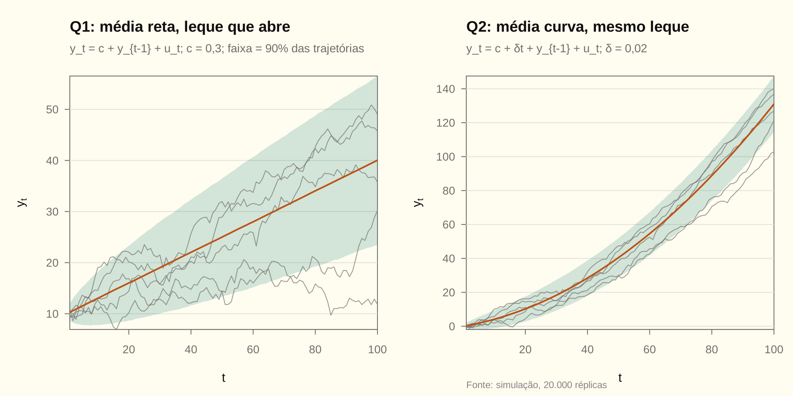

# Módulo 01 — Processos estocásticos, estacionariedade e momentos (Q1–Q4)

Teoria e demonstrações de apoio em [01_teoria.md](01_teoria.md). Os números são conferidos por simulação em [01_processos.R](01_processos.R).

---

## Q1 — Passeio aleatório com drift: momentos e estacionariedade

**Tipo:** derivação · **Ferramenta:** substituição recursiva (D01.1)

**Solução explícita.** Substituindo para trás até $y_0=10$:

$$
y_t=c+y_{t-1}+u_t=2c+y_{t-2}+u_t+u_{t-1}=\dots=10+ct+\sum_{i=1}^{t}u_i .
$$

**Média.** $E(y_t)=10+ct+\sum_{i=1}^{t}E(u_i)=10+ct$, pois $E(u_i)=0$ [RB].

**Variância.** $y_0$ e $ct$ são constantes, e os $u_i$ são não correlacionados [RB]:

$$
\operatorname{Var}(y_t)=\operatorname{Var}\Big(\sum_{i=1}^{t}u_i\Big)=\sum_{i=1}^{t}\operatorname{Var}(u_i)=t\sigma^2 .
$$

**Autocovariância** ($0\le k\lt t$). Os desvios em relação à média são somas de choques, e só os choques comuns às duas somas ($i=1,\dots,t-k$) contribuem:

$$
\operatorname{Cov}(y_t,y_{t-k})=E\Big[\Big(\sum_{i=1}^{t}u_i\Big)\Big(\sum_{j=1}^{t-k}u_j\Big)\Big]=\sum_{i=1}^{t-k}E(u_i^2)=(t-k)\sigma^2 .
$$

**Não é estacionário.** Três razões: a média depende de $t$ (se $c\neq0$); a variância depende de $t$ sempre, mesmo com $c=0$; e a covariância depende de $t$, não só de $k$. A autocorrelação $\rho(t,k)=\sqrt{(t-k)/t}$ tende a 1 para $k$ fixo: a memória não se esgota (AU01).

> [!TIP]
> **Como escrever na prova**
> Solução explícita, depois $E$, $\operatorname{Var}$ e $\operatorname{Cov}$, cada um com a hipótese usada. Feche assim: "viola as condições 1, 2 e 3 de estacionariedade de 2ª ordem". Acrescente que $\Delta y_t=c+u_t$ é estacionária: o processo é **estacionário em diferença** (DS).

<!-- conferência numérica (c = 0,3; sigma2 = 1; 20.000 réplicas)
| chave_R | nota |
|---|---|
| m01_q1_media_t50_teo | 25 |
| m01_q1_media_t50_sim | 25,0 |
| m01_q1_var_t50_sim | 49 |
| m01_q1_cov_50_40_sim | 39 |
| m01_q1_rho_100_10 | 0,949 |
-->

## Q2 — Passeio com drift **e** tendência determinística

**Tipo:** derivação e conceito · **Ferramenta:** substituição recursiva e soma de PA

**(a) Solução explícita.** Com $y_0=0$, cada passo soma $c+\delta s+u_s$:

$$
y_t=\sum_{s=1}^{t}(c+\delta s+u_s)=ct+\delta\frac{t(t+1)}{2}+\sum_{s=1}^{t}u_s .
$$

**(b) Momentos.** A parte determinística sai da variância [RB]:

$$
E(y_t)=ct+\frac{\delta}{2}t(t+1),\qquad \operatorname{Var}(y_t)=t\sigma^2,\qquad \operatorname{Cov}(y_t,y_{t-k})=(t-k)\sigma^2 .
$$

**(c) Comparação com o passeio com drift.** A variância e a autocovariância são **idênticas**, porque a parte estocástica é a mesma soma de choques. Só a média muda: era linear em $t$ e passa a ser **quadrática**.

**(d) Natureza da tendência e como removê-la.**
- **Passeio com drift:** tendência **estocástica** ($\sum u_s$) mais tendência determinística linear ($ct$). Uma diferença basta: $\Delta y_t=c+u_t$ é estacionária.
- **Com $\delta t$:** tendência estocástica mais tendência determinística quadrática. Uma diferença **não basta**, porque $\Delta y_t=c+\delta t+u_t$ ainda tem média linear em $t$. É estacionária em torno de uma tendência (TS).

O procedimento correto é diferenciar uma vez e **remover a tendência linear por regressão** de $\Delta y_t$ em $(1,t)$. A alternativa de diferenciar de novo dá $\Delta^2y_t=\delta+u_t-u_{t-1}$. Esse processo tem MA com raiz unitária: é não invertível, porque houve **sobrediferenciação** (Q9 e Q10).

> [!WARNING]
> **Armadilha: "tem tendência, então diferencio duas vezes"**
> A segunda diferença elimina o $\delta t$, mas cria um MA(1) com $\theta=1$. O teste de raiz unitária deve ser feito em $\Delta y_t$ **com** tendência (ADF com constante e tendência). Essa especificação é a que separa os dois casos.

<!-- conferência numérica (c = 0,3; delta = 0,02)
| chave_R | nota |
|---|---|
| m01_q2_media_t50_teo | 40,5 |
| m01_q2_media_t50_sim | 40,5 |
| m01_q2_var_t50_sim | 49 |
| m01_q2_media_dif_t50_teo | 1,3 |
| m01_q2_media_dif_t50_sim | 1,3 |
-->

## Q3 — Soma de processos estacionários

**Tipo:** cálculo · **Ferramenta:** bilinearidade da covariância

**(a) Autocovariância de $z_{3t}=z_{1t}+2z_{2t}$.** Como $z_1$ e $z_2$ são não correlacionados em **todas** as defasagens, os termos cruzados somem:

$$
\gamma^{(3)}_k=\operatorname{Cov}(z_{1t}+2z_{2t},\,z_{1,t-k}+2z_{2,t-k})=\gamma^{(1)}_k+4\gamma^{(2)}_k .
$$

| $k$ | $\gamma^{(1)}_k$ | $4\gamma^{(2)}_k$ | $\gamma^{(3)}_k$ | $\rho^{(3)}_k$ |
|---|---|---|---|---|
| 0 | 0,5 | 9,20 | **9,70** | 1 |
| 1 | 0,2 | −5,72 | **−5,52** | −0,5691 |
| 2 | 0 | 1,20 | **1,20** | 0,1237 |
| $\ge3$ | 0 | 0 | **0** | 0 |

**(b) Estacionariedade.** A média é $E(z_{3t})=\mu_1+2\mu_2$, constante. A autocovariância depende só de $k$, porque é soma de funções que dependem só de $k$. Logo $z_{3t}$ é estacionário de 2ª ordem.

Para ser rigoroso, ainda é preciso checar que $\{\gamma^{(3)}_k\}$ é uma autocovariância **válida** (semidefinida positiva). A densidade espectral $f(\omega)\propto9{,}70-11{,}04\cos\omega+2{,}40\cos2\omega$ tem mínimo $1{,}06\gt0$ em $\omega=0$. ✔️

**(c) Classe ARMA.** A FAC é não nula até a defasagem 2 e **corta** depois: $z_{3t}$ é um **MA(2)**. A fatoração espectral dá o MA(2) invertível com a mesma FAC: $z_{3t}=e_t-0{,}7795\,e_{t-1}+0{,}204\,e_{t-2}$, com $\sigma_e^2=5{,}88$.

> [!NOTE]
> **De onde vêm $z_1$ e $z_2$**
> - $z_1$ é um MA(1): $\rho_1=0{,}4=\theta/(1+\theta^2)$ dá $\theta=0{,}5$ e $\sigma^2=0{,}4$.
> - $z_2=(1-1{,}1B+0{,}3B^2)a_t$, com $\sigma^2=1$: confira que $\gamma_0=1+1{,}21+0{,}09=2{,}30$, $\gamma_1=-1{,}1+(-1{,}1)(0{,}3)=-1{,}43$ e $\gamma_2=0{,}30$.
>
> Regra geral: a soma de um MA($q_1$) com um MA($q_2$) independentes é um MA($\max(q_1,q_2)$).

<!-- conferência numérica
| chave_R | nota |
|---|---|
| m01_q3_g0 | 9,70 |
| m01_q3_g1 | -5,52 |
| m01_q3_g2 | 1,20 |
| m01_q3_rho1 | -0,5691 |
| m01_q3_rho2 | 0,1237 |
| m01_q3_espec_min | 1,06 |
| m01_q3_z1_sigma2 | 0,4 |
| m01_q3_z2_check_g1 | -1,43 |
| m01_q3_ma_theta1_r | -0,7795 |
| m01_q3_ma_theta2_r | 0,204 |
| m01_q3_ma_sigma2 | 5,88 |
-->

## Q4 — Teorema de Wold

**Tipo:** enunciado e demonstração · **Ferramenta:** D01.3

**(a) Enunciado.** Seja $\{y_t\}$ estacionário em covariância, com média zero. Então

$$
y_t=\sum_{j=0}^{\infty}\psi_j\varepsilon_{t-j}+\kappa_t ,
$$

em que:
1. $\psi_0=1$ e $\sum_j\psi_j^2\lt\infty$;
2. $\varepsilon_t=y_t-P(y_t\mid y_{t-1},y_{t-2},\dots)$ é o erro de previsão linear de um passo. Esse erro é ruído branco, chamado de **inovação**;
3. $\operatorname{Cov}(\varepsilon_t,\kappa_s)=0$ para todo $t,s$;
4. $\kappa_t$ é **linearmente determinístico**: é previsto sem erro, por projeção linear, a partir do seu próprio passado remoto.

A representação é única. O exemplo típico de $\kappa_t$ é $A\cos(\omega t)+B\sin(\omega t)$ com $A,B$ aleatórios: sorteados uma vez, ditam a série para sempre. Um processo **puramente não determinístico** tem $\kappa_t=0$, e é a esse caso que a lista se refere.

**(b) AR(1).** Iterando $k$ vezes:

$$
y_t=\phi^{k}y_{t-k}+\sum_{j=0}^{k-1}\phi^{j}\varepsilon_{t-j}.
$$

O resto vai a zero em média quadrática: $E(\phi^ky_{t-k})^2=\phi^{2k}\gamma_0\to0$, porque $\lvert\phi\rvert\lt1$. Logo $y_t=\sum_{j\ge0}\phi^j\varepsilon_{t-j}$, com $\boxed{\psi_j=\phi^j}$, $\psi_0=1$ e $\sum\psi_j^2=1/(1-\phi^2)\lt\infty$.

Falta checar que $\varepsilon_t$ é a inovação de Wold. Ele é não correlacionado com $y_{t-1},y_{t-2},\dots$, porque estes dependem só de choques passados. Então $\phi y_{t-1}$ é a projeção linear de $y_t$ no passado, e $\varepsilon_t$ é o erro dessa projeção. ✔️

**(c) Invertibilidade.** A representação AR($\infty$) do MA é $\varepsilon_t=\theta(B)^{-1}y_t=\sum_j\pi_jy_{t-j}$. Ela só converge em média quadrática se os $\pi_j$ forem somáveis, isto é, se as raízes de $\theta(z)$ estiverem fora do círculo unitário. No MA(1), $\pi_j=-(-\theta)^j$ explode se $\lvert\theta\rvert\gt1$ (AU02).

Há ainda uma razão mais profunda. $\theta$ e $1/\theta$ geram a mesma FAC, e só a versão invertível tem $\varepsilon_t$ no espaço gerado pelo passado de $y$. Ou seja, só nela o $\varepsilon_t$ é a inovação de Wold, recuperável dos dados e utilizável para prever.

<!-- conferência numérica (phi = 0,7)
| chave_R | nota |
|---|---|
| m01_q4_psi3 | 0,343 |
| m01_q4_soma_psi2 | 1,9608 |
| m01_q4_soma_psi2_teo | 1,9608 |
-->
