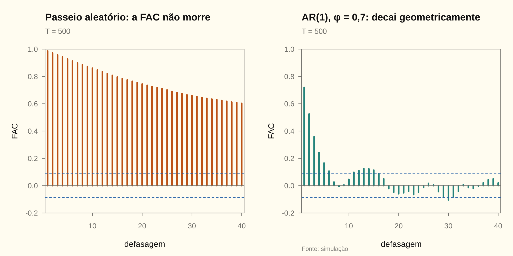

# Módulo 01 — Processos estocásticos e estacionariedade

> [!NOTE]
> **Mapa do módulo**
> Estacionariedade fraca e forte → ergodicidade → os quatro processos de referência: ruído branco, passeio aleatório, passeio com drift e passeio com drift e tendência → processo linear geral e teorema de Wold. Cai na lista como Q1–Q4 e sustenta a escolha de diferenciar ou não a série do INPC no [trabalho](../trabalho_inpc/relatorio.md).

## 1. Definições

**Estacionariedade de 2ª ordem** (fraca, *lato sensu*). Para todo $t$ e todo $k$:

1. $E(y_t)=\mu$;
2. $\operatorname{Var}(y_t)=\gamma_0\lt\infty$;
3. $\operatorname{Cov}(y_t,y_{t-k})=\gamma_k$, que depende só de $k$.

Daí seguem $\gamma_k=\gamma_{-k}$ e $\rho_k=\gamma_k/\gamma_0$.

**Estacionariedade estrita.** A distribuição conjunta de $(y_{t_1},\dots,y_{t_m})$ é invariante a deslocamentos no tempo. Com segundo momento finito, estrita implica fraca. A recíproca vale no caso gaussiano.

**Ergodicidade.** Uma única realização basta para estimar os momentos: $\bar y\xrightarrow{p}\mu$ e $\widehat\gamma_k\xrightarrow{p}\gamma_k$. É ela que justifica estimar a FAC com **uma** série temporal.

**Ruído branco.** $\varepsilon_t\sim RB(0,\sigma^2)$: média zero, variância $\sigma^2$ e $\gamma_k=0$ para $k\neq0$. Não exige independência nem normalidade.

## 2. Os quatro processos de referência

Todos têm $y_0$ dado e $u_t\sim RB(0,\sigma^2)$.

| Processo | Equação | $E(y_t)$ | $\operatorname{Var}(y_t)$ | Estacionário? | Remoção |
|---|---|---|---|---|---|
| Tendência determinística | $y_t=\alpha+\beta t+u_t$ | $\alpha+\beta t$ | $\sigma^2$ | em torno da tendência (TS) | regressão em $t$ |
| Passeio aleatório | $y_t=y_{t-1}+u_t$ | $y_0$ | $t\sigma^2$ | não | $\Delta$ |
| Passeio com drift | $y_t=c+y_{t-1}+u_t$ | $y_0+ct$ | $t\sigma^2$ | não | $\Delta$ (DS) |
| Drift e tendência | $y_t=c+\delta t+y_{t-1}+u_t$ | $y_0+ct+\delta\frac{t(t+1)}{2}$ | $t\sigma^2$ | não | $\Delta$ e depois regressão em $t$ |

### D01.1 · Momentos do passeio aleatório com drift

> [!NOTE]
> **O que se quer provar**
> Seja $y_t=c+y_{t-1}+u_t$, com $y_0$ fixo e $u_t\sim RB(0,\sigma^2)$. Então $E(y_t)=y_0+ct$, $\operatorname{Var}(y_t)=t\sigma^2$ e $\operatorname{Cov}(y_t,y_{t-k})=(t-k)\sigma^2$.

**Passo a passo.**

1. Substituição recursiva $t$ vezes:

$$
y_t=y_0+ct+\sum_{i=1}^{t}u_i .
$$

2. Tomando a esperança, com $E(u_i)=0$ [RB]: $E(y_t)=y_0+ct$.

3. A parte determinística não varia, e os $u_i$ são não correlacionados [RB]:

$$
\operatorname{Var}(y_t)=\sum_{i=1}^{t}\sigma^2=t\sigma^2 .
$$

4. Para $0\le k\lt t$, só os índices comuns às duas somas têm covariância não nula:

$$
\operatorname{Cov}(y_t,y_{t-k})=\sum_{i=1}^{t-k}\operatorname{Var}(u_i)=(t-k)\sigma^2 .
$$

$$\boxed{\rho(t,k)=\frac{(t-k)\sigma^2}{\sqrt{t\sigma^2\,(t-k)\sigma^2}}=\sqrt{\frac{t-k}{t}}\;\xrightarrow{t\to\infty}\;1}$$

> [!TIP]
> **Como o professor pode torcer**
> - Trocar $y_0$ fixo por $y_0$ aleatório: a variância ganha $\operatorname{Var}(y_0)$, e a conclusão não muda.
> - Pedir o caso com $\delta t$: a soma de PA $\sum s=t(t+1)/2$ aparece na média, e a variância é a mesma.
> - Pedir a FAC: ela **depende de $t$**, e esse é o argumento mais forte de não estacionariedade, porque vale mesmo com $c=0$.

## 3. Processo linear geral e Wold

### D01.2 · Autocovariância de um processo linear

> [!NOTE]
> **O que se quer provar**
> Se $y_t=\mu+\sum_{j\ge0}\psi_j\varepsilon_{t-j}$, com $\psi_0=1$, $\sum\psi_j^2\lt\infty$ e $\varepsilon_t\sim RB(0,\sigma^2)$, então $\gamma_k=\sigma^2\sum_{j\ge0}\psi_j\psi_{j+k}$.

**Passo a passo.**

1. Escreva os desvios: $y_t-\mu=\sum_j\psi_j\varepsilon_{t-j}$ e $y_{t-k}-\mu=\sum_i\psi_i\varepsilon_{t-k-i}$.

2. O produto esperado só tem termos não nulos quando os choques coincidem, isto é, $t-j=t-k-i$, ou seja, $j=i+k$ [RB]:

$$
\gamma_k=\sum_{i\ge0}\psi_{i+k}\psi_i\,E(\varepsilon_{t-k-i}^2)=\sigma^2\sum_{i\ge0}\psi_i\psi_{i+k}.
$$

3. Com $k=0$: $\gamma_0=\sigma^2\sum\psi_i^2$. A soma quadrática finita garante que os momentos existem. Pela desigualdade de Cauchy-Schwarz, $\lvert\gamma_k\rvert\le\gamma_0$.

$$\boxed{\gamma_k=\sigma^2\sum_{i=0}^{\infty}\psi_i\psi_{i+k}}$$

Essa fórmula é o motor do `acvf_arma()` em [R/series.R](../R/series.R) e dá, em uma linha, a FAC de qualquer MA($q$): ela corta depois de $q$.

### D01.3 · Teorema de Wold e o AR(1)

> [!NOTE]
> **O que se quer provar**
> O AR(1) $y_t=\phi y_{t-1}+\varepsilon_t$, com $\lvert\phi\rvert\lt1$, é um processo linear com $\psi_j=\phi^j$, e $\varepsilon_t$ é a sua inovação de Wold.

**Passo a passo.**

1. Itere $k$ vezes: $y_t=\phi^ky_{t-k}+\sum_{j=0}^{k-1}\phi^j\varepsilon_{t-j}$.

2. O resto converge a zero em média quadrática: $E(\phi^ky_{t-k})^2=\phi^{2k}\gamma_0\to0$, porque $\lvert\phi\rvert\lt1$ e $\gamma_0$ é finita sob estacionariedade.

3. Logo $y_t=\sum_{j\ge0}\phi^j\varepsilon_{t-j}$, com $\sum\phi^{2j}=1/(1-\phi^2)\lt\infty$.

4. Para $s\ge1$, $\operatorname{Cov}(\varepsilon_t,y_{t-s})=0$, porque $y_{t-s}$ só contém choques até $t-s$. Então $\phi y_{t-1}$ é a projeção linear de $y_t$ no passado, e $\varepsilon_t$ é o erro dessa projeção.

$$\boxed{\psi_j=\phi^{j},\qquad \gamma_0=\frac{\sigma^2}{1-\phi^2},\qquad \gamma_k=\phi^{k}\gamma_0}$$

> [!IMPORTANT]
> **O que o Wold diz e o que não diz**
> Diz que **todo** processo estacionário puramente não determinístico é um MA($\infty$) nas suas inovações lineares. É por isso que ARMA é um bom ponto de partida: um ARMA de ordem baixa aproxima bem $\Psi(B)=\theta(B)/\phi(B)$.
>
> Não diz que os $\varepsilon_t$ são independentes, nem que o melhor previsor **não linear** coincide com o linear. Esse espaço é o de modelos como o GARCH.

## 4. Checklist

- [ ] Escrevo as três condições de estacionariedade de 2ª ordem sem olhar.
- [ ] Derivo $E$, $\operatorname{Var}$ e $\operatorname{Cov}$ do passeio com drift e do passeio com drift e tendência.
- [ ] Sei por que a FAC do passeio aleatório depende de $t$ e quanto ela vale.
- [ ] Provo $\gamma_k=\sigma^2\sum\psi_i\psi_{i+k}$ e uso essa fórmula para um MA($q$).
- [ ] Enuncio Wold com as quatro propriedades e explico o termo determinístico.
