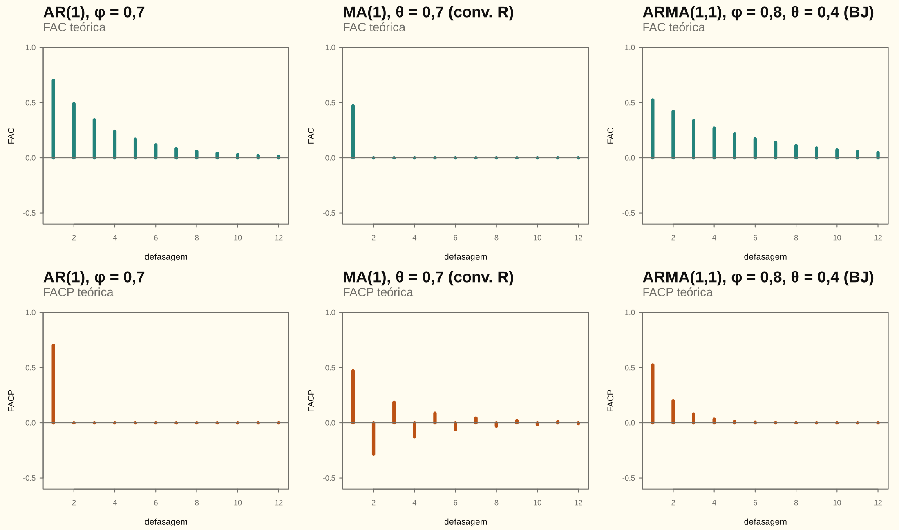

# Módulo 02 — Processos AR, MA e ARMA

> [!NOTE]
> **Mapa do módulo**
> Operador de defasagem → estacionariedade e invertibilidade (raízes fora do círculo unitário) → pesos $\psi_j$ e $\pi_j$ → FAC de MA($q$), AR($p$) e ARMA($p,q$) → Yule-Walker → FACP → a tabela de identificação. Cai como Q5–Q8 e é a base da identificação do [INPC](../trabalho_inpc/relatorio.md).

## 1. Operador, polinômios e convenções

$B^jy_t=y_{t-j}$. A AU02 chama o mesmo operador de $L$. Um ARMA($p,q$) escreve-se

$$
\phi(B)(y_t-\mu)=\theta(B)\varepsilon_t,\qquad \phi(B)=1-\phi_1B-\dots-\phi_pB^p .
$$

| Convenção | Polinômio MA | Quem usa | $\rho_1$ do MA(1) |
|---|---|---|---|
| Box-Jenkins | $\theta(B)=1-\theta_1B-\dots-\theta_qB^q$ | lista (Q5, Q6, Q9, Q10, Q12, Q15, Q16), Box et al., `forecast` | $-\theta/(1+\theta^2)$ |
| Sinal positivo | $\theta(L)=1+\theta_1L+\dots+\theta_qL^q$ | AU02, lista (Q8), Hamilton, `stats::arima` | $\theta/(1+\theta^2)$ |

A relação com a média é $c=\phi(1)\mu=(1-\phi_1-\dots-\phi_p)\mu$. No R, o "intercept" de `arima` é $\mu$, não $c$.

### Exercício · Álgebra do operador de defasagem

Seja $\phi(B)=1-1{,}1B+0{,}3B^2$. (a) Fatore. (b) Ache as raízes e diga se o AR(2) é estacionário. (c) Escreva $\phi(B)^{-1}$ como série em $B$ até $B^3$. (d) Simplifique $\phi(B)y_t=(1-0{,}5B)\varepsilon_t$.

**Solução.** O operador de defasagem se manipula como uma variável comum de polinômio: produto, fatoração e inversa valem termo a termo (AU02).

- **(a)** $(1-0{,}5B)(1-0{,}6B)=1-(0{,}5+0{,}6)B+0{,}5\cdot0{,}6\,B^2$, com coeficientes −1,1 e 0,3. O produto de polinômios é a convolução dos coeficientes, conferida em [02_arma.R](02_arma.R).
- **(b)** As raízes de $\phi(z)=0$ são $1/0{,}5=2$ e $1/0{,}6=1{,}667$, as duas fora do círculo unitário. O AR(2) é estacionário (D02.1).
- **(c)** Cada fator se inverte por série geométrica, $(1-aB)^{-1}=\sum_{j\ge0}a^jB^j$, válida se $\lvert a\rvert\lt1$. O produto das duas séries dá $\psi_j=\sum_{i=0}^{j}0{,}5^i\,0{,}6^{\,j-i}$, com $\psi_1=1{,}1$, $\psi_2=0{,}91$ e $\psi_3=0{,}671$. São os pesos de Wold do AR(2).
- **(d)** $\phi(B)=(1-0{,}5B)(1-0{,}6B)$, e o fator $(1-0{,}5B)$ aparece dos dois lados. Cancelando, $(1-0{,}6B)y_t=\varepsilon_t$: o "ARMA(2,1)" é um AR(1) disfarçado. É o fator comum da Q5, modelo 3, com os papéis trocados.

<!-- conferência numérica
| chave_R | nota |
|---|---|
| m02_op_b1 | -1,1 |
| m02_op_b2 | 0,3 |
| m02_op_raiz1 | 1,667 |
| m02_op_raiz2 | 2 |
| m02_op_psi1 | 1,1 |
| m02_op_psi2 | 0,91 |
| m02_op_psi3 | 0,671 |
-->

## 2. Estacionariedade e invertibilidade

### D02.1 · Raízes fora do círculo unitário

> [!NOTE]
> **O que se quer provar**
> O AR($p$) é estacionário se e somente se as raízes de $\phi(z)=0$ têm $\lvert z\rvert\gt1$. Equivalentemente: os autovalores $\lambda_i$ da matriz companheira $\mathbf F$ têm $\lvert\lambda_i\rvert\lt1$.

**Passo a passo.**

1. Empilhe $\mathbf y_t=(y_t,\dots,y_{t-p+1})'$. Então $\mathbf y_t=\mathbf F\mathbf y_{t-1}+\mathbf v_t$, com $\phi_1,\dots,\phi_p$ na primeira linha de $\mathbf F$ e a identidade deslocada abaixo (AU02, p. 37).

2. Iterando: $\mathbf y_t=\mathbf F^t\mathbf y_0+\sum_{i=0}^{t-1}\mathbf F^i\mathbf v_{t-i}$.

3. Com autovalores distintos, $\mathbf F^i=\mathbf T\boldsymbol\Lambda^i\mathbf T^{-1}$, logo $\mathbf F^i\to\mathbf 0$ se e somente se $\lvert\lambda_i\rvert\lt1$ para todo $i$. Nesse caso o efeito de $\mathbf y_0$ some e os pesos são somáveis.

4. Os $\lambda$ resolvem $\lambda^p-\phi_1\lambda^{p-1}-\dots-\phi_p=0$. Divida por $\lambda^p$ e defina $z=1/\lambda$: obtém-se $1-\phi_1z-\dots-\phi_pz^p=0$. Assim, $\lvert\lambda\rvert\lt1\iff\lvert z\rvert\gt1$.

$$\boxed{\text{AR estacionário}\iff\phi(z)\neq0\ \text{para}\ \lvert z\rvert\le1;\qquad \text{MA invertível}\iff\theta(z)\neq0\ \text{para}\ \lvert z\rvert\le1}$$

**AR(2), o triângulo:** $\phi_1+\phi_2\lt1$, $\phi_2-\phi_1\lt1$ e $\lvert\phi_2\rvert\lt1$.

> [!IMPORTANT]
> **A dualidade AR ↔ MA (AU02, p. 36)**
> - **Estacionariedade:** diz respeito ao lado AR e permite escrever o processo como MA($\infty$). É sempre satisfeita no MA puro.
> - **Invertibilidade:** diz respeito ao lado MA e permite escrever o processo como AR($\infty$). É sempre satisfeita no AR puro.
>
> A invertibilidade ainda **identifica** o modelo: $\theta$ e $1/\theta$ (com $\sigma^2$ ajustado) geram a mesma FAC. Consequência útil: no MA(1), $\lvert\rho_1\rvert\le\frac12$.

### D02.4 · Equações de diferenças: a mesma conta da estacionariedade

> [!NOTE]
> **O que se quer provar**
> A parte determinística de um AR é uma equação de diferenças (revisão EQD; Chiang e Wainwright, caps. 17–18).
> - Na equação de diferenças de primeira ordem $y_{t+1}+ay_t=c$, a solução converge se e somente se $\lvert a\rvert\lt1$.
> - Na de segunda ordem, $y_{t+2}+a_1y_{t+1}+a_2y_t=c$, a solução converge se e somente se as raízes da equação característica $b^2+a_1b+a_2=0$ têm $\lvert b\rvert\lt1$. Essas raízes são as **inversas** das raízes de $\phi(z)$, então a condição é a de D02.1.

**Passo a passo.**

1. **Solução geral = particular + homogênea.** A particular é qualquer solução da equação completa. A homogênea resolve a equação com $c=0$ e carrega a constante que a condição inicial fixa.
2. **Primeira ordem, particular.** Tente $y_t=k$: $k+ak=c$, então $y_p=c/(1+a)$ se $a\ne-1$. Se $a=-1$, tente $y_t=kt$: $k(t+1)-kt=c$, então $y_p=ct$, que é a tendência linear do passeio com drift.
3. **Primeira ordem, homogênea.** Tente $y_t=Ab^t$: $Ab^{t+1}+aAb^t=0$, então $b=-a$. Com $y_0$ dado, $A=y_0-y_p$:
   $$y_t=\big(y_0-\tfrac{c}{1+a}\big)(-a)^t+\tfrac{c}{1+a}.$$
   O método iterativo, substituir $y_1,y_2,\dots$ um a um, chega na mesma fórmula.
4. **Estabilidade.** O termo $Ab^t$ some se e somente se $\lvert b\rvert\lt1$. Com $b\lt0$, a trajetória oscila; com $b\gt0$, é monótona.
5. **Segunda ordem.** A particular é $y_p=c/(1+a_1+a_2)$. A homogênea tenta $Ab^t$ e chega à equação característica $b^2+a_1b+a_2=0$. Com raízes distintas, $y_t=A_1b_1^t+A_2b_2^t+y_p$.
   - Se o discriminante $a_1^2-4a_2$ for negativo, as raízes são complexas, $b=r(\cos\omega\pm i\sin\omega)$, e a solução é $r^t$ vezes uma combinação de $\cos\omega t$ e $\sin\omega t$: um **ciclo amortecido** se $r\lt1$.
6. **A ligação com o AR(2).** $y_t=\phi_1y_{t-1}+\phi_2y_{t-2}$ é a equação de segunda ordem com $a_1=-\phi_1$ e $a_2=-\phi_2$. A equação característica é $b^2-\phi_1b-\phi_2=0$. Dividindo $\phi(z)=1-\phi_1z-\phi_2z^2=0$ por $z^2$ e trocando $b=1/z$, obtém-se a mesma equação. Então $\lvert b\rvert\lt1\iff\lvert z\rvert\gt1$.

$$\boxed{y_t=\Big(y_0-\frac{c}{1+a}\Big)(-a)^t+\frac{c}{1+a}\ \text{converge}\iff\lvert a\rvert\lt1;\qquad \text{2ª ordem: }\lvert b_i\rvert\lt1\iff\text{raízes de }\phi(z)\text{ fora do círculo}}$$

**Dois exemplos** (conferidos em [02_arma.R](02_arma.R)):

- **Primeira ordem.** $y_{t+1}-0{,}5y_t=3$ com $y_0=10$. Aqui $y_p=6$, $b=0{,}5$ e $A=4$, então $y_t=4\cdot0{,}5^t+6$. A trajetória converge monotonamente para 6. Em $t=3$, a fórmula e a iteração dão 6,5.
- **Segunda ordem, o AR(2) com ciclo.** $y_t=y_{t-1}-0{,}5y_{t-2}$. O discriminante é $\phi_1^2+4\phi_2=-1\lt0$, então as raízes são complexas:
  - $b=0{,}5\pm0{,}5i$, com módulo $r=0{,}707$ e ângulo $\omega=0{,}785$ ($\pi/4$);
  - o ciclo tem período $2\pi/\omega=8$ períodos e amortece, porque $r\lt1$;
  - as raízes de $\phi(z)$ têm módulo $1/r=1{,}414\gt1$, a mesma conclusão por D02.1.

  Com termo constante 2, o equilíbrio é $y_p=2/(1-\phi_1-\phi_2)=4$. É a média $\mu=c/\phi(1)$ do AR.

<!-- conferência numérica
| chave_R | nota |
|---|---|
| m02_eqd1_yp | 6 |
| m02_eqd1_b | 0,5 |
| m02_eqd1_A | 4 |
| m02_eqd1_y3 | 6,5 |
| m02_eqd2_disc | -1 |
| m02_eqd2_mod | 0,707 |
| m02_eqd2_ang | 0,785 |
| m02_eqd2_periodo | 8 |
| m02_eqd2_mod_z | 1,414 |
| m02_eqd2_yp | 4 |
-->

> [!TIP]
> **Como o professor pode torcer**
> - Escrever a equação "para a frente" ($y_{t+1}+ay_t=c$) num exercício e "para trás" ($y_t=\phi y_{t-1}+c$) no outro: $a=-\phi$, e a condição é a mesma.
> - Pedir o caso $a=-1$: não há equilíbrio. A solução particular é $ct$, a raiz unitária do passeio com drift (D01.1).
> - Pedir o período do ciclo de um AR(2) com raízes complexas: $2\pi/\omega$, com $\cos\omega=\phi_1/(2\sqrt{-\phi_2})$.

## 3. FAC

### D02.2 · FAC de MA($q$), AR($p$) e ARMA($p,q$)

> [!NOTE]
> **O que se quer provar**
> Com $\theta_0=1$:
> - **MA($q$), sinal positivo:** $\gamma_k=\sigma^2\sum_{j=0}^{q-k}\theta_j\theta_{j+k}$ para $k\le q$, e $\gamma_k=0$ para $k\gt q$.
> - **AR($p$):** $\gamma_k=\sum_i\phi_i\gamma_{k-i}$ para $k\ge1$.
> - **ARMA($p,q$):** a mesma recursão do AR vale para $k\ge q+1$.

**Passo a passo.**

1. **MA:** aplique D01.2 com $\psi_j=\theta_j$ para $j\le q$ e $\psi_j=0$ depois. A soma tem $q-k+1$ termos e se anula para $k\gt q$: a FAC **corta** em $q$.

2. **AR:** multiplique $y_t-\mu=\sum_i\phi_i(y_{t-i}-\mu)+\varepsilon_t$ por $(y_{t-k}-\mu)$ e tome $E$. O termo $E(\varepsilon_t(y_{t-k}-\mu))$ é zero para $k\ge1$, porque $y_{t-k}$ só contém choques passados.

3. **ARMA:** o termo MA $\sum_j\theta_jE(\varepsilon_{t-j}(y_{t-k}-\mu))$ é zero quando $t-j\gt t-k$ para todo $j\le q$, isto é, quando $k\gt q$. Para $k\le q$, sobram as covariâncias $E(\varepsilon_{t-j}y_{t-k})=\sigma^2\psi_{k-j}$.

$$\boxed{\gamma_k=\phi_1\gamma_{k-1}+\dots+\phi_p\gamma_{k-p},\quad k\ge q+1}$$

### D02.3 · Equações de Yule-Walker

> [!NOTE]
> **O que se quer provar**
> Num AR($p$), $\mathbf R\boldsymbol\phi=\mathbf r$, em que $\mathbf R=[\rho_{\lvert i-j\rvert}]$ é $p\times p$ e $\mathbf r=(\rho_1,\dots,\rho_p)'$. Além disso, $\gamma_0=\sigma^2/(1-\sum_i\phi_i\rho_i)$.

**Passo a passo.**

1. Divida a recursão de D02.2 por $\gamma_0$: $\rho_k=\sum_i\phi_i\rho_{k-i}$ para $k=1,\dots,p$. São $p$ equações lineares em $\boldsymbol\phi$.

2. Com $k=0$, entra $E(\varepsilon_ty_t)=\sigma^2$: $\gamma_0=\sum_i\phi_i\gamma_i+\sigma^2$.

3. Trocando os $\rho$ teóricos pelos amostrais, $\widehat{\boldsymbol\phi}=\widehat{\mathbf R}^{-1}\widehat{\mathbf r}$: é o estimador de Yule-Walker.

$$\boxed{\boldsymbol\phi=\mathbf R^{-1}\mathbf r,\qquad \phi_{kk}=\text{último coeficiente do AR}(k)\text{ ajustado}}$$

A FACP $\phi_{kk}$ sai de Yule-Walker resolvido para ordens crescentes: $\phi_{11}=\rho_1$ e $\phi_{22}=(\rho_2-\rho_1^2)/(1-\rho_1^2)$.

### D02.5 · De onde vem a banda $\pm1{,}96/\sqrt T$ e quando ela engana

> [!NOTE]
> **O que se quer provar**
> - Para um ruído branco, $\widehat\rho_k$ é aproximadamente $N(0,1/T)$, e daí vem a banda de 95%, $\pm1{,}96/\sqrt T$.
> - Para um MA($q$) e $k\gt q$, a fórmula de Bartlett dá $\operatorname{Var}(\widehat\rho_k)\approx\frac1T\big(1+2\sum_{j=1}^{q}\rho_j^2\big)$. Com ela, a banda do ruído branco fica **estreita demais** a partir da defasagem $q+1$.

**Passo a passo.**

1. **A fórmula de Bartlett.** Para um processo linear com $\sum\lvert\psi_j\rvert\lt\infty$, $\sqrt T(\widehat\rho_k-\rho_k)$ é assintoticamente normal, com variância $\sum_{j}\big(\rho_{j+k}+\rho_{j-k}-2\rho_j\rho_k\big)^2$.
2. **Ruído branco.** $\rho_j=0$ para $j\ne0$. Na soma só sobra $j=\pm k$, com $\rho_0=1$, e a variância é 1. Então $\widehat\rho_k\approx N(0,1/T)$.
3. **MA($q$) e $k\gt q$.** $\rho_k=0$, e a soma vira $\sum_j\rho_{j-k}^2=\sum_{\lvert i\rvert\le q}\rho_i^2=1+2\sum_{j=1}^{q}\rho_j^2$.
4. **A simulação**, com $T=200$ e 5000 réplicas:
   - **ruído branco:** o desvio-padrão de $\widehat\rho_1$ dá 0,0699, contra $1/\sqrt T=0{,}0707$. A banda rejeita 4,8% das vezes, perto dos 5% nominais;
   - **MA(1) com $\theta=0{,}5$** (sinal do R), $\rho_1=0{,}4$: o desvio-padrão de $\widehat\rho_2$ dá 0,0800, contra 0,0812 por Bartlett. A banda **ingênua** acusa um pico espúrio em $k=2$ em 8,2% das vezes. A de Bartlett, em 4,5%.

$$\boxed{\operatorname{Var}(\widehat\rho_k)\approx\frac{1}{T}\Big(1+2\sum_{j=1}^{q}\rho_j^2\Big),\quad k\gt q;\qquad\text{ruído branco: }\pm1{,}96/\sqrt T}$$

**O que isso muda na prática.** A banda que o R desenha no `acf` é a do ruído branco. Ela serve para a pergunta "a série é ruído branco?". Também serve para os resíduos (Questão 5 do [INPC](../trabalho_inpc/relatorio.md)) e para a FACP de um AR, cuja variância depois de $p$ é mesmo $1/T$. Para decidir onde a FAC de um MA corta, porém, um pico pouco acima da banda depois de $q$ não prova nada: a banda certa é mais larga. No INPC, a FAC em $k=13$ (0,123) fica pouco acima de 0,109, e é por isso que a decisão sobre o grupo 11-12-13 veio dos critérios de informação, e não só do correlograma.

<!-- conferência numérica
| chave_R | nota |
|---|---|
| m02_bart_T | 200 |
| m02_bart_R | 5000 |
| m02_bart_dp_wn | 0,0699 |
| m02_bart_dp_wn_teo | 0,0707 |
| m02_bart_rej_wn | 4,8 |
| m02_bart_rho1_ma | 0,4 |
| m02_bart_dp_ma2 | 0,0800 |
| m02_bart_dp_ma2_teo | 0,0812 |
| m02_bart_rej_ma2_ingenua | 8,2 |
| m02_bart_rej_ma2_bartlett | 4,5 |
| inpc_fac13 | 0,123 |
| inpc_banda | 0,109 |
-->

## 4. A tabela de identificação

| Processo | FAC | FACP |
|---|---|---|
| AR($p$) | decai (exponencial ou senoide amortecida) | **corta** após $p$ |
| MA($q$) | **corta** após $q$ | decai |
| ARMA($p,q$) | decai a partir de $q$ | decai a partir de $p$ |
| SAR($P$)$_s$ | decai nas defasagens $s,2s,\dots$ | corta após $Ps$ |
| SMA($Q$)$_s$ | corta após $Qs$ | decai nas defasagens $s,2s,\dots$ |

> [!TIP]
> **Como o professor pode torcer**
> - Dar um ARMA com fator comum (Q5, modelo 3): reduza antes de classificar.
> - Pedir os $\pi_j$ com o MA na convenção de sinal positivo: refaça a recursão, porque os sinais alternam.
> - Pedir o "processo resultante" de somas de processos (Q3): MA + MA independentes dão MA($\max q$).

## 5. Checklist

- [ ] Escrevo um ARMA em $B$ e acho as raízes para estacionariedade e invertibilidade.
- [ ] Calculo $\psi_1,\dots,\psi_4$ e $\pi_1,\dots,\pi_4$ pela recursão, nas duas convenções.
- [ ] Derivo $\gamma_0$, $\gamma_1$ e $\gamma_k$ do ARMA(1,1) sem olhar.
- [ ] Derivo Yule-Walker do AR(2) e a variância $\gamma_0$.
- [ ] Reconheço a assinatura FAC/FACP dos cinco casos da tabela.
