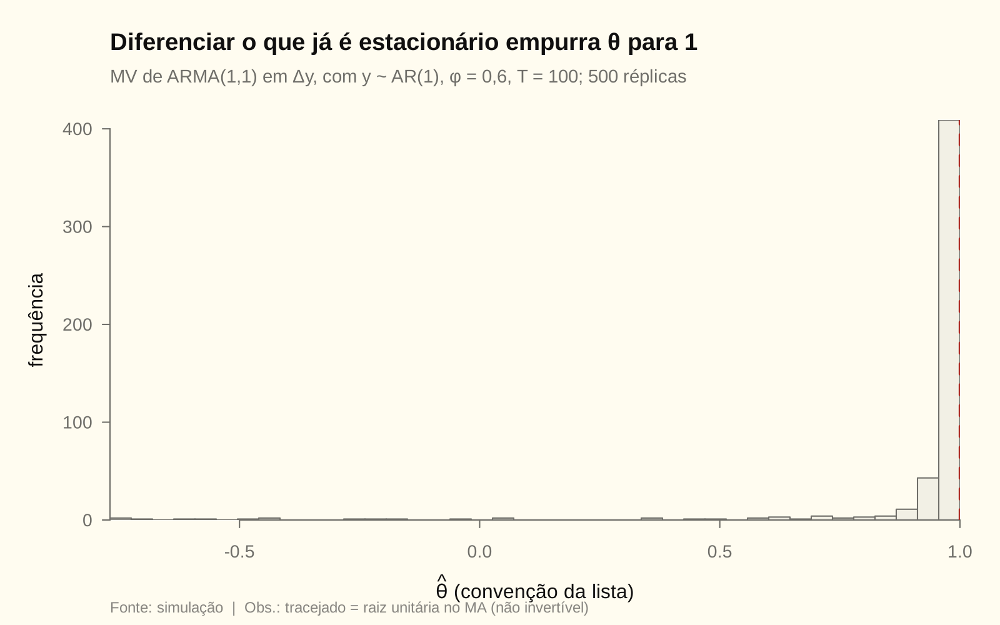

# Módulo 03 — Processos integrados, ARIMA e SARIMA (Q9–Q12)

Teoria em [03_teoria.md](03_teoria.md). Conferência em [03_arima_sarima.R](03_arima_sarima.R). Convenção do MA: **Box-Jenkins**, com sinal negativo.

---

## Q9 — Diferenciar um AR(1) estacionário

**Tipo:** derivação e conceito · **Ferramenta:** D03.2

**(a) Duas formas de escrever $w_t=\Delta y_t$.**

Primeira forma: substitua $y_t=\phi y_{t-1}+\varepsilon_t$ em $w_t=y_t-y_{t-1}$:

$$
w_t=\phi y_{t-1}+\varepsilon_t-y_{t-1}=-(1-\phi)\,y_{t-1}+\varepsilon_t .
$$

Segunda forma: use a MA($\infty$) $y_t=(1-\phi B)^{-1}\varepsilon_t$. Os operadores polinomiais comutam, então

$$
w_t=(1-B)y_t=(1-B)(1-\phi B)^{-1}\varepsilon_t\ \Longrightarrow\ \boxed{(1-\phi B)\,w_t=(1-B)\,\varepsilon_t}
$$

O polinômio AR é $\phi(B)=1-\phi B$, com raiz $1/\phi$, fora do círculo. O polinômio MA é $\theta(B)=1-B$, ou seja, $\theta_1=1$. Logo $w_t$ é um ARMA(1,1) com $\theta=1$.

**(b) Raiz unitária no MA.** $1-z=0$ dá $z=1$: a raiz está **sobre** o círculo unitário, e o processo não é invertível. Os pesos AR($\infty$) são

$$
\pi(B)=\frac{1-\phi B}{1-B}=1+(1-\phi)(B+B^2+\cdots),\qquad \pi_j=-(1-\phi)\ \text{para todo}\ j .
$$

Eles **não decaem**: $\sum\lvert\pi_j\rvert=\infty$. Não existe AR($\infty$) convergente, e $\varepsilon_t$ não é recuperável do passado de $w$. Com $\phi=0{,}6$, $\pi_j=-0{,}4$ em qualquer defasagem; no R, $\pi_{50}=-0{,}4$.

**(c) Por que sobrediferenciar faz mal.**
1. **Cria não invertibilidade.** O modelo correto para $w$ tem $\theta=1$, na fronteira. A máxima verossimilhança tem o problema de **acúmulo na fronteira** (*pile-up*): numa simulação com $\phi=0{,}6$ e $T=100$, 62,8% das estimativas de $\widehat\theta$ ficam acima de 0,99, com média 0,934. As distribuições assintóticas usuais deixam de valer, e os testes $t$ ficam distorcidos.
2. **Introduz dependência espúria.** $\rho_1(w)=-(1-\phi)/2=-0{,}2$: aparece uma autocorrelação negativa que não existia no processo. O analista desavisado ajusta um MA a ela.
3. **Joga fora o nível.** A previsão de longo prazo de $y$ deixa de convergir para $\mu$: o modelo trata choques transitórios como permanentes. A variância do erro de previsão do nível cresce com $h$, em vez de convergir para $\gamma_0$, e os intervalos ficam largos demais.

A variância muda de $\gamma_0(y)=1{,}5625$ para $\operatorname{Var}(w)=2\sigma^2/(1+\phi)=1{,}25$. A sobrediferenciação **não** se reconhece por "variância maior", e sim pela FAC de $w$: $\rho_1\lt0$, perto de $-0{,}5$ quando $\phi\to0$.

<!-- conferência numérica (phi = 0,6)
| chave_R | nota |
|---|---|
| m03_q9_raiz_ma | 1 |
| m03_q9_pi_j | -0,4 |
| m03_q9_mc_frac_099 | 0,628 |
| m03_q9_mc_media_theta | 0,934 |
| m03_q9_rho1_w | -0,2 |
| m03_q9_rho1_w_formula | -0,2 |
| m03_q9_var_y | 1,5625 |
| m03_q9_var_w | 1,25 |
| m03_q9_var_w_formula | 1,25 |
-->

## Q10 — ARIMA, raiz unitária e tendência determinística

**(a) $y_t\sim$ ARIMA($p,1,q$) implica $w_t=\Delta y_t\sim$ ARMA($p,q$).** Por definição, $\phi(B)(1-B)y_t=\theta(B)a_t$, com as raízes de $\phi(z)$ fora do círculo e $\theta(z)$ invertível. Como $w_t=(1-B)y_t$, segue $\phi(B)w_t=\theta(B)a_t$. É um ARMA($p,q$) **estacionário**, porque a única raiz unitária de $\phi(B)(1-B)$ era a do fator $(1-B)$, que foi absorvido em $w$. Esta é a definição operacional de "integrado de ordem 1".

**(b) ARIMA(1,1,1).** $(1-\phi B)(1-B)=1-(1+\phi)B+\phi B^2$, logo

$$
\boxed{y_t=(1+\phi)\,y_{t-1}-\phi\,y_{t-2}+a_t-\theta a_{t-1}}
$$

É uma equação de diferenças de 2ª ordem com uma raiz unitária. Com $\phi=0{,}5$, os coeficientes são 1,5 e −0,5, que somam 1: a soma dos coeficientes AR igual a 1 é a marca da raiz unitária.

**(c) Raiz unitária × tendência determinística.**

| | Tendência estocástica (DS) | Tendência determinística (TS) |
|---|---|---|
| Modelo | $\Delta y_t=\beta+u_t$, com $u$ estacionário | $y_t=\alpha+\beta t+u_t$, com $u$ estacionário |
| Choques | **permanentes**: mudam o nível para sempre | **transitórios**: a série volta à tendência |
| $\operatorname{Var}(y_t)$ | cresce com $t$ | constante |
| Previsão de longo prazo | a partir do último nível | volta à reta $\alpha+\beta t$ |
| Como estacionarizar | diferenciar | regredir em $t$ e usar os resíduos |

As duas produzem séries que "sobem". A diferença está na **memória dos choques**, e é isso que os testes de raiz unitária (ADF com tendência) discriminam.

**(d) Diferenciar uma série TS.** Se $y_t=\alpha+\beta t+u_t$ com $u_t$ ruído branco, então $\Delta y_t=\beta+u_t-u_{t-1}$: um **MA(1) com $\theta=1$, não invertível**, com $\rho_1=-0{,}5$ (na simulação, −0,495). Se $u_t$ for ARMA($p,q$), $\Delta y_t$ será ARMA($p,q+1$) com raiz unitária no MA. O procedimento é inadequado: é a sobrediferenciação da Q9.

**(e) Por que remover a tendência por regressão.**
1. **Preserva a estrutura certa.** Os resíduos estimam $u_t$ diretamente, que é estacionário e invertível, e a modelagem ARMA segue normalmente.
2. **Estimação eficiente.** O MQO da tendência converge mais rápido ($\widehat\beta$ é superconsistente, à taxa $T^{3/2}$) e não cria a raiz unitária no MA.
3. **Previsão correta.** A previsão volta à reta $\alpha+\beta t$. Com a série diferenciada, ela parte do último nível e trata como permanente um choque transitório.

O outro lado: **tirar a tendência de uma série DS** também erra. Os resíduos continuam I(1), e aparecem ciclos espúrios (Nelson e Kang, 1981). Por isso a decisão vem do teste ADF com constante e tendência, e não de olhar o gráfico.

<!-- conferência numérica
| chave_R | nota |
|---|---|
| m03_q10_coef_b1 | 1,5 |
| m03_q10_coef_b2 | -0,5 |
| m03_q10_rho1_dif_sim | -0,495 |
-->

## Q11 — SAR(1) com período 4

**(a) Autocovariâncias de $y_t=\Phi_1y_{t-4}+\varepsilon_t$.**

- **Variância.** Multiplique por $y_t$: $\gamma_0=\Phi_1\gamma_4+\sigma^2$. Multiplique por $y_{t-4}$: $\gamma_4=\Phi_1\gamma_0$. Logo $\boxed{\gamma_0=\dfrac{\sigma^2}{1-\Phi_1^2}}$.
- **Recursão geral.** Para $k\ge1$, $\gamma_k=\Phi_1\gamma_{k-4}$. Nos múltiplos de 4: $\gamma_4=\Phi_1\gamma_0$, $\gamma_8=\Phi_1^2\gamma_0$, e em geral $\boxed{\gamma_{4m}=\Phi_1^m\gamma_0}$.
- **Não múltiplos de 4.** $\gamma_1=\Phi_1\gamma_{-3}=\Phi_1\gamma_3$ e $\gamma_3=\Phi_1\gamma_{-1}=\Phi_1\gamma_1$, logo $\gamma_1=\Phi_1^2\gamma_1$. Como $\lvert\Phi_1\rvert\lt1$, $\gamma_1=0$; daí $\gamma_3=0$. Também $\gamma_2=\Phi_1\gamma_{-2}=\Phi_1\gamma_2$, logo $\gamma_2=0$. Por recursão, **$\gamma_k=0$ sempre que $k$ não é múltiplo de 4**.

**(b) Padrão da FAC e da FACP.**
- **FAC:** $\rho_{4m}=\Phi_1^m$ e zero fora dos múltiplos de 4. É o decaimento geométrico do AR(1), mas "esticado" e só nas defasagens sazonais. Com $\Phi_1=0{,}6$: $\rho_4=0{,}6$, $\rho_8=0{,}36$, $\rho_{12}=0{,}216$.
- **FACP:** um único pico, $\phi_{44}=\Phi_1$, e zero em todas as outras defasagens. O SAR(1)$_4$ é um AR(4) com $\phi_1=\phi_2=\phi_3=0$.
- **Comparação:** o AR(1) tem FAC $\phi^k$ em **todas** as defasagens e FACP com pico em 1. O SAR(1)$_4$ reproduz o mesmo desenho na escala $k=4m$.

**(c) SARIMA(1,0,0)(1,0,0)$_4$ como AR(5) restrito.**

$$
(1-\phi B)(1-\Phi B^4)=1-\phi B-\Phi B^4+\phi\Phi B^5
\ \Longrightarrow\
y_t=\phi\,y_{t-1}+0\,y_{t-2}+0\,y_{t-3}+\Phi\,y_{t-4}-\phi\Phi\,y_{t-5}+\varepsilon_t .
$$

Um AR(5) irrestrito tem 5 coeficientes; o multiplicativo tem 2. São **3 restrições**: $\phi_2=0$, $\phi_3=0$ e $\phi_5=-\phi_1\phi_4$. A última é não linear e é a "assinatura" do modelo multiplicativo. Com $\phi=0{,}5$ e $\Phi=0{,}6$, os coeficientes são $0{,}5;\ 0;\ 0;\ 0{,}6;\ -0{,}3$.

<!-- conferência numérica (Phi = 0,6; phi = 0,5)
| chave_R | nota |
|---|---|
| m03_q11_g0 | 1,5625 |
| m03_q11_g0_formula | 1,5625 |
| m03_q11_rho4 | 0,6 |
| m03_q11_rho8 | 0,36 |
| m03_q11_rho12 | 0,216 |
| m03_q11_rho_nao_mult | 0 |
| m03_q11_facp4 | 0,6 |
| m03_q11_facp_outros | 0 |
| m03_q11_ar5_c1 | 0,5 |
| m03_q11_ar5_c2 | 0 |
| m03_q11_ar5_c3 | 0 |
| m03_q11_ar5_c4 | 0,6 |
| m03_q11_ar5_c5 | -0,3 |
| m03_q11_ar5_c5_formula | -0,3 |
-->

## Q12 — SARIMA(1,1,0)(0,1,1)$_4$ trimestral

**(a) Modelo em $B$.**

$$
\boxed{(1-\phi B)(1-B)(1-B^4)\,y_t=(1-\Theta B^4)\,a_t}
$$

**(b) Observações perdidas: 5.** Seja $w_t=(1-B)(1-B^4)y_t=y_t-y_{t-1}-y_{t-4}+y_{t-5}$. O primeiro $w$ computável precisa de $y_{t-5}$, logo $t=6$. Sobram $T-5$ observações: $d+sD=1+4\cdot1=5$.

**(c) Equações de previsão.** Expandindo o lado AR:

$$
(1-\phi B)(1-B-B^4+B^5)=1-(1+\phi)B+\phi B^2-B^4+(1+\phi)B^5-\phi B^6,
$$

$$
y_t=(1+\phi)y_{t-1}-\phi y_{t-2}+y_{t-4}-(1+\phi)y_{t-5}+\phi y_{t-6}+a_t-\Theta a_{t-4}.
$$

Tome $E(\cdot\mid\mathcal F_T)$. Valores conhecidos ficam como estão, valores futuros de $y$ viram as próprias previsões, e $E(a_{T+j}\mid\mathcal F_T)=0$ para $j\ge1$. Escrevendo $\widehat y(h)=y_{T+h\mid T}$:

$$
\begin{aligned}
\widehat y(1)&=(1+\phi)y_T-\phi y_{T-1}+y_{T-3}-(1+\phi)y_{T-4}+\phi y_{T-5}-\Theta a_{T-3}\\
\widehat y(2)&=(1+\phi)\widehat y(1)-\phi y_T+y_{T-2}-(1+\phi)y_{T-3}+\phi y_{T-4}-\Theta a_{T-2}\\
\widehat y(4)&=(1+\phi)\widehat y(3)-\phi\widehat y(2)+y_T-(1+\phi)y_{T-1}+\phi y_{T-2}-\Theta a_T\\
\widehat y(5)&=(1+\phi)\widehat y(4)-\phi\widehat y(3)+\widehat y(1)-(1+\phi)y_T+\phi y_{T-1}
\end{aligned}
$$

O termo MA aparece até $h=4$, usando os resíduos $a_{T-3},\dots,a_T$, e **some a partir de $h=5$**, porque $a_{T+1}$ tem esperança zero.

**Propagação sazonal.**
- O termo $y_{T+h-4}$, ou $\widehat y(h-4)$, carrega o desenho do mesmo trimestre do ano anterior.
- Para $h\ge5$, as previsões obedecem à equação homogênea $(1-\phi B)(1-B)(1-B^4)\widehat y(h)=0$.
- As raízes dessa equação são $1$ (dupla), $-1$, $\pm i$ e $1/\phi$. Então a função de previsão é **tendência linear + padrão sazonal fixo de período 4 + termo $\phi^h$ que some**.
- A sazonalidade estimada no fim da amostra se repete, deslocada pela tendência, em todos os anos à frente.

As fórmulas foram conferidas contra o `predict()` do R numa série simulada com $\phi=0{,}4$ e $\Theta=0{,}6$: diferença máxima de $10^{-11}$.

**(d) Diagnóstico dos resíduos** (AU03):
1. **Gráfico dos resíduos padronizados:** procurar quebras, *outliers* e mudança de variância.
2. **FAC e FACP dos resíduos**, com atenção às defasagens 4 e 8: um pico ali indica que a parte sazonal está mal especificada.
3. **Ljung-Box** com $\nu=K-p-q-P-Q=K-2$ graus de liberdade.
4. **Normalidade:** Jarque-Bera, histograma e QQ-plot.
5. **Heterocedasticidade condicional:** ARCH-LM ($nR^2$) e FAC de $\widehat a_t^2$.
6. **Estabilidade:** CUSUM ou Chow numa data a priori.
7. **Invertibilidade:** $\widehat\Theta$ perto de 1 indica **sobrediferenciação sazonal**, isto é, sazonalidade determinística. A alternativa é usar dummies trimestrais com $D=0$.

<!-- conferência numérica (phi = 0,4; Theta = 0,6)
| chave_R | nota |
|---|---|
| m03_q12_perda | 5 |
| m03_q12_c1 | 1,4 |
| m03_q12_c2 | -0,4 |
| m03_q12_c3 | 0 |
| m03_q12_c4 | 1 |
| m03_q12_c5 | -1,4 |
| m03_q12_c6 | 0,4 |
| m03_q12_n_par | 3 |
-->
