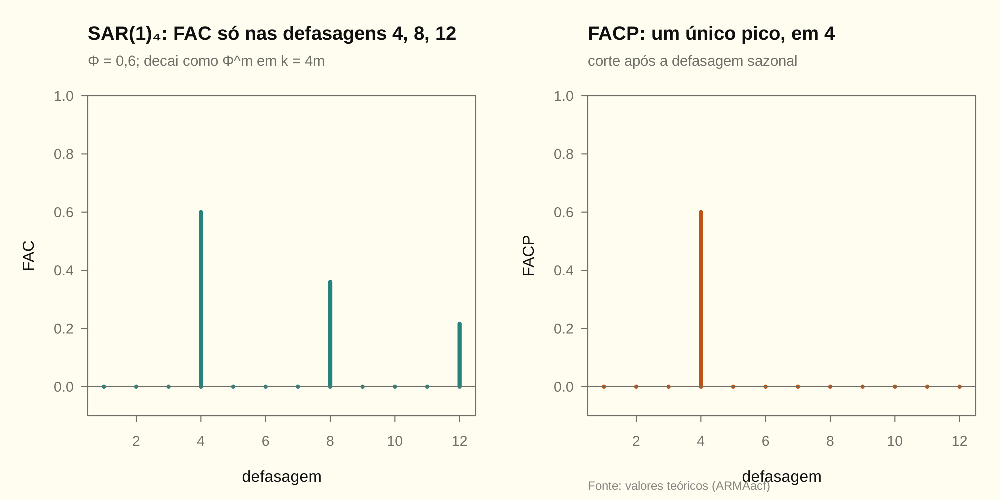

# Módulo 03 — Processos integrados, ARIMA e SARIMA

> [!NOTE]
> **Mapa do módulo**
> Processo integrado e raiz unitária → TS × DS → sobrediferenciação → testes de raiz unitária (ADF, KPSS) → sazonalidade: SAR, SMA, multiplicativo, $(1-B^s)$ → previsão de SARIMA. Cai como Q9–Q12. No [INPC](../trabalho_inpc/relatorio.md), decide que o log do índice é I(1) e a variação mensal é I(0).

## 1. Integração

$y_t\sim I(d)$ quando $\Delta^dy_t$ é estacionário e invertível, mas $\Delta^{d-1}y_t$ não é. O ARIMA($p,d,q$) escreve-se

$$
\phi(B)(1-B)^dy_t=c+\theta(B)a_t .
$$

O polinômio AR completo, $\phi(B)(1-B)^d$, tem $d$ raízes **sobre** o círculo unitário, em $z=1$.

### D03.1 · Raiz unitária ⇔ choques permanentes

> [!NOTE]
> **O que se quer provar**
> Se $\Delta y_t=\psi(B)\varepsilon_t$, com $\sum\lvert\psi_j\rvert\lt\infty$, então um choque $\varepsilon_t$ muda $\lim_{h\to\infty}E(y_{t+h}\mid\mathcal F_t)$ em $\psi(1)=\sum_j\psi_j$. Num processo estacionário, essa mudança é zero.

**Passo a passo.**

1. $y_{t+h}=y_{t-1}+\sum_{i=0}^{h}\Delta y_{t+i}$. O efeito de $\varepsilon_t$ sobre $\Delta y_{t+i}$ é $\psi_i$.

2. Logo $\partial y_{t+h}/\partial\varepsilon_t=\sum_{i=0}^{h}\psi_i\to\psi(1)$.

3. Num processo estacionário $y_t=\psi(B)\varepsilon_t$, o efeito é $\psi_h\to0$.

$$\boxed{\text{efeito de longo prazo}=\psi(1)\ \text{(DS)}\quad\text{vs.}\quad 0\ \text{(TS)}}$$

$\psi(1)$ é a "persistência" e é a base da decomposição de Beveridge e Nelson (MAT §1.6).

### D03.2 · Sobrediferenciação cria raiz unitária no MA

> [!NOTE]
> **O que se quer provar**
> Se $\phi(B)y_t=\theta(B)\varepsilon_t$ é estacionário, então $w_t=\Delta y_t$ satisfaz $\phi(B)w_t=(1-B)\theta(B)\varepsilon_t$, que é não invertível.

**Passo a passo.**

1. Aplique $(1-B)$ dos dois lados. Os polinômios em $B$ comutam: $\phi(B)(1-B)y_t=(1-B)\theta(B)\varepsilon_t$.

2. O novo polinômio MA, $(1-B)\theta(B)$, tem raiz $z=1$, logo não tem inversa somável.

3. Consequência: $\rho_1(w)\lt0$. No caso $y\sim$ RB, $\rho_1(w)=-1/2$.

$$\boxed{\phi(B)\,\Delta y_t=(1-B)\,\theta(B)\,\varepsilon_t}$$

## 2. Testes de raiz unitária

Regressão de Dickey-Fuller aumentada:

$$
\Delta y_t=\alpha+\beta t+\gamma y_{t-1}+\sum_{i=1}^{k}\delta_i\Delta y_{t-i}+e_t .
$$

O teste é $H_0:\gamma=0$ (raiz unitária) vs. $H_1:\gamma\lt0$, pela estatística $\tau=\widehat\gamma/ep(\widehat\gamma)$.

> [!WARNING]
> **Os críticos não são os da $t$ de Student**
> Sob $H_0$, $\tau$ tem a distribuição de Dickey-Fuller, que é assimétrica e depende de haver constante e/ou tendência. Os críticos de 5% são −1,95 (sem determinísticos), −2,86 (constante) e −3,41 (constante e tendência), com pequenas variações por $T$.
>
> A especificação certa importa. Use **tendência** se a série tem tendência sob a alternativa; caso contrário, o teste perde poder.

### D03.3 · A distribuição de Dickey-Fuller e o baixo poder do teste (Monte Carlo)

> [!NOTE]
> **O que se quer provar**
> Sob $H_0:\gamma=0$, a estatística $\tau$ não é normal nem $t$: ela fica deslocada para a esquerda, e mais ainda quanto mais termos determinísticos houver (AU04). Sob a alternativa estacionária com $\phi$ perto de 1, o teste quase não rejeita em amostras do tamanho usual.

**Passo a passo.**

1. **Por que a distribuição muda.** Sob $H_0$, $y_{t-1}$ é um passeio aleatório, e a variância amostral dele cresce como $T^2$, não como $T$. O numerador e o denominador de $\widehat\gamma$ convergem para funcionais do movimento browniano, e não para uma normal. Com constante, $y_{t-1}$ entra centrado na média, que puxa $\widehat\gamma$ para baixo. Com tendência, o efeito se repete.
2. **A simulação.** Simulamos 10000 passeios aleatórios de $T=100$ e rodamos a regressão de DF:

   | Especificação | Quantil de 5% de $\tau$ | Média de $\tau$ | Rejeições com −1,645 (normal) |
   |---|---|---|---|
   | sem determinísticos, $\tau$ | −1,93 | −0,41 | 9,0% |
   | constante, $\tau_\mu$ | −2,88 | −1,52 | 45,3% |
   | constante e tendência, $\tau_\tau$ | −3,46 | −2,19 | 77,2% |

   Os quantis batem com os críticos tabelados acima. Usar o crítico da normal por engano faz o teste rejeitar uma raiz unitária **verdadeira** em quase metade das vezes com constante, e em três de cada quatro com tendência.
3. **O poder.** Agora o processo verdadeiro é um AR(1) estacionário. Mostramos a porcentagem de rejeições a 5% do DF com constante, em 2000 réplicas, com o crítico exato da simulação:

   | $\phi$ | 0,80 | 0,90 | 0,95 | 0,99 |
   |---|---|---|---|---|
   | $T=100$ | 87,7% | 32,4% | 12,6% | 5,9% |
   | $T=400$ | 100% | 100% | 86,1% | 10,3% |

   Com $\phi=0{,}95$ e oito anos e meio de dados mensais, o teste acerta só uma vez em oito. Com $\phi=0{,}99$, não se distingue de um palpite: o poder fica perto do tamanho de 5%.

$$\boxed{\tau\ \text{sob } H_0\ \text{segue Dickey-Fuller, não } N(0,1);\qquad \text{não rejeitar } H_0 \ne \text{aceitar a raiz unitária}}$$

**O que isso muda na prática.** É o motivo para cruzar o ADF com o KPSS, cuja nula é a estacionariedade (Mattos, MAT, sobre o poder). No [INPC](../trabalho_inpc/relatorio.md), Questão 2d, o ADF do log do índice dá $p=0{,}075$. Sozinho, ele seria ambíguo, mas o PP e o KPSS decidem. Mais dados ajudam muito mais que mais defasagens: passar de $T=100$ a $T=400$ leva o poder com $\phi=0{,}95$ de 12,6% a 86,1%.

<!-- conferência numérica
| chave_R | nota |
|---|---|
| m03_df_R | 10000 |
| m03_df_T | 100 |
| m03_df_q05_nc | -1,93 |
| m03_df_media_nc | -0,41 |
| m03_df_rej_normal_nc | 9,0 |
| m03_df_q05_c | -2,88 |
| m03_df_media_c | -1,52 |
| m03_df_rej_normal_c | 45,3 |
| m03_df_q05_ct | -3,46 |
| m03_df_media_ct | -2,19 |
| m03_df_rej_normal_ct | 77,2 |
| m03_df_poder_t100_phi80 | 87,7 |
| m03_df_poder_t100_phi90 | 32,4 |
| m03_df_poder_t100_phi95 | 12,6 |
| m03_df_poder_t100_phi99 | 5,9 |
| m03_df_poder_t400_phi80 | 100 |
| m03_df_poder_t400_phi90 | 100 |
| m03_df_poder_t400_phi95 | 86,1 |
| m03_df_poder_t400_phi99 | 10,3 |
-->

### D03.4 · Uma quebra estrutural de nível imita uma raiz unitária (Perron, 1989)

> [!NOTE]
> **O que se quer provar**
> Uma série estacionária em torno de um nível que **muda uma vez** pode fazer o ADF não rejeitar a raiz unitária. O teste confunde o salto permanente com acúmulo de choques. Incluir a quebra na regressão auxiliar devolve o poder (AU04; MAT, conclusão).

**Passo a passo.**

1. **O processo.** $y_t=\delta\,DU_t+u_t$, com $DU_t=\mathbf 1\{t\gt T/2\}$ e $u_t=0{,}8u_{t-1}+\varepsilon_t$. É I(0) em cada metade: os choques morrem. Só o nível médio muda, uma vez, de 0 para $\delta$. O desvio-padrão de $u_t$ é $1/\sqrt{1-0{,}64}=1{,}67$.
2. **Por que o ADF erra.** A regressão de DF com constante supõe **uma** média. Diante do salto, o melhor ajuste é pôr $\widehat\gamma$ perto de zero: um processo que "não volta" explica a mudança de patamar melhor que um que volta a uma média única e errada. O teste fica viesado para a não rejeição.
3. **A correção.** Pôr a dummy na regressão: $\Delta y_t=a+d\,DU_t+\gamma y_{t-1}+e_t$. Os críticos mudam. Eles dependem da posição da quebra; aqui foram simulados sob $H_0$, com o passeio aleatório, e o de 5% dá −3,36, mais negativo que o −2,88 do DF com constante.
4. **A simulação**, com $T=200$, quebra na metade, 2000 réplicas, rejeições a 5%:

   | Salto $\delta$ | 0 | 3 | 6 | 10 |
   |---|---|---|---|---|
   | DF com constante, ignorando a quebra | 100% | 93,8% | 5,4% | 0% |
   | DF com a dummy de nível | 100% | 100% | 99,95% | 100% |

   Com um salto de 6, cerca de 3,6 desvios-padrão de $u_t$, o ADF comum rejeita só 5,4% das vezes, o mesmo que faria se houvesse raiz unitária de verdade. Com a dummy, rejeita quase sempre.

$$\boxed{\begin{gathered}\text{quebra de nível ignorada}\Rightarrow\text{ADF viesado para "raiz unitária"}\\ \text{data conhecida: dummy na regressão e crítico próprio}\end{gathered}}$$

Quando a data da quebra não é conhecida e é escolhida pelos dados, os críticos mudam de novo. É o caso de Zivot e Andrews (1992), que procuram a quebra que mais favorece a alternativa.

**A ligação com o INPC.** No [relatório](../trabalho_inpc/relatorio.md), o Chow indica quebra em mar/2020, e mesmo assim o ADF da variação mensal rejeita com folga a raiz unitária (Questão 2). Isso é coerente com esta seção: uma quebra **enfraquece** o teste, mas ali a evidência de estacionariedade é forte o bastante para sobreviver a ela. Se o ADF não tivesse rejeitado, a quebra seria o primeiro suspeito, antes de concluir por $d=1$.

<!-- conferência numérica
| chave_R | nota |
|---|---|
| m03_quebra_dp_u | 1,67 |
| m03_quebra_c5_du | -3,36 |
| m03_df_q05_c | -2,88 |
| m03_quebra_d0_rej_df | 100 |
| m03_quebra_d3_rej_df | 93,8 |
| m03_quebra_d6_rej_df | 5,4 |
| m03_quebra_d10_rej_df | 0 |
| m03_quebra_d0_rej_du | 100 |
| m03_quebra_d3_rej_du | 100 |
| m03_quebra_d6_rej_du | 99,95 |
| m03_quebra_d10_rej_du | 100 |
-->

**KPSS:** as hipóteses são invertidas, com $H_0$ = estacionária (em nível ou em tendência). A leitura padrão é cruzar os dois: ADF não rejeita e KPSS rejeita aponta I(1); ADF rejeita e KPSS não rejeita aponta I(0).

## 3. Sazonalidade

| Componente | Polinômio | Quem cuida |
|---|---|---|
| AR sazonal | $\Phi(B^s)=1-\Phi_1B^s-\dots-\Phi_PB^{Ps}$ | estacionariedade sazonal |
| MA sazonal | $\Theta(B^s)=1-\Theta_1B^s-\dots-\Theta_QB^{Qs}$ | invertibilidade sazonal |
| Diferença sazonal | $(1-B^s)^D$ | raiz unitária sazonal |

O SARIMA$(p,d,q)(P,D,Q)_s$ é

$$
\phi(B)\Phi(B^s)(1-B)^d(1-B^s)^Dy_t=\theta(B)\Theta(B^s)a_t .
$$

O modelo é **multiplicativo**: o produto dos polinômios gera termos cruzados com coeficientes restritos. Um exemplo é $\phi\Phi$ em $B^{s+1}$ (Q11c).

> [!TIP]
> **Sazonalidade determinística vs. estocástica**
> $(1-B^s)$ supõe raiz unitária sazonal: o padrão sazonal muda de forma permanente com os choques. Se o padrão é fixo, as dummies sazonais são o modelo certo.
>
> O sintoma de ter diferenciado sem precisar é $\widehat\Theta_1\approx1$. O sintoma de um SARMA estar imitando dummies é $\widehat\Phi_1$ perto de 1 com $\widehat\Theta_1\approx-\widehat\Phi_1$. É o que aparece no INPC (relatório, §3).

## 4. Checklist

- [ ] Explico TS × DS por memória dos choques, variância e previsão.
- [ ] Mostro que diferenciar uma série estacionária cria raiz unitária no MA.
- [ ] Escrevo a regressão ADF, as hipóteses e por que os críticos não são os da $t$.
- [ ] Calculo $\gamma_k$ de um SAR(1)$_s$ e reconheço a FAC/FACP.
- [ ] Expando um SARIMA e escrevo $\widehat y(h)$ para $h$ dentro e fora do alcance do MA.
