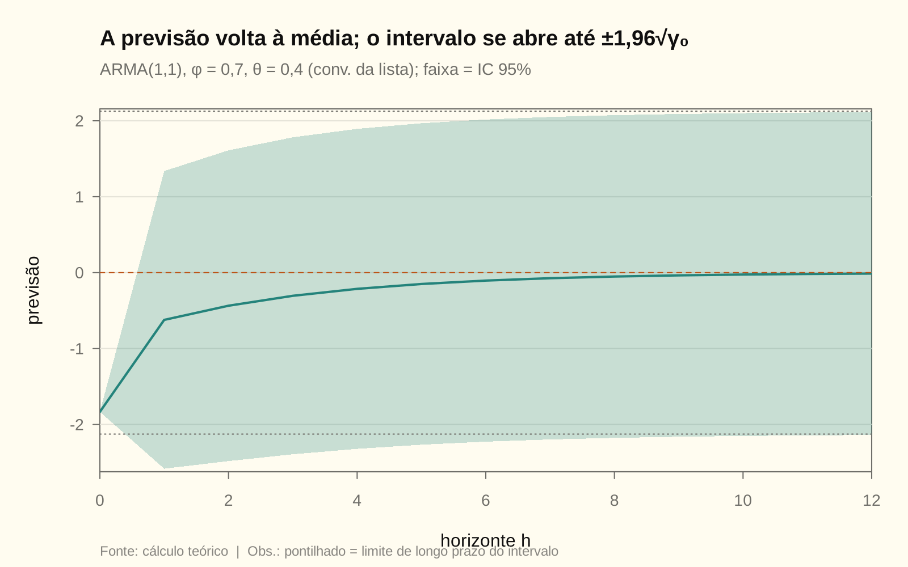

# Módulo 05 — Previsão (Q15)

Conferência em [05_previsao.R](05_previsao.R). A avaliação de previsão fora da amostra (janelas, métricas, Diebold-Mariano, Winkler) está aplicada no [INPC](../trabalho_inpc/relatorio.md) §6. Convenção do MA: **Box-Jenkins**.

## Teoria em uma página

| Conceito | Definição |
|---|---|
| Previsor | $y_{T+h\mid T}=E(y_{T+h}\mid\mathcal F_T)$ |
| Erro de previsão | $e_T(h)=y_{T+h}-y_{T+h\mid T}=\sum_{j=0}^{h-1}\psi_ja_{T+h-j}$ |
| Variância do erro | $\operatorname{Var}(e_T(h))=\sigma_a^2\sum_{j=0}^{h-1}\psi_j^2\ \nearrow\ \gamma_0$ |
| Intervalo de 95% | $y_{T+h\mid T}\pm1{,}96\,\sigma_a\sqrt{\sum_{j\lt h}\psi_j^2}$ |
| Regra de cálculo | troque $y$ futuro pela previsão, $a$ futuro por 0 e $a$ passado pelo resíduo |

### D05.1 · A esperança condicional minimiza o EQM

> [!NOTE]
> **O que se quer provar**
> Entre todas as funções $g$ da informação $\mathcal F_T$, $E\big[(y_{T+h}-g)^2\big]$ é mínimo em $g^\ast=E(y_{T+h}\mid\mathcal F_T)$.

**Passo a passo.**

1. Some e subtraia $g^\ast$: $y_{T+h}-g=(y_{T+h}-g^\ast)+(g^\ast-g)$.

2. Eleve ao quadrado e tome $E(\cdot\mid\mathcal F_T)$:

$$
E\big[(y_{T+h}-g)^2\mid\mathcal F_T\big]=E\big[(y_{T+h}-g^\ast)^2\mid\mathcal F_T\big]+(g^\ast-g)^2+2(g^\ast-g)\,E\big[y_{T+h}-g^\ast\mid\mathcal F_T\big].
$$

O fator $(g^\ast-g)$ é $\mathcal F_T$-mensurável e sai da esperança condicional.

3. O termo cruzado é zero: $E(y_{T+h}-g^\ast\mid\mathcal F_T)=g^\ast-g^\ast=0$.

4. O primeiro termo não depende de $g$, e o segundo é $\ge0$, com igualdade só em $g=g^\ast$. Tomando a esperança incondicional (lei das expectativas iteradas), vale para o EQM.

$$\boxed{y_{T+h\mid T}=E(y_{T+h}\mid\mathcal F_T)\ \text{é o previsor de mínimo EQM}}$$

---

## Q15 — Previsão em ARMA($p,q$) estacionário e invertível

**(a)** É a D05.1. A estacionariedade garante momentos finitos. A invertibilidade garante que $\mathcal F_T=\sigma(y_T,y_{T-1},\dots)$ contém os $a_T,a_{T-1},\dots$, que são então conhecidos em $T$.

**(b) ARMA(1,1):** $y_t=\phi y_{t-1}+a_t-\theta a_{t-1}$.

$$
y_{T+1\mid T}=E(\phi y_T+a_{T+1}-\theta a_T\mid\mathcal F_T)=\boxed{\phi y_T-\theta a_T}
$$

$$
y_{T+2\mid T}=E(\phi y_{T+1}+a_{T+2}-\theta a_{T+1}\mid\mathcal F_T)=\phi\,y_{T+1\mid T}=\boxed{\phi^2y_T-\phi\theta a_T}
$$

Em geral, $y_{T+h\mid T}=\phi^{h-1}y_{T+1\mid T}$ para $h\ge1$, e a previsão decai geometricamente para a média: o MA só "mexe" no primeiro passo. Com média $\mu$, aplique as fórmulas a $y-\mu$. Na prática, $a_T$ é o último resíduo do modelo estimado. Conferido contra o `predict()` do R, com diferença zero.

**(c) O erro de previsão é MA($h-1$).** Da forma MA($\infty$), $y_{T+h}=\sum_{j\ge0}\psi_ja_{T+h-j}$. Os choques com índice $\le T$ são conhecidos, e os futuros têm esperança zero. Logo

$$
y_{T+h\mid T}=\sum_{j\ge h}\psi_ja_{T+h-j},\qquad e_T(h)=\sum_{j=0}^{h-1}\psi_ja_{T+h-j}.
$$

É uma combinação de $h$ choques futuros, isto é, um MA($h-1$). Pela não correlação dos $a$:

$$
\boxed{\operatorname{Var}\big(e_T(h)\big)=\sigma_a^2\sum_{j=0}^{h-1}\psi_j^2}
$$

A variância é crescente em $h$ e converge para $\gamma_0=\sigma_a^2\sum_{j\ge0}\psi_j^2$. No ARMA(1,1) com $\phi=0{,}7$, $\theta=0{,}4$ e $\sigma_a^2=1$, temos $\psi_1=\phi-\theta=0{,}3$, e a variância vale 1 em $h=1$, 1,09 em $h=2$ e 1,1764 em $h=12$, já colada em $\gamma_0=1{,}1765$.

Consequência útil: erros de previsão $h$ passos à frente feitos em origens vizinhas **são autocorrelacionados** até a defasagem $h-1$. Por isso o teste de Diebold-Mariano usa variância de longo prazo quando $h\gt1$.

**(d) Intervalo de 95%.** Com $a_t$ gaussiano, $e_T(h)\sim N\big(0,\sigma_a^2\sum_{j\lt h}\psi_j^2\big)$:

$$
IC_{95\%}:\quad y_{T+h\mid T}\pm1{,}96\,\widehat\sigma_a\sqrt{\textstyle\sum_{j=0}^{h-1}\widehat\psi_j^2}.
$$

Em $h=1$, a meia-largura é $1{,}96\sigma_a=1{,}96$. Em $h=2$, é 2,046. O intervalo ignora a incerteza de estimar os parâmetros, que é de ordem $1/T$, e fica estreito demais se os erros tiverem caudas pesadas. Foi o que aconteceu no INPC.

**(e) ARIMA(0,1,1) é suavização exponencial simples.** O modelo é $y_t=y_{t-1}+a_t-\theta a_{t-1}$.

1. $y_{T+1\mid T}=y_T-\theta a_T$.
2. Para $h\ge2$, $y_{T+h\mid T}=y_{T+h-1\mid T}$, porque os $a$ futuros somem. A previsão é **constante** em $h$: o modelo não tem tendência nem retorno à média, só um "nível" que se atualiza.
3. Use $a_T=y_T-y_{T\mid T-1}$, o erro de previsão de um passo:

$$
y_{T+1\mid T}=y_T-\theta(y_T-y_{T\mid T-1})=\boxed{(1-\theta)\,y_T+\theta\,y_{T\mid T-1}}
$$

É a recursão da suavização exponencial simples, com **constante de suavização $\alpha=1-\theta$**.

4. Iterando, $y_{T+1\mid T}=(1-\theta)\sum_{j\ge0}\theta^jy_{T-j}$: uma média móvel com pesos exponencialmente decrescentes, que somam 1. A expansão só converge se $\lvert\theta\rvert\lt1$, isto é, se o modelo for invertível.

Com $\theta=0{,}6$, $\alpha=0{,}4$ e os pesos são $0{,}4;\ 0{,}24;\ 0{,}144;\ 0{,}0864;\dots$ A previsão do `arima(0,1,1)` e a do `HoltWinters` com $\alpha=0{,}4$ coincidem até $10^{-16}$.

> [!TIP]
> **Leitura econômica**
> $\theta$ perto de 1 significa $\alpha$ pequeno: a série é quase estacionária em torno de um nível que muda pouco, e a previsão é uma média longa. $\theta$ perto de 0 significa $\alpha\approx1$: é praticamente um passeio aleatório, e a melhor previsão é o último valor.

<!-- conferência numérica (phi = 0,7; theta = 0,4; sigma2 = 1; SES com theta = 0,6)
| chave_R | nota |
|---|---|
| m05_q15_dif_h1 | 0 |
| m05_q15_dif_h2 | 0 |
| m05_q15_psi1 | 0,3 |
| m05_q15_var_h1 | 1 |
| m05_q15_var_h2 | 1,09 |
| m05_q15_var_h12 | 1,1764 |
| m05_q15_gamma0 | 1,1765 |
| m05_q15_ic_h1_meia | 1,96 |
| m05_q15_ic_h2_meia | 2,046 |
| m05_q15_alpha | 0,4 |
| m05_q15_peso0 | 0,4 |
| m05_q15_peso3 | 0,0864 |
| m05_q15_ses_dif | 0 |
| m05_q15_ses_const | 0 |
-->
