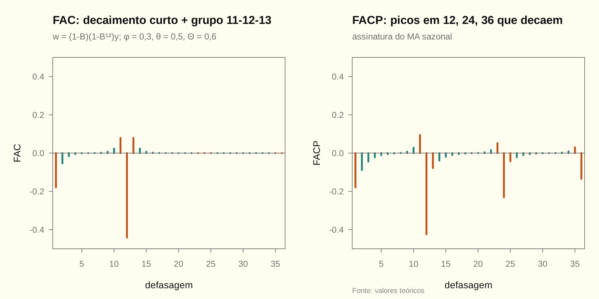

# Módulo 06 — SARIMA(1,1,1)(0,1,1)$_{12}$ com 240 meses (Q16)

Conferência em [06_aplicacao.R](06_aplicacao.R), com $\phi=0{,}3$, $\theta=0{,}5$ e $\Theta=0{,}6$. É a "irmã" do modelo *airline* de Box e Jenkins. A aplicação de verdade, com dados, é o [INPC](../trabalho_inpc/relatorio.md). Convenção do MA: **Box-Jenkins**.

## Q16

**(a) Modelo completo.**

$$
\boxed{(1-\phi B)(1-B)(1-B^{12})\,y_t=(1-\theta B)(1-\Theta B^{12})\,a_t}
$$

Expandindo o lado MA: $a_t-\theta a_{t-1}-\Theta a_{t-12}+\theta\Theta a_{t-13}$. O coeficiente de $a_{t-13}$ não é livre: é o produto dos outros dois.

**(b) Parâmetros: 4.** São $\phi$ (AR regular), $\theta$ (MA regular), $\Theta$ (MA sazonal) e $\sigma_a^2$. Não há constante: com $d=D=1$, uma constante em $w_t$ implicaria tendência quadrática em $y$, e ela normalmente não é incluída. Se for incluída, são 5. A estimação usa $240-1-12=227$ observações de $w_t$.

**(c) FAC e FACP esperadas de $w_t=(1-B)(1-B^{12})y_t$.** Escreva $w_t=(1-\phi B)^{-1}u_t$, com $u_t=(1-\theta B)(1-\Theta B^{12})a_t$. A FAC de $u$ é não nula só nas defasagens 1, 11, 12 e 13. O AR(1) "espalha" essa estrutura com decaimento $\phi^k$.

| Defasagem | FAC teórica | FACP teórica | Leitura |
|---|---|---|---|
| 1 | −0,179 | −0,179 | AR(1) + MA(1) regulares |
| 2 | −0,054 | −0,089 | decaimento rápido |
| 11 | 0,079 | — | "satélite" do pico sazonal |
| 12 | **−0,441** | **−0,424** | MA sazonal |
| 13 | 0,079 | — | "satélite" do pico sazonal |
| 24 | 0,000 | −0,231 | FAC já morreu; FACP ainda decai |

O que corrobora a especificação:
- **FAC:** decaimento curto nas primeiras defasagens, um pico negativo em 12 com satélites simétricos em 11 e 13 (assinatura do produto $(1-\theta B)(1-\Theta B^{12})$), e **nada depois de 13**, a menos do resto do AR.
- **FACP:** decaimento nas defasagens 12, 24, 36, que é a assinatura de um MA sazonal (e não de um AR sazonal), mais um decaimento nas primeiras defasagens.

**(d) Comparar com SARIMA(2,1,1)(0,1,1)$_{12}$.** Os modelos são **aninhados**: o primeiro é o segundo com $\phi_2=0$. Têm o mesmo $d$ e $D$ e, portanto, o mesmo $T$ efetivo, então os critérios de informação são comparáveis. Há três caminhos:

1. **Teste da razão de verossimilhança:** $LR=2(\ell_{(2,1,1)}-\ell_{(1,1,1)})\sim\chi^2_1$ sob $H_0:\phi_2=0$. Na série simulada, $LR=1{,}08\lt\chi^2_{tab}(1)=3{,}84$ ($p=0{,}30$), então não se rejeita $H_0$. Equivale ao teste $z$ de $\widehat\phi_2$ ($z=-1{,}59$, $p=0{,}11$).
2. **BIC:** recomendado para *identificar*, porque é consistente. Com $T=227$, cada parâmetro custa $\ln227\approx5{,}4$. Na simulação: BIC = 634,9 contra 639,3, e fica o modelo menor, o verdadeiro.
3. **AIC:** se o objetivo for prever. Na simulação, o AIC também fica com o menor (621,2 contra 622,2), mas a margem é estreita, como a teoria da Q14 antecipa.

**Recomendação.** BIC, ou o LR, por serem modelos aninhados e por haver interesse em parcimônia. Em seguida, confirmar com o diagnóstico de resíduos: Ljung-Box com $\nu=K-3$ ou $K-4$ conforme o modelo, de modo que o $\phi_2$ extra não "resolva" autocorrelação remanescente. Se o objetivo final for prever, avaliar os dois fora da amostra com Diebold-Mariano, como no INPC.

> [!WARNING]
> **Só compare critérios com o mesmo $T$ e a mesma série**
> Um SARIMA com $D=1$ e outro com $D=0$ são estimados em amostras diferentes ($w_t$ vs. $y_t$), e o AIC entre eles não é comparável (AU02, p. 99). Para decidir $D$, use teste de raiz unitária sazonal (OCSB, Canova-Hansen) ou avaliação fora da amostra.

<!-- conferência numérica
| chave_R | nota |
|---|---|
| m06_q16_k1 | 4 |
| m06_q16_k2 | 5 |
| m06_q16_t_efetivo | 227 |
| m06_q16_fac1 | -0,179 |
| m06_q16_fac2 | -0,054 |
| m06_q16_fac11 | 0,079 |
| m06_q16_fac12 | -0,441 |
| m06_q16_fac13 | 0,079 |
| m06_q16_fac24 | 0,000 |
| m06_q16_facp1 | -0,179 |
| m06_q16_facp2 | -0,089 |
| m06_q16_facp12 | -0,424 |
| m06_q16_facp24 | -0,231 |
| m06_q16_lr | 1,08 |
| m06_q16_chi2_1 | 3,84 |
| m06_q16_lr_p | 0,30 |
| m06_q16_ar2_z | -1,59 |
| m06_q16_ar2_p | 0,11 |
| m06_q16_bic1 | 634,9 |
| m06_q16_bic2 | 639,3 |
| m06_q16_aic1 | 621,2 |
| m06_q16_aic2 | 622,2 |
-->
