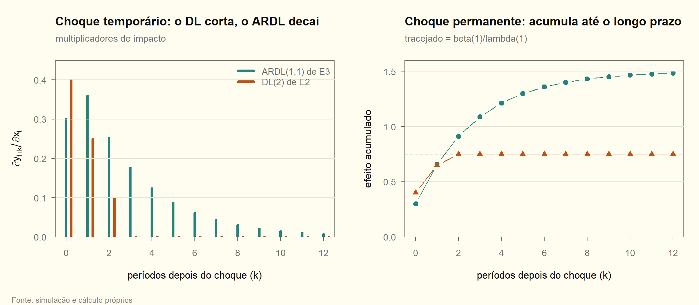
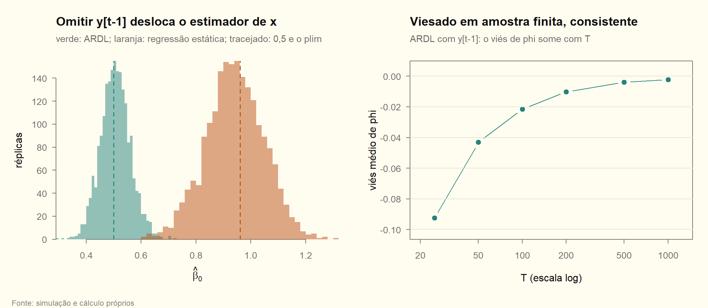

# Módulo 07 — Exercícios resolvidos (E1–E7)

A AU06 não tem lista oficial. Estes exercícios são **próprios**, no formato que a aula sugere para a prova: classificar a exogeneidade, calcular multiplicadores, reescrever em ECM e testar Granger. Os três últimos são experimentos de Monte Carlo e uma estimação completa. A teoria está em [07_teoria](07_teoria.md), e todos os números saem de [07_regressao.R](07_regressao.R).

## E1. Classificar a exogeneidade

Para cada regressão, diga se o regressor é estritamente exógeno, predeterminado ou contemporaneamente endógeno, e o que isso faz com o MQO.

| Regressão | Classificação | Por quê |
|---|---|---|
| (a) preço do café arábica no mês $t$ contra a ocorrência de geada no sul de Minas no mês $t$ | **estritamente exógeno** (plausível) | o preço do café não muda o clima; não há *feedback* do erro para geadas futuras |
| (b) inflação mensal contra a Selic do mês | **predeterminado**, não estritamente exógeno | a Selic do mês foi decidida antes de a inflação do mês ser conhecida, mas o Copom reage às surpresas: um choque de inflação hoje muda a Selic das próximas reuniões ($\varepsilon_t\to x_{t+1}$) |
| (c) preço em reais de um importado no dia contra a taxa de câmbio do dia | **endógeno** | a mesma notícia move o câmbio e o preço no mesmo dia; falha até a exogeneidade contemporânea |
| (d) vendas mensais de uma rede contra o gasto em publicidade | **depende do calendário** | orçamento fixado antes do mês: predeterminado; gasto ajustado dentro do mês ao ver as vendas: endógeno |

**Consequência para o MQO.** Em (a), o MQO é não viesado e consistente. Em (b) e no primeiro caso de (d), pode ser viesado em amostra finita, mas é consistente. Em (c) e no segundo caso de (d), é inconsistente, e o caminho é instrumentar ou modelar o sistema.

## E2. Multiplicadores de um DL(2)

Seja $y_t=1+0{,}4x_t+0{,}25x_{t-1}+0{,}1x_{t-2}+\varepsilon_t$. Calcule os efeitos de um aumento **temporário** e de um **permanente** de uma unidade em $x$, o multiplicador de longo prazo e a defasagem média.

**Solução.** No DL, os multiplicadores de impacto são os próprios coeficientes, e o acumulado é a soma parcial deles:

| $k$ | Temporário, $\partial y_{t+k}/\partial x_t$ | Permanente, $\sum_{j\le k}\beta_j$ |
|---|---|---|
| 0 | 0,4 | 0,4 |
| 1 | 0,25 | 0,65 |
| 2 | 0,1 | 0,75 |
| 3 em diante | 0 | 0,75 |

- O **longo prazo** é $\beta(1)=0{,}75$. Ele é atingido em $k=2$, quando acaba a última defasagem.
- A **defasagem média**, $\sum_jj\beta_j/\sum_j\beta_j=0{,}6$ período, diz onde está o "centro de massa" da resposta.

<!-- conferência numérica
| chave_R | nota |
|---|---|
| m07_e2_m0 | 0,4 |
| m07_e2_m1 | 0,25 |
| m07_e2_m2 | 0,1 |
| m07_e2_m3 | 0 |
| m07_e2_cum0 | 0,4 |
| m07_e2_cum1 | 0,65 |
| m07_e2_cum2 | 0,75 |
| m07_e2_lp | 0,75 |
| m07_e2_defas_media | 0,6 |
-->

## E3. ARDL(1,1): multiplicadores, longo prazo e ECM

Seja $y_t=0{,}2+0{,}7y_{t-1}+0{,}3x_t+0{,}15x_{t-1}+\varepsilon_t$.

**(a) Multiplicadores** (D07.2). $m_0=\beta_0$, $m_1=\phi_1\beta_0+\beta_1$ e $m_k=\phi_1m_{k-1}$:

| $k$ | Temporário $m_k$ | Permanente $\sum_{j\le k}m_j$ |
|---|---|---|
| 0 | 0,3 | 0,3 |
| 1 | $0{,}7\cdot0{,}3+0{,}15=0{,}36$ | 0,66 |
| 2 | $0{,}7\cdot0{,}36=0{,}252$ | 0,912 |
| 3 | 0,1764 | 1,0884 |

**(b) Longo prazo.** $\theta=(0{,}3+0{,}15)/(1-0{,}7)=1{,}5$. O acumulado passa de 90% de $\theta$ em $k=6$. A média de equilíbrio de $y$, com $x=0$, é $0{,}2/0{,}3=0{,}667$.

**(c) ECM** (D07.4). $\Delta y_t=0{,}2+0{,}3\,\Delta x_t-0{,}3\,(y_{t-1}-1{,}5\,x_{t-1})+\varepsilon_t$.

- A velocidade de ajuste é $\alpha=\phi_1-1=-0{,}3$: a cada período, 30% do desvio do equilíbrio é corrigido.
- A meia-vida de um desvio é $\ln0{,}5/\ln0{,}7=1{,}94$ período.

**(d) E com $\phi_1=-0{,}5$ e $\beta=(0{,}3;\ 0{,}3)$?** A resposta alterna de sinal: 0,3, 0,15, −0,075, 0,0375. O longo prazo é $0{,}6/1{,}5=0{,}4$, menor que o impacto.

<!-- conferência numérica
| chave_R | nota |
|---|---|
| m07_e3_m0 | 0,3 |
| m07_e3_m1 | 0,36 |
| m07_e3_m2 | 0,252 |
| m07_e3_m3 | 0,1764 |
| m07_e3_cum0 | 0,3 |
| m07_e3_cum1 | 0,66 |
| m07_e3_cum2 | 0,912 |
| m07_e3_cum3 | 1,0884 |
| m07_e3_lp | 1,5 |
| m07_e3_k90 | 6 |
| m07_e3_media_y | 0,667 |
| m07_e3_alpha | -0,3 |
| m07_e3_meia_vida | 1,94 |
| m07_e3n_m0 | 0,3 |
| m07_e3n_m1 | 0,15 |
| m07_e3n_m2 | -0,075 |
| m07_e3n_m3 | 0,0375 |
| m07_e3n_lp | 0,4 |
-->

## E4. O viés de omitir $y_{t-1}$ (Monte Carlo)

O verdadeiro é $y_t=0{,}6y_{t-1}+0{,}5x_t+\varepsilon_t$, com $x_t=0{,}8x_{t-1}+v_t$, sem *feedback*. Compare a regressão estática $y_t$ em $x_t$ com o ARDL.

**Solução teórica** (D07.3). $\operatorname{Cov}(x_t,y_{t-1})/\operatorname{Var}(x_t)=\beta_0\rho/(1-\phi_1\rho)=0{,}769$. Então $\operatorname{plim}\widehat\beta_0=0{,}5+0{,}6\cdot0{,}769=0{,}962$. A regressão estática não estima o impacto (0,5) nem o longo prazo ($0{,}5/0{,}4=1{,}25$). Ela fica no meio.

**Simulação**, com 2000 réplicas de $T=200$. A média do $\widehat\beta_0$ estático é 0,942, perto do plim. O pouco que falta é viés de amostra finita. A do ARDL é 0,507, perto do verdadeiro.

**O canal (B), *feedback*.** Repetimos sem persistência própria em $x$, mas com $x_t=0{,}3y_{t-1}+v_t$. O $\widehat\beta_0$ estático, numa amostra muito grande, dá 0,913, de novo longe de 0,5. Nesse caso o viés vem inteiro da reação de $x$ ao passado de $y$.

<!-- conferência numérica
| chave_R | nota |
|---|---|
| m07_e4_razao | 0,769 |
| m07_e4_plim | 0,962 |
| m07_e4_lp | 1,25 |
| m07_e4_R | 2000 |
| m07_e4_T | 200 |
| m07_e4_mc_estatico | 0,942 |
| m07_e4_mc_ardl | 0,507 |
| m07_e4b_estatico | 0,913 |
-->

## E5. Viesado em amostra finita, consistente (Monte Carlo)

No mesmo processo de E4, estime o ARDL correto e veja a média de $\widehat\phi_1-0{,}6$ em 4000 réplicas para cada $T$.

| $T$ | 25 | 50 | 100 | 200 | 500 | 1000 |
|---|---|---|---|---|---|---|
| viés médio de $\widehat\phi_1$ | −0,092 | −0,043 | −0,021 | −0,010 | −0,004 | −0,002 |

**Leitura.**

- **O viés é negativo e cai com $T$.** Cai aproximadamente pela metade quando $T$ dobra, a taxa $1/T$.
- **Por quê.** É a falha da exogeneidade estrita (D07.1): o MQO é viesado em amostra finita, mas consistente.
- **Comparação.** No AR(1) puro, a aproximação de Kendall dá $-(1+3\phi)/T=-0{,}112$ para $T=25$. Com $x$ na equação, parte da variação de $y$ vem de um regressor exógeno, e o viés fica um pouco menor.

<!-- conferência numérica
| chave_R | nota |
|---|---|
| m07_e5_R | 4000 |
| m07_e5_vies_t25 | -0,092 |
| m07_e5_vies_t50 | -0,043 |
| m07_e5_vies_t100 | -0,021 |
| m07_e5_vies_t200 | -0,010 |
| m07_e5_vies_t500 | -0,004 |
| m07_e5_vies_t1000 | -0,002 |
| m07_e5_vies_ar1_t25 | -0,112 |
-->

## E6. Granger nas duas direções e o *feedback*

Simule $x_t=0{,}5x_{t-1}+\gamma y_{t-1}+v_t$ e $y_t=x_t+\varepsilon_t$, com $T=300$, para $\gamma=0$ e $\gamma=0{,}3$. Teste Granger nas duas direções, com $p$ escolhido por BIC.

**Solução.** O BIC escolhe $p=1$ nos dois casos.

| | $x\to y$: $F$ ($p$-valor) | $y\to x$: $F$ ($p$-valor) | Leitura |
|---|---|---|---|
| $\gamma=0$ | 5,72 (0,017) | 0,01 (0,93) | $x$ antecede $y$, sem *feedback* |
| $\gamma=0{,}3$ | 29,65 (0,0000) | 35,46 (0,0000) | *feedback* nas duas direções |

**Por que $x$ Granger-causa $y$ mesmo com $\gamma=0$.** $y_t=0{,}5x_{t-1}+v_t+\varepsilon_t$, e $y_{t-1}=x_{t-1}+\varepsilon_{t-1}$ é uma medida ruidosa de $x_{t-1}$. O próprio $x_{t-1}$ prevê melhor, e o teste vê isso.

**A ligação com a exogeneidade** (D07.5). Numa amostra muito grande:

- **Com $\gamma=0{,}3$:** $E(\varepsilon_tx_{t+1})$ estimado dá 0,304, contra o teórico $\gamma\sigma^2=0{,}3$. Já $E(\varepsilon_tx_t)$ dá 0,000. O regressor é **predeterminado, mas não estritamente exógeno**, e o $F$ de $y\to x$ detectou exatamente isso.
- **Com $\gamma=0$:** as duas covariâncias dão 0,000.

Com *feedback*, $x$ segue $x_t=0{,}8\,x_{t-1}+\dots$, que continua estacionário.

<!-- conferência numérica
| chave_R | nota |
|---|---|
| m07_e6_g0_p | 1 |
| m07_e6_g3_p | 1 |
| m07_e6_g0_f_xy | 5,72 |
| m07_e6_g0_p_xy | 0,017 |
| m07_e6_g0_f_yx | 0,01 |
| m07_e6_g0_p_yx | 0,93 |
| m07_e6_g3_f_xy | 29,65 |
| m07_e6_g3_p_xy | 0,0000 |
| m07_e6_g3_f_yx | 35,46 |
| m07_e6_g3_p_yx | 0,0000 |
| m07_e6_cov_g3 | 0,304 |
| m07_e6_cov0_g3 | 0,000 |
| m07_e6_cov_g0 | 0,000 |
| m07_e6_cov0_g0 | 0,000 |
| m07_e6_ar_x_g3 | 0,8 |
-->

## E7. Estimação completa de um ARDL

Com 200 observações simuladas do processo de E3 (e $x_t=0{,}5x_{t-1}+v_t$), siga o roteiro da AU06: escolher a ordem, estimar, diagnosticar, obter o longo prazo com erro padrão e a forma ECM.

**(a) Ordem.** Na grade com $p\le3$ e $q\le3$ (12 modelos), todos estimados na mesma amostra de 197 observações, o BIC e o AIC escolhem $p=1$ e $q=1$, a ordem verdadeira.

**(b) Estimativas (MQO, ARDL(1,1)).**

| Coeficiente | Estimativa | Erro padrão | Verdadeiro |
|---|---|---|---|
| $\phi_0$ | 0,244 | 0,078 | 0,2 |
| $\phi_1$ | 0,666 | 0,047 | 0,7 |
| $\beta_0$ | 0,265 | 0,069 | 0,3 |
| $\beta_1$ | 0,203 | 0,073 | 0,15 |

**(c) Diagnóstico.** Breusch-Godfrey com 4 defasagens: $LM=0{,}88$, $p=0{,}93$. Os resíduos não têm autocorrelação, a dinâmica está completa, e o MQO é consistente.

**(d) Longo prazo.** $\widehat\theta=(0{,}265+0{,}203)/(1-0{,}666)=1{,}40$. Pelo método delta, o erro padrão é 0,25, e o IC de 95% vai de 0,90 a 1,90. Ele contém o verdadeiro 1,5.

**(e) ECM.** Regredindo $\Delta y_t$ em $\Delta x_t$, $y_{t-1}$ e $x_{t-1}$:

- $\widehat\alpha=-0{,}334$, com erro padrão 0,047, o mesmo de $\widehat\phi_1$;
- o curto prazo dá $\widehat\beta_0=0{,}265$, igual ao do ARDL;
- o longo prazo dá $-\widehat\gamma/\widehat\alpha=1{,}40$.

Os resíduos são idênticos aos do ARDL (a diferença nas somas de quadrados é da ordem de $10^{-13}$, arredondamento da máquina). É a reparametrização de D07.4 verificada nos dados.

<!-- conferência numérica
| chave_R | nota |
|---|---|
| m07_e7_n_grade | 12 |
| m07_e7_n_comum | 197 |
| m07_e7_p_bic | 1 |
| m07_e7_q_bic | 1 |
| m07_e7_p_aic | 1 |
| m07_e7_q_aic | 1 |
| m07_e7_c | 0,244 |
| m07_e7_c_ep | 0,078 |
| m07_e7_phi | 0,666 |
| m07_e7_phi_ep | 0,047 |
| m07_e7_b0 | 0,265 |
| m07_e7_b0_ep | 0,069 |
| m07_e7_b1 | 0,203 |
| m07_e7_b1_ep | 0,073 |
| m07_e7_bg4 | 0,88 |
| m07_e7_bg4_p | 0,93 |
| m07_e7_lp | 1,40 |
| m07_e7_lp_ep | 0,25 |
| m07_e7_lp_li | 0,90 |
| m07_e7_lp_ls | 1,90 |
| m07_e7_ecm_alpha | -0,334 |
| m07_e7_ecm_alpha_ep | 0,047 |
| m07_e7_ecm_b0 | 0,265 |
| m07_e7_ecm_lp | 1,40 |
-->
