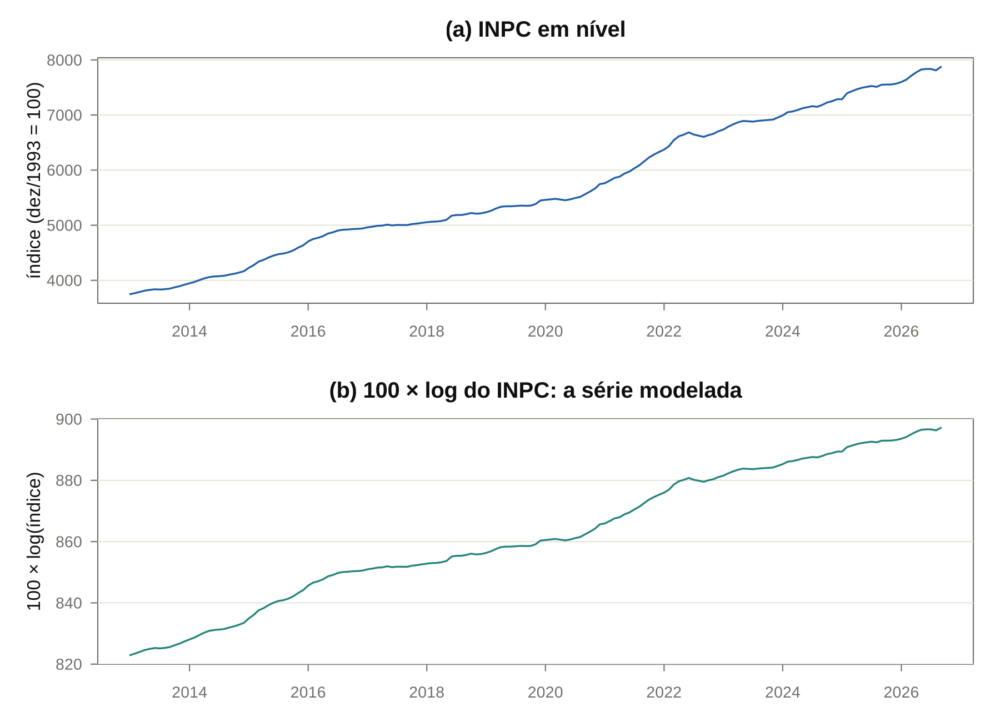
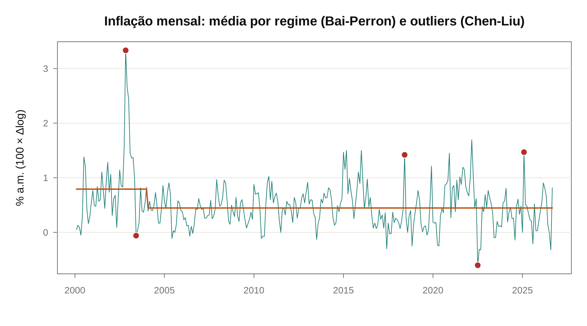
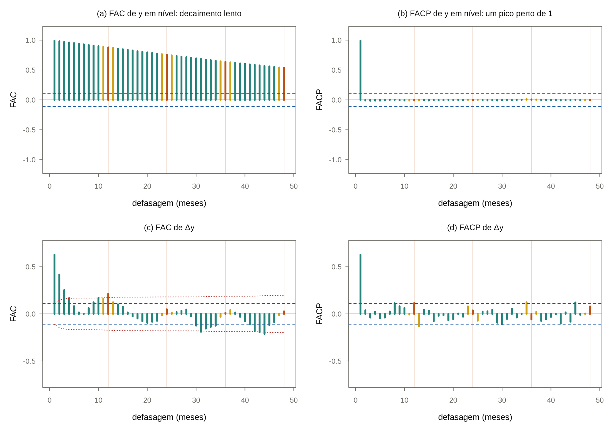
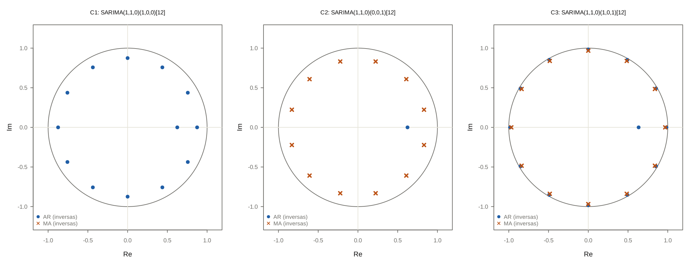
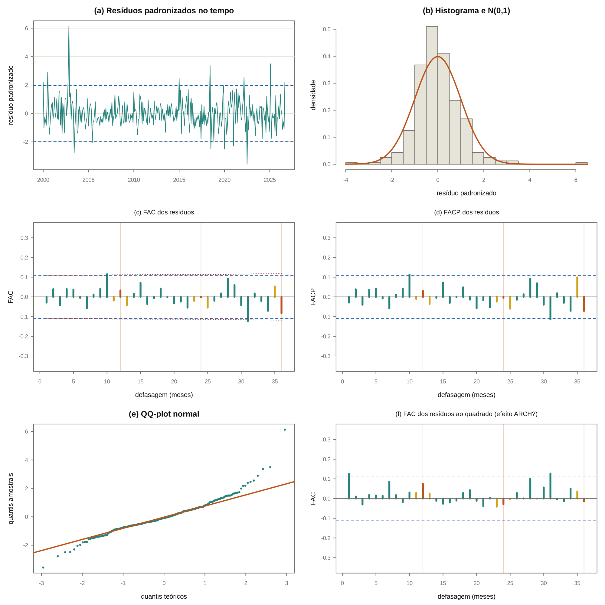
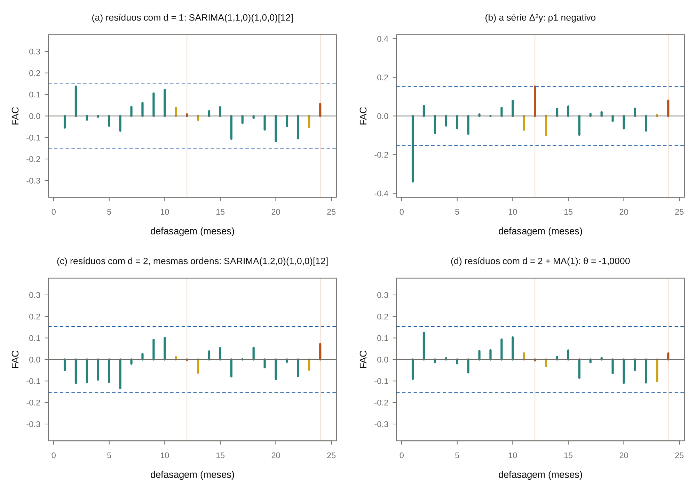
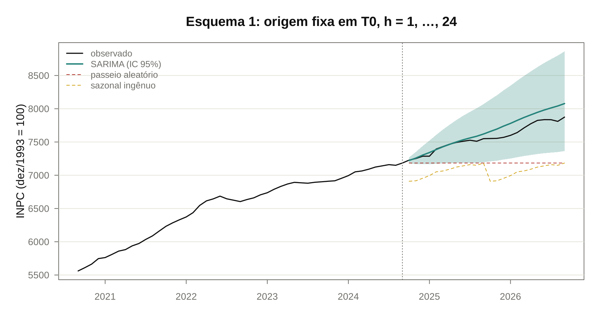

# Guia de estudo da Lista 01: o que estou fazendo e por quê

Este guia acompanha o script [lista01_inpc.R](lista01_inpc.R) passo a passo. A série é o **INPC mensal de jan/2013 a set/2026, 165 observações**. Para cada etapa da Lista 01, o guia diz:
- **o que** estou tentando descobrir;
- **por que** este teste, e não outro;
- **como** o teste funciona por dentro;
- **o que** o INPC respondeu;
- **o que** costuma cair na prova.

O guia foi feito para ler antes de rodar o código e para revisar antes da prova. Cada número citado sai do R (`lista01/guia_numeros.R`) e é conferido pelo build. As demonstrações completas estão nos módulos da lista teórica, indicados em cada seção.

> [!TIP]
> **Como usar**
> 1. Leia a seção 0 inteira: ela dá o mapa.
> 2. Para cada questão, leia a seção aqui, rode o bloco correspondente no RStudio e confira se o número na tela bate com o do texto.
> 3. Termine com as [perguntas de prova](#12-perguntas-de-prova-com-resposta) e tente responder sem olhar.

## 0. O mapa: o que a Lista 01 inteira está fazendo

**O objetivo** é construir um modelo para o INPC mensal que sirva para **prever**, e provar que ele é bom. A ferramenta é o ciclo de **Box-Jenkins**, que tem quatro fases:

1. **Transformar e tornar a série estacionária** (Q1 e Q2). Os modelos ARMA só valem para séries estacionárias. Primeiro se descobre o que é preciso fazer com a série (log? diferença? diferença sazonal?) para chegar lá.
2. **Identificar** (Q3). Olhando a FAC e a FACP da série estacionária, propõem-se alguns modelos candidatos.
3. **Estimar e escolher** (Q4). Os candidatos são estimados por máxima verossimilhança e comparados por AIC e BIC.
4. **Diagnosticar** (Q5 e Q6). Se o modelo está certo, o que sobra (os resíduos) é ruído branco. Se não for, volta-se à fase 2.

Depois do ciclo vem a **prova final** (Q7): o modelo prevê melhor, fora da amostra, do que regras ingênuas que não exigem econometria nenhuma?

| Questão | Pergunta que estou respondendo | Ferramenta | O INPC respondeu |
|---|---|---|---|
| Q1 | Como é a série? Preciso transformá-la? | gráficos, Box-Cox | tendência, sazonalidade, outliers; usar log |
| Q2 | Quantas diferenças ($d$) e diferenças sazonais ($D$)? | ADF, PP, KPSS, OCSB | $d=1$, $D=0$: passeio aleatório com drift |
| Q3 | Que estrutura ARMA tem a série diferenciada? | FAC e FACP | AR(1), talvez AR(2), e algo sazonal em 12; três candidatos |
| Q4 | Qual candidato é o melhor? | MV exata, AIC, BIC, raízes | AIC e BIC discordam por pouco; fica C1, o mais simples |
| Q5 | O que sobrou é ruído branco? | Ljung-Box, Jarque-Bera, ARCH-LM, sobreajuste | sim, exceto a normalidade |
| Q6 | O que acontece se eu diferenciar demais? | o modelo com $d=2$ | o MA vai para a raiz unitária |
| Q7 | O modelo prevê bem? | 24 meses fora da amostra, RMSE/MAE/MAPE | bate o passeio aleatório e o sazonal ingênuo |
| Q8 | Teoria, à mão | lista teórica | ver [02_lista](../02_arma/02_lista.md) e [03_lista](../03_arima_sarima/03_lista.md) |

### Os quatro conceitos que sustentam tudo

Quase toda pergunta de prova volta a um destes quatro conceitos.

**1. Estacionariedade (fraca).** Uma série é estacionária quando a média, a variância e as autocovariâncias não dependem do tempo:

$$
E(y_t)=\mu,\qquad \operatorname{Var}(y_t)=\gamma_0,\qquad \operatorname{Cov}(y_t,y_{t-k})=\gamma_k\quad\text{para todo } t.
$$

*Por que importa.* Para estimar $\mu$ ou $\gamma_k$ com uma única trajetória, é preciso que a série "se repita" ao longo do tempo. Se a média muda com $t$, cada observação vem de uma distribuição diferente, e a média amostral não estima nada.

**2. Ruído branco.** Uma sequência $a_t\sim RB(0,\sigma^2)$ tem média zero, variância constante e **nenhuma** autocorrelação. É o "imprevisível puro": o que um bom modelo deixa como resíduo.

**3. O operador defasagem $B$.** Por definição, $By_t=y_{t-1}$ e $B^ky_t=y_{t-k}$. Com ele, um AR(1) $y_t=\phi y_{t-1}+a_t$ vira $(1-\phi B)y_t=a_t$. A diferença é $\Delta=1-B$, e a diferença sazonal é $\Delta_{12}=1-B^{12}$.

**4. Raiz unitária.** No AR(1), a raiz do polinômio $1-\phi z=0$ é $z=1/\phi$:
- se $\lvert\phi\rvert\lt 1$, a raiz fica fora do círculo unitário e a série é estacionária: um choque morre como $\phi^k$;
- se $\phi=1$, a raiz é $z=1$, a **raiz unitária**: $y_t=y_{t-1}+a_t$ é o passeio aleatório, e um choque **nunca morre**.

O passeio aleatório tem $\operatorname{Var}(y_t)=t\sigma^2$, que cresce com o tempo: não é estacionário. Mas sua diferença $\Delta y_t=a_t$ é. Uma série que fica estacionária depois de $d$ diferenças é **integrada de ordem $d$**, $I(d)$.

> [!IMPORTANT]
> **A frase-resumo da Lista 01**
> O log do INPC é um processo **diferença estacionária**: tem tendência determinística (o drift, a inflação média) e tendência estocástica (a soma dos choques). Na definição ampla, é $I(1)$. A inflação mensal $\Delta y_t$ é $I(0)$: estacionária em torno de uma média positiva, sem tendência nenhuma. Por isso o modelo é um ARIMA com $d=1$ e constante para o log, o que é o mesmo que um ARMA com média para a inflação.

## 1. Q1: olhar a série antes de testar qualquer coisa

### O que estou fazendo

Antes de qualquer teste, faço gráficos da série em três formas: o índice $P_t$, o log $y_t=100\ln P_t$ e a diferença $\Delta y_t$.

### Por quê

Os testes respondem perguntas estreitas ("há raiz unitária?"), mas é o gráfico que diz **quais perguntas fazer**. Ele mostra:
- se há tendência, e se ela é linear ou exponencial;
- se há sazonalidade;
- se há quebras ou outliers, que podem enganar os testes depois;
- se a variabilidade cresce com o nível, o que pede uma transformação.

### Por que $100\ln P_t$

São três motivos, e vale saber os três.

1. **O log estabiliza a variância.** Um índice de preços cresce de forma exponencial: um choque de 1% move o índice em 37 pontos quando ele vale 3.700 e em 79 pontos quando vale 7.900. Em log, os dois choques têm o mesmo tamanho.
2. **O log lineariza a tendência.** Se $P_t=P_0(1+\pi)^t$, então $\ln P_t=\ln P_0+t\ln(1+\pi)$, que é uma reta.
3. **A diferença do log é a taxa de inflação.** Como $\ln(1+x)\approx x$ para $x$ pequeno:

$$
\Delta y_t=100(\ln P_t-\ln P_{t-1})=100\ln\frac{P_t}{P_{t-1}}\approx 100\,\frac{P_t-P_{t-1}}{P_{t-1}}.
$$

Logo $\Delta y_t$ é a inflação mensal em pontos percentuais. O fator 100 só muda a escala, para os números ficarem legíveis.

### Box-Cox: a justificativa formal, e por que aqui ela não decide

A família de Box-Cox é $y(\lambda)=(P^\lambda-1)/\lambda$ para $\lambda\neq0$, com $y(0)=\ln P$. Assim, $\lambda=1$ é "não transformar" e $\lambda=0$ é o log. Há dois estimadores comuns:
- o de **máxima verossimilhança** dá $\widehat\lambda=0{,}30$, mais perto do log;
- o de **Guerrero**, que escolhe o $\lambda$ que deixa constante o coeficiente de variação entre subperíodos, dá $0{,}74$, mais perto de não transformar.

Eles discordam porque, em 13 anos, o índice só dobra (de 3.749 para 7.874), e a variância quase não muda com o nível: há pouca informação para estimar $\lambda$. Quem decide é o **motivo 3**. Com o log, o drift do modelo é a inflação média, uma *taxa* que pode ser constante. Sem o log, o drift seria um aumento médio em pontos de índice, que não pode ser constante: o mesmo 0,5% ao mês vale 19 pontos em 2013 e 39 pontos em 2026.

### O que o INPC mostrou

- **Tendência** forte no índice; em log, quase uma reta. A inclinação do log é a inflação, e ela muda de patamar: mais alta até meados de 2016 (com o pico de 2015), baixa em 2016–2020, alta no pós-pandemia (2020–2022) e menor depois. O teste de Bai-Perron, na versão completa do código, acha essas três quebras na média da inflação.
- **Sazonalidade** invisível no índice, mas presente na inflação mensal: fevereiro, março e dezembro altos, agosto baixo.
- **Outliers** na inflação: jun/2018 (greve dos caminhoneiros), jul/2022 (corte de impostos sobre combustíveis), fev/2025 (fim do bônus de Itaipu na conta de luz).

A figura, da versão completa do código, marca os outliers detectados automaticamente e a média da inflação em cada regime.

> [!TIP]
> **Na prova**
> Se perguntarem "por que usar log", não basta "para estabilizar a variância". Diga também que a diferença do log é a taxa de crescimento, o que dá ao modelo uma interpretação econômica direta. Quando o Box-Cox é ambíguo, como aqui, é esse argumento que decide.

## 2. Q2: quantas diferenças? (raiz unitária)

### O que estou fazendo

Estou decidindo $d$ (o número de diferenças regulares) e $D$ (o número de diferenças sazonais) para tornar a série estacionária.

### Por quê: a pergunta de fundo é DS ou TS

Uma série que sobe ao longo do tempo pode ter dois tipos de tendência, e eles pedem tratamentos opostos:

| | Tendência estacionária (TS) | Diferença estacionária (DS) |
|---|---|---|
| Modelo | $y_t=\alpha+\beta t+u_t$, $u_t$ estacionário | $y_t=\beta+y_{t-1}+u_t$ (passeio com drift) |
| Tendências que contém | só determinística | determinística ($\beta t$) **e** estocástica ($\sum u_j$) |
| Um choque hoje | passa: a série volta para a reta | é permanente: muda o nível para sempre |
| Variância de $y_t$ | constante | cresce com $t$ |
| Como estacionarizar | tirar a tendência (regredir em $t$) | diferenciar |
| Errar para o outro lado | diferenciar uma TS cria um MA não invertível | tirar a tendência de uma DS deixa uma raiz unitária no resíduo |

### Os quatro processos (MATTOS, 2019, seção 1.11)

A tabela acima é um resumo. O texto de Mattos (MAT), da bibliografia do curso, organiza tudo em quatro processos, que diferem em **quais tendências** contêm. Somando a equação de um passeio com drift desde o início:

$$
y_t=y_0+\beta t+\sum_{j=1}^{t}u_j,
$$

aparecem as duas tendências: $\beta t$ é a parte **determinística** (um acréscimo fixo e previsível a cada período), e $\sum u_j$ é a parte **estocástica** (a soma de todos os choques, que nunca se apaga).

| Processo | Equação | Tendência determinística | Tendência estocástica | No INPC |
|---|---|---|---|---|
| Estacionário | $y_t=a+\rho y_{t-1}+u_t$, $\lvert\rho\rvert\lt 1$ | não | não | a inflação mensal |
| Raiz unitária, I(1) | $y_t=y_{t-1}+u_t$ | não | sim | — |
| Tendência estacionária (TS) | $y_t=a+bt+u_t$ | sim | não | rejeitado |
| Diferença estacionária (DS) | $y_t=a+y_{t-1}+u_t$ | sim | sim | o log do índice |

**Duas definições de I(1).** Na definição **ampla**, usada pela maioria dos livros, uma série é I(1) se precisa de uma diferença para ficar estacionária: o passeio com e sem drift são ambos I(1). Na definição **restrita** de Engle e Granger, adotada por Mattos, I(1) é só o processo sem termos determinísticos; o passeio com drift é "diferença estacionária", que **contém** um processo I(1) somado a uma reta. Na prova, diga qual definição está usando: "o log do INPC é DS (I(1) na definição ampla)".

**Toda série é estocástica.** Não faz sentido perguntar se a *série* é determinística ou estocástica: todas têm choques aleatórios. O que é determinístico ou estocástico é a **tendência**.

Os dois erros têm custo. A Q6 mostra o custo de diferenciar demais. O custo de não diferenciar uma série I(1) é pior: a inferência usual deixa de valer, e aparecem regressões espúrias. Os testes de raiz unitária servem para escolher entre as duas colunas da tabela.

### O teste ADF, por dentro

**A ideia.** Escreva um AR(1) para $y$: $y_t=\rho y_{t-1}+a_t$. Há raiz unitária se $\rho=1$. Subtraindo $y_{t-1}$ dos dois lados:

$$
\Delta y_t=(\rho-1)y_{t-1}+a_t=\gamma\, y_{t-1}+a_t,\qquad \gamma=\rho-1.
$$

Testar $\rho=1$ é testar $\gamma=0$, um teste $t$ comum numa regressão de $\Delta y_t$ em $y_{t-1}$.

**Por que "aumentado".** Se a série tiver mais dinâmica do que um AR(1), o erro dessa regressão fica autocorrelacionado, e o teste erra o tamanho. A solução de Said e Dickey é acrescentar defasagens de $\Delta y_t$ até o erro ficar branco:

$$
\Delta y_t=\alpha+\beta t+\gamma\, y_{t-1}+\sum_{i=1}^{k}\delta_i\,\Delta y_{t-i}+e_t.
$$

- $H_0$: $\gamma=0$ (raiz unitária, DS).
- $H_1$: $\gamma\lt 0$ (estacionária em torno de $\alpha+\beta t$, TS).

O teste é **unilateral à esquerda**: rejeita-se $H_0$ quando $\tau=\widehat\gamma/\operatorname{ep}(\widehat\gamma)$ é muito negativo.

**O que cada versão testa (MAT, seção 2.2).** As hipóteses mudam com os termos determinísticos:

| Versão | $H_0$ (raiz unitária) | $H_1$ (sem raiz unitária) |
|---|---|---|
| sem constante | I(1) puro: só tendência estocástica | estacionário com média zero |
| com constante | I(1) puro: só tendência estocástica | estacionário com média $\neq0$ |
| com constante e tendência | DS: tendência determinística + estocástica | TS: tendência determinística + erro estacionário |

Na versão com tendência, **as duas hipóteses são não estacionárias**. Ali o ADF não testa "estacionária ou não"; testa se há um processo I(1) embutido na série. É um erro comum, e Mattos chama a atenção para ele.

**Por que a estatística não segue a $t$ de Student.** Sob $H_0$, o regressor $y_{t-1}$ é um passeio aleatório, não estacionário. A variância amostral de $y_{t-1}$ não converge para uma constante, e o teorema central do limite usual não se aplica. A distribuição limite de $\tau$ é um funcional do movimento browniano (a distribuição de Dickey-Fuller). Ela é assimétrica e deslocada para a esquerda, e os valores críticos são mais negativos do que $-1{,}645$.

**Os três casos e seus valores críticos.** Os termos determinísticos mudam a distribuição, e por isso há três tabelas:

| Regressão | Estatística | Crítico de 5% | Testes conjuntos |
|---|---|---|---|
| sem constante e sem tendência | $\tau_1$ | $-1{,}95$ | — |
| com constante | $\tau_2$ | $-2{,}86$ | $\phi_1$: $\alpha=\gamma=0$ |
| com constante e tendência | $\tau_3$ | $-3{,}41$ | $\phi_2$: $\alpha=\beta=\gamma=0$; $\phi_3$: $\beta=\gamma=0$ |

(Com $T=165$, o `urca` imprime $-3{,}43$ e $-2{,}88$, os valores ajustados ao tamanho da amostra.)

**Por onde começar.** A hipótese alternativa precisa descrever a série de forma plausível. O log do INPC sobe por 13 anos. Se ele for estacionário, só pode ser estacionário **em torno de uma tendência**. Por isso o teste começa com constante e tendência. Depois, o **procedimento sequencial** (Dolado, Jenkinson e Sosvilla-Rivero) vai tirando os termos que não são necessários:
1. modelo com tendência: se $\tau_3$ não rejeita, olha-se o $\phi_3$; se ele também não rejeita, a tendência sai;
2. modelo com constante: se $\tau_2$ não rejeita, olha-se o $\phi_1$; se ele rejeita, há raiz unitária **com drift**;
3. modelo sem nada, só se a constante também sair.

**Como escolher a versão na prática (MAT, seção 2.2.5).** Pelo gráfico. Se a série cresce, usa-se a versão com constante e tendência; na dúvida, também, porque ela engloba as outras. Se a série oscila em torno de uma média, usa-se a versão com constante. Para o INPC: o log do índice cresce (com tendência); a inflação oscila em torno de 0,45% (com constante).

**Como escolher $k$.** Defasagens de menos deixam autocorrelação no erro, e o teste erra o tamanho. Defasagens demais custam poder. A prática é partir de um máximo, $k_{\max}=12\,(T/100)^{1/4}=13$ para $T=165$ (regra de Schwert), e escolher por AIC ou BIC.

### Phillips-Perron: a mesma pergunta, outra correção

O PP estima a regressão **sem** as defasagens $\Delta y_{t-i}$ e corrige a estatística depois, com uma variância de longo prazo de Newey-West. A vantagem é não depender da escolha de $k$. As hipóteses e os valores críticos são os mesmos do ADF.

### KPSS: inverter as hipóteses

O ADF e o PP têm **pouco poder** quando $\rho$ está perto de 1: um AR(1) com $\rho=0{,}97$ e um passeio aleatório produzem amostras quase iguais. Por isso o teste "não rejeita" com frequência, e "não rejeitar" não prova a raiz unitária.

O KPSS inverte o papel das hipóteses. Ele escreve $y_t=\beta t+r_t+\varepsilon_t$, com $r_t=r_{t-1}+u_t$ um passeio aleatório:
- $H_0$: $\operatorname{Var}(u_t)=0$, isto é, o passeio é constante e $y$ é **estacionária** (em torno da tendência);
- $H_1$: há raiz unitária.

A estatística é $\mathrm{KPSS}=\sum_t S_t^2/(T^2\widehat\sigma^2_{LP})$, em que $S_t$ é a soma acumulada dos resíduos da regressão de $y$ em $(1,t)$. Se a série tem raiz unitária, as somas acumuladas vagueiam e a estatística fica grande. Rejeita-se $H_0$ quando ela passa do crítico.

**Por que usar os dois.** O uso conjunto é chamado de análise confirmatória:

| ADF/PP | KPSS | Conclusão |
|---|---|---|
| rejeita $H_0$ (estacionária) | não rejeita $H_0$ (estacionária) | estacionária: os dois concordam |
| não rejeita (raiz unitária) | rejeita (raiz unitária) | $I(1)$: os dois concordam |
| não rejeita | não rejeita | dados pouco informativos |
| rejeita | rejeita | conflito: olhar quebras, especificação, teoria |

### O que o INPC respondeu (no nível $y_t$)

| Teste | Estatística | Crítico de 5% | Decisão |
|---|---|---|---|
| ADF, tendência, $k=2$ (AIC) | $\tau_3=-2{,}36$ | $-3{,}43$ | não rejeita a raiz unitária |
| ADF, tendência, $k=1$ (BIC) | $\tau_3=-2{,}09$ | $-3{,}43$ | não rejeita |
| PP, tendência | $Z_\tau=-1{,}96$ | $-3{,}44$ | não rejeita |
| KPSS, tendência | $0{,}082$ | $0{,}146$ | não rejeita a estacionariedade |

O ADF e o PP apontam raiz unitária, e o KPSS não confirma: estamos na terceira linha da tabela confirmatória, **dados pouco informativos**. O $\widehat\rho$ da regressão ADF é $1+\widehat\gamma=0{,}972$, exatamente a zona em que é difícil distinguir uma série muito persistente de uma raiz unitária, sobretudo com só 165 meses.

**O procedimento sequencial, passo a passo (Q2b):**
1. **Com tendência:** $\tau_3=-2{,}36$ não rejeita, e $\phi_3=3{,}05$ fica abaixo do crítico de $6{,}49$. Dada a raiz unitária, a tendência é dispensável: ela sai.
2. **Só com constante:** $\tau_2=-1{,}01$ continua sem rejeitar. Mas $\phi_1=8{,}42$ passa do crítico de $4{,}63$: rejeita $\alpha=\gamma=0$. Como $\gamma=0$ não foi rejeitado, quem é diferente de zero é a constante.
3. **Conclusão:** **passeio aleatório com drift**, $\Delta y_t=\alpha+u_t$, com $\alpha$ igual à inflação média.

Repare no que acontece sem termo nenhum: $\tau_1=+3{,}94$, **positivo**. O teste interpreta o drift omitido como explosividade. A lição: um teste de raiz unitária com termos determinísticos errados dá a resposta errada.

### A decisão: $d=1$, e como defendê-la

Adota-se tendência estocástica, $d=1$, por cinco argumentos. Na prova, cite pelo menos três.

1. **Os testes de raiz unitária concordam.** ADF com AIC e com BIC, PP e, na versão completa, DF-GLS e Zivot-Andrews: nenhum rejeita. O procedimento sequencial termina num passeio com drift.
2. **O KPSS tem pouco poder aqui.** Com 165 observações e 13 defasagens na variância de longo prazo, a estatística tende a ficar pequena mesmo sob raiz unitária. Não rejeitar a estacionariedade não é evidência forte a favor dela.
3. **O argumento econômico.** Sob metas de inflação, o Banco Central mira a inflação, não o nível de preços. Um choque que eleva o índice não é revertido: o nível nunca volta para uma trajetória fixa. Isso é a definição de tendência estocástica.
4. **O teste na diferença.** Na inflação $\Delta y_t$, o ADF com constante dá $\tau_2=-5{,}16$, muito abaixo de $-2{,}88$, e o KPSS de nível dá $0{,}114$, abaixo do crítico de $0{,}463$. Os dois concordam: $\Delta y$ é estacionária, então $d=1$ basta. O `ndiffs` (KPSS em sequência) também devolve $d=1$.
5. **O diagnóstico de sobrediferenciação.** Se $y$ fosse TS, diferenciar criaria um MA com raiz unitária em $\Delta y$. Na Q5, o MA(1) acrescentado ao modelo de $\Delta y$ sai $-0{,}17$, longe de $-1$.

**Robustez à sazonalidade (MAT, seção 2.6).** Numa série mensal, a sazonalidade não modelada pode distorcer o ADF. A correção de Dickey e Miller é acrescentar 11 dummies sazonais centradas à regressão do teste; os valores críticos continuam os mesmos. No INPC, com dummies e defasagens pelo BIC:
- log do índice, versão com tendência: $\tau=-2{,}21$, contra o crítico de $-3{,}43$. Não rejeita: continua DS;
- inflação, versão com constante: $\tau=-6{,}74$, contra $-2{,}88$. Rejeita: continua estacionária.

A conclusão $d=1$ (ou $d=0$ para a inflação) não depende de como se trata a sazonalidade.

> [!NOTE]
> **Por que o argumento 5 é forte**
> Se $y_t=\alpha+\beta t+u_t$ com $u_t$ estacionário, então $\Delta y_t=\beta+(1-B)u_t$. O fator $(1-B)$ no lado do erro é um MA com raiz exatamente unitária. Se o modelo estimado para $\Delta y$ não mostra esse MA, a série não era TS. É a mesma álgebra da Q10 da lista teórica ([03_lista](../03_arima_sarima/03_lista.md)).

### A diferença sazonal: $D=0$

**A pergunta.** A sazonalidade é **determinística** (cada mês tem uma média própria e fixa) ou **estocástica** (o padrão sazonal vagueia como um passeio aleatório, $y_t=y_{t-12}+a_t$)? Só a segunda pede a diferença sazonal $1-B^{12}$.

**O teste.** O OCSB (Osborn, Chui, Smith e Birchenhall) testa a raiz unitária sazonal. O `nsdiffs(y, test = "ocsb")` devolve $D=0$, e o HEGY e o Canova-Hansen da versão completa concordam.

> [!CAUTION]
> **Armadilha**
> Diferenciar sazonalmente sem precisar é o análogo sazonal da Q6: cria um MA sazonal com raiz unitária. Se o padrão é fixo, ele se modela com termos SAR/SMA ou com dummies, não com $1-B^{12}$.

## 3. Q3: identificar a estrutura pela FAC e pela FACP

### O que estou fazendo

Estou olhando as "impressões digitais" da inflação $\Delta y_t$ para propor modelos.

### As duas ferramentas

**A FAC** mede a correlação total entre $\Delta y_t$ e $\Delta y_{t-k}$:

$$
\rho_k=\frac{\operatorname{Cov}(\Delta y_t,\Delta y_{t-k})}{\operatorname{Var}(\Delta y_t)}.
$$

**A FACP** mede a correlação **líquida** em $k$: a que sobra depois de descontar o efeito das defasagens $1,\dots,k-1$. Na prática, $\phi_{kk}$ é o último coeficiente de um AR($k$) ajustado à série.

**A banda.** Se a série fosse ruído branco, $\widehat\rho_k$ teria desvio-padrão aproximado de $1/\sqrt T$. A banda de 95% é $\pm1{,}96/\sqrt T=\pm0{,}153$ para o INPC. Uma barra fora da banda é uma autocorrelação estatisticamente diferente de zero. Com 165 observações a banda é larga, e efeitos moderados ficam no limite.

### Por que FAC e FACP juntas identificam o modelo

| Processo | FAC | FACP | Por quê |
|---|---|---|---|
| AR($p$) | decai (geométrica ou senoidal) | **corta** depois de $p$ | $y_t$ depende só de $p$ defasagens diretamente; o resto é efeito indireto |
| MA($q$) | **corta** depois de $q$ | decai | $y_t$ e $y_{t-k}$ não compartilham choque nenhum para $k>q$ |
| ARMA($p,q$) | decai depois de $q$ | decai depois de $p$ | mistura dos dois |
| SAR(1)$_{12}$ | picos em 12, 24, 36 decaindo | pico só em 12 | o mesmo, em múltiplos de 12 |
| SMA(1)$_{12}$ | pico só em 12 | picos em 12, 24, 36 decaindo | o mesmo, em múltiplos de 12 |

**Os picos vizinhos de 12.** Num modelo multiplicativo como $(1-\phi B)(1-\Phi B^{12})$, o produto gera um termo em $B^{13}$ com coeficiente $\phi\Phi$. Isso cria correlação nas defasagens 11 e 13, ao lado do pico em 12 (Q11 e Q16 da lista teórica). Quando $\Phi$ é pequeno, esse termo cruzado também é, e não aparece no correlograma.

Os dois painéis de cima são a FAC e a FACP do **nível** $y_t$, e valem como revisão da Q2. A FAC decai muito devagar, quase em linha reta, e a FACP tem um único pico perto de 1. É a assinatura visual de uma raiz unitária: num processo estacionário, a FAC cairia geometricamente. Os painéis de baixo são os da inflação $\Delta y_t$, que são os que se leem para identificar o modelo.

### O que o INPC mostrou

- **FACP**: $\phi_{11}=0{,}518$, claramente fora da banda. $\phi_{22}=0{,}147$ fica **no limite** da banda ($0{,}153$); depois tudo cai dentro. A leitura principal é AR(1); o AR(2) é uma alternativa.
- **FAC**: $0{,}518$, $0{,}376$, $0{,}180$... Decai, mas o segundo valor é maior que $0{,}518^2\approx0{,}27$: mais devagar que um AR(1) puro, o que reforça o AR(2) como alternativa.
- **Defasagem 12**: a FAC vale $0{,}216$, acima da banda, e a FACP vale $0{,}105$, dentro. Em 24 a FAC já é $-0{,}031$. Há algo sazonal, fraco, e não fica claro se é SAR (decaimento) ou SMA (corte). Com só 13 repetições de cada mês, é o esperado.
- **Defasagem 13**: a FACP vale $-0{,}078$, dentro da banda: não há sinal claro de termo cruzado multiplicativo.

Como há duas ambiguidades (a parte sazonal e o AR(2)), entram três candidatos, todos com $d=1$, $D=0$ e drift:

| Candidato | Modelo para $y_t$ | O que testa |
|---|---|---|
| C1 | SARIMA(1,1,0)(1,0,0)$_{12}$ | AR(1) com SAR(1): a leitura principal |
| C2 | SARIMA(1,1,0)(0,0,1)$_{12}$ | troca o SAR por um SMA |
| C3 | SARIMA(2,1,0)(1,0,0)$_{12}$ | acrescenta o AR(2) |

**Por que o drift.** Num modelo com $d=1$, a constante do modelo de $\Delta y$ vira uma tendência linear em $y$. Aqui, ela é a inflação média mensal. Sem drift, o modelo diria que a inflação média é zero. O procedimento sequencial da Q2 já tinha dito que ela é necessária.

> [!TIP]
> **Na prova**
> A identificação é uma **proposta**, não uma conclusão. Quem decide entre os candidatos é a estimação (Q4) e o diagnóstico (Q5). Por isso a Lista pede três candidatos, e não um.

## 4. Q4: estimar e escolher

### O que estou fazendo

Estou estimando os três candidatos por máxima verossimilhança e escolhendo um.

### O modelo escolhido, escrito por extenso

O C1 é:

$$
(1-\phi B)(1-\Phi B^{12})(\Delta y_t-\mu)=a_t,\qquad a_t\sim RB(0,\sigma^2).
$$

| Parâmetro | Significado | Estimativa |
|---|---|---|
| $\phi$ | persistência da inflação de um mês para o outro | $0{,}506$ |
| $\Phi$ | persistência do padrão sazonal de um ano para o outro | $0{,}178$ (p-valor $0{,}022$) |
| $\mu$ | inflação média mensal (o drift), em % | $0{,}453$ |
| $\sigma^2$ | variância do choque | $0{,}1259$ |

> [!CAUTION]
> **O sinal do MA**
> O C2 tem um MA sazonal. O R escreve o MA com sinal **positivo**, $1+\Theta B^{12}$; a lista (convenção de Box-Jenkins) escreve $1-\Theta B^{12}$. Um $\Theta$ positivo no R é negativo na notação da lista. Diga sempre qual convenção está usando. Ver [CONVENCOES.md](../CONVENCOES.md) §2.

### Por que máxima verossimilhança exata

Há dois jeitos de estimar um ARMA:
- **Mínimos quadrados condicionais (CSS):** fixam-se os valores iniciais, por exemplo os choques anteriores à amostra iguais a zero, e minimiza-se a soma dos quadrados dos erros. É rápido, mas descarta informação das primeiras observações. Com um termo sazonal, isso significa perder ao menos 12 meses, o que pesa numa amostra de 165.
- **MV exata:** escreve-se a verossimilhança de toda a amostra, incluindo as primeiras observações. O filtro de Kalman decompõe a verossimilhança nos erros de previsão um passo à frente $v_t$ e nas suas variâncias $F_t$:

$$
\ln L=-\frac12\sum_{t=1}^{T}\left[\ln(2\pi F_t)+\frac{v_t^2}{F_t}\right].
$$

A MV exata usa toda a informação e impõe estacionariedade e invertibilidade. Para o AR(1) puro, a MV condicional coincide com o MQO (Q13 da lista teórica).

### AIC e BIC: o que eles medem

Quanto mais parâmetros, maior a verossimilhança: um modelo grande sempre "ajusta" melhor. Os critérios cobram um preço por parâmetro:

$$
AIC=-2\ln L+2k,\qquad BIC=-2\ln L+k\ln n.
$$

Menor é melhor. No **R**, $k$ conta **todos** os parâmetros estimados, **incluindo $\sigma^2$** (o script confere à mão). Com $n=164$, $\ln n\approx5{,}1$: o BIC cobra mais que o dobro do AIC por parâmetro.

> [!NOTE]
> **A versão das aulas (AU02, slides 98–99)**
> A aula difere do R em dois pontos:
> - divide os critérios por $T$: $AIC=(-2\ln L+2k)/T$;
> - conta $k=p+q+1$ num ARMA com média, **sem** $\sigma^2$. O R usa $k=p+q+P+Q+1+1$.
>
> Com o mesmo $T$ e os mesmos ajustes em todos os modelos, a ordenação é idêntica: só muda o valor do critério. É exatamente o que a Q4(d) pede: dizer qual convenção o software usa. A resposta é "o R inclui $\sigma^2$; a convenção da aula não inclui". A mesma aula alerta que não se comparam critérios entre séries de tamanhos diferentes: $T$ deve ser o mesmo.

**Quando a comparação é válida.** Só se compara AIC entre modelos com a **mesma variável dependente** e a **mesma amostra efetiva**. Um modelo com $d=1$ e outro com $d=2$ têm verossimilhanças de séries diferentes ($\Delta y$ e $\Delta^2y$), e seus AIC não se comparam. Aqui os três têm $d=1$, $D=0$ e $n=T-d-sD=165-1-0=164$. A comparação vale.

### O que o INPC respondeu

| Modelo | AIC | BIC |
|---|---|---|
| C1: AR(1) + SAR | $125{,}618$ | $\mathbf{138{,}017}$ |
| C2: AR(1) + SMA | $125{,}966$ | $138{,}366$ |
| C3: AR(2) + SAR | $\mathbf{125{,}104}$ | $140{,}603$ |

**O AIC escolhe C3, e o BIC escolhe C1.** Os dois critérios discordam, e isso tem explicação teórica:
- o **BIC é consistente**: se o modelo verdadeiro está entre os candidatos, o BIC o escolhe com probabilidade que tende a 1;
- o **AIC é eficiente**: ele minimiza o erro de previsão esperado, mesmo que nenhum candidato seja o modelo verdadeiro.

**A escolha: C1.** O objetivo da Lista é prever, o que favorece o AIC. Mas a vantagem do C3 no AIC é de só $0{,}51$ ponto. Uma diferença de AIC menor que 2 não discrimina modelos (Burnham e Anderson): os pesos de Akaike são $0{,}41$ para o C3 e $0{,}32$ para o C1, quase um empate. Três evidências apontam para o mais simples:
- o $\widehat\phi_2=0{,}126$ do C3 não é significativo (p-valor $0{,}111$);
- o teste LR de C1 contra C3 ($\phi_2=0$) dá $LR=2(\ln L_{C3}-\ln L_{C1})=2{,}51$, com p-valor $0{,}113$: não rejeita;
- o BIC, que pune mais o excesso de parâmetros, prefere o C1.

A regra foi fixada **antes** de olhar a validação da Q7: usar o AIC, salvo quando a diferença for menor que 2, caso em que fica o mais parcimonioso.

### As raízes: o modelo é estacionário?

- **Estacionariedade:** as raízes de $(1-\phi z)(1-\Phi z^{12})=0$ precisam estar fora do círculo unitário, $\lvert z\rvert>1$.
- **Invertibilidade:** o C1 não tem MA, então é invertível por construção.

O gráfico do R mostra as **raízes inversas** $1/z$, que precisam ficar **dentro** do círculo. No C1, a raiz inversa regular é $\widehat\phi=0{,}506$, e as 12 sazonais têm módulo $\widehat\Phi^{1/12}=0{,}866$. Repare: um $\widehat\Phi$ pequeno, de $0{,}18$, vira 12 raízes inversas de módulo alto, porque $\Phi^{1/12}$ fica perto de 1 mesmo para $\Phi$ pequeno. Isso não é problema: elas continuam dentro do círculo.

## 5. Q5: diagnosticar os resíduos

### O que estou fazendo

Estou verificando se os resíduos $\widehat a_t$ do C1 se comportam como o modelo supõe: ruído branco, com variância constante e, de preferência, normal.

### Por quê

O modelo diz que $a_t$ é imprevisível. Se os resíduos tiverem autocorrelação, sobrou estrutura que o modelo não captou, e as previsões podem melhorar. Cada teste checa uma suposição diferente:

| Suposição | Teste | Se falhar, o que se perde |
|---|---|---|
| sem autocorrelação | Ljung-Box | o modelo está mal especificado; volta à Q3 |
| variância condicional constante | ARCH-LM | os intervalos de previsão ficam errados em períodos turbulentos |
| normalidade | Jarque-Bera | os intervalos ficam errados nas caudas; os estimadores continuam consistentes |

### Ljung-Box

A estatística junta as autocorrelações dos resíduos até a defasagem $K$:

$$
Q(K)=T(T+2)\sum_{j=1}^{K}\frac{\widehat\rho_j^2}{T-j}.
$$

- $H_0$: $\rho_1=\dots=\rho_K=0$ nos resíduos.
- Sob $H_0$, $Q\sim\chi^2(K-p-q-P-Q)$.

**Por que descontar os graus de liberdade.** Os parâmetros ARMA foram escolhidos justamente para zerar as primeiras autocorrelações dos resíduos. Cada parâmetro estimado "gasta" um grau de liberdade. No C1, $p+q+P+Q=1+0+1+0=2$; o drift não conta, porque não mexe na autocorrelação. Com $K=24$, são $24-2=22$ graus.

**Resultado:** $Q=20{,}32$, p-valor $0{,}563$. Não rejeita: os resíduos não têm autocorrelação.

**O contraste com um modelo ruim (Q5d).** O modelo sem o AR(1), SARIMA(0,1,0)(1,0,0)$_{12}$, tem p-valor de Ljung-Box $0{,}000$: os resíduos herdam a autocorrelação de 0,52 da inflação. É por isso que todos os candidatos têm o AR(1).

### Jarque-Bera

O teste compara a assimetria $S$ e a curtose $K$ dos resíduos com as da normal ($S=0$, $K=3$):

$$
JB=\frac{T}{6}\left[S^2+\frac{(K-3)^2}{4}\right]\sim\chi^2(2)\ \text{sob } H_0.
$$

**Resultado:** $JB=18{,}1$, e a normalidade é rejeitada. A curtose dos resíduos é $4{,}4$, acima de 3: as caudas são mais pesadas que as da normal. A causa são os três choques identificados na Q1. Na versão completa do código, com uma dummy de intervenção para cada um, o JB cai para cerca de 4 e a normalidade deixa de ser rejeitada.

**Isso invalida o modelo?** Não. A MV gaussiana continua consistente sem normalidade (é quase-MV), e as previsões pontuais continuam válidas. O que fica comprometido são os intervalos de previsão, que supõem caudas normais.

### ARCH-LM

O teste verifica se a **variância** dos choques depende do passado. A regressão auxiliar é:

$$
\widehat a_t^2=\alpha_0+\alpha_1\widehat a_{t-1}^2+\dots+\alpha_{12}\widehat a_{t-12}^2+u_t.
$$

$H_0$: $\alpha_1=\dots=\alpha_{12}=0$. A estatística é $T R^2\sim\chi^2(12)$.

**Resultado:** $LM=5{,}95$, p-valor $0{,}918$. Não há efeito ARCH.

### Sobreajuste

**A lógica.** Se o C1 está correto, acrescentar um parâmetro não deve ajudar: ele deve sair não significativo. Acrescenta-se um termo em cada direção:
- um AR(2) a mais (que é o C3): p-valor $0{,}111$;
- um MA(1) a mais: p-valor $0{,}169$, com $\widehat\theta=-0{,}17$.

Nenhum é significativo. Não falta dinâmica no C1. E o MA(1) extra, longe de $-1$, é o argumento 5 da Q2: $\Delta y$ não está sobrediferenciada.

## 6. Q6: o que acontece quando se diferencia demais

### O que estou fazendo

Estou estimando, de propósito, o modelo errado, com $d=2$, para ver como ele denuncia o erro.

### A teoria (Q9 da lista teórica)

Suponha que $y$ é $I(1)$ e que a inflação segue $\phi(B)\Delta y_t=\theta(B)a_t$. Diferenciar mais uma vez multiplica os dois lados por $(1-B)$:

$$
\phi(B)\,\Delta^2y_t=(1-B)\,\theta(B)\,a_t.
$$

O fator $(1-B)$ entra no **MA**. Sua raiz é $z=1$, exatamente sobre o círculo unitário. O modelo deixa de ser invertível: não é possível recuperar os choques $a_t$ a partir do passado da série.

### Os sintomas

| Sintoma | Por quê | O INPC com $d=2$ |
|---|---|---|
| $\widehat\theta\approx-1$ (convenção do R) | é o fator $(1-B)$ estimado | $\widehat\theta=-1{,}0000$ |
| variância residual maior | diferenciar ruído soma variância: $\operatorname{Var}(a_t-a_{t-1})=2\sigma^2$ | $\widehat\sigma^2$ sobe $19{,}9\%$ sem o MA extra ($0{,}1509$ contra $0{,}1259$) |
| $\rho_1$ negativo na série diferenciada | a diferença de uma série estacionária induz correlação negativa | $\widehat\rho_1(\Delta^2y)=-0{,}339$ |
| AR que troca de sinal | o AR tenta absorver a correlação negativa | $\widehat\phi=-0{,}345$, contra $+0{,}506$ com $d=1$ |

**De onde vem o $\rho_1$ teórico.** Se $x_t=\Delta y_t$ é um AR(1) com parâmetro $\phi$, então $w_t=x_t-x_{t-1}$ tem:

$$
\gamma_0^w=2(\gamma_0-\gamma_1)=2\gamma_0(1-\phi),\qquad \gamma_1^w=2\gamma_1-\gamma_0-\gamma_2=-\gamma_0(1-\phi)^2,
$$

$$
\rho_1^w=\frac{\gamma_1^w}{\gamma_0^w}=-\frac{1-\phi}{2}.
$$

Com $\widehat\phi=0{,}506$, o valor teórico é $-0{,}247$; o observado é $-0{,}339$, na mesma direção e ordem de grandeza. Se $x_t$ fosse ruído branco ($\phi=0$), daria $-0{,}5$: é o valor de referência do "teste de olho" para sobrediferenciação.

> [!TIP]
> **Na prova**
> A pergunta clássica é "como saber se diferenciei demais?". A resposta tem três partes: um MA estimado perto de $-1$ (ou $+1$ na convenção de Box-Jenkins), uma variância residual que aumenta em vez de diminuir e um $\rho_1$ perto de $-0{,}5$ na série diferenciada.

## 7. Q7: o modelo prevê bem?

### O que estou fazendo

Estou separando os últimos 24 meses (out/2024 a set/2026), estimando o modelo só com os dados anteriores e vendo como ele prevê os meses que não viu.

### Por que fora da amostra

Dentro da amostra, um modelo maior sempre se ajusta melhor, porque ele se adapta ao ruído. A previsão fora da amostra é o único teste em que o modelo não pode "trapacear". É também a forma honesta de responder à pergunta prática: este modelo vale o trabalho?

### Os dois esquemas

| | Esquema 1: origem fixa | Esquema 2: origem móvel, um passo |
|---|---|---|
| O que se prevê | $h=1,\dots,24$, todos a partir de $T_0$ | só o mês seguinte, a cada mês |
| Informação usada | só até $T_0$ | os dados observados até o mês anterior |
| Coeficientes | estimados até $T_0$ | os mesmos, sem reestimar |
| Simula | um plano de dois anos feito hoje | um analista que atualiza a previsão todo mês |

O esquema 2 é bem mais fácil, porque a cada passo o modelo conhece o último dado. Por isso seus erros são muito menores.

### A previsão e o intervalo

A previsão ótima, no sentido de menor erro quadrático médio, é a esperança condicional: $y_{T+h\mid T}=E(y_{T+h}\mid\mathcal F_T)$. Escrevendo o modelo como MA($\infty$), $y_t=\sum_j\psi_ja_{t-j}$, o erro de previsão em $h$ passos é:

$$
e_T(h)=a_{T+h}+\psi_1a_{T+h-1}+\dots+\psi_{h-1}a_{T+1},\qquad \operatorname{Var}(e_T(h))=\sigma^2\sum_{j=0}^{h-1}\psi_j^2.
$$

Num modelo integrado, os $\psi_j$ não vão a zero, e a variância cresce sem limite com $h$. O intervalo de 95% é a previsão $\pm1{,}96\sqrt{\operatorname{Var}(e_T(h))}$ e se abre como um funil.

**De volta ao índice.** O modelo prevê $y=100\ln P$. Para chegar ao índice, aplica-se $\exp(y/100)$. A rigor, isso dá a **mediana** da previsão do índice, não a média; a correção para a média seria multiplicar por $\exp(\sigma_h^2/2)$, desprezível aqui.

### Por que comparar com regras ingênuas

Um RMSE sozinho não diz nada: 80 pontos é muito ou pouco? O que dá sentido ao número é a comparação com regras que qualquer um aplicaria sem econometria:
- **passeio aleatório**: o próximo valor é igual ao último, $\widehat P_{t+h}=P_t$;
- **sazonal ingênuo**: o próximo valor é igual ao do mesmo mês do ano anterior, $\widehat P_{t+h}=P_{t+h-12}$.

Se o modelo não bate essas regras, ele não vale o trabalho.

### As métricas

Com $e_t=P_t-\widehat P_t$:

$$
RMSE=\sqrt{\tfrac1H\textstyle\sum e_t^2},\qquad MAE=\tfrac1H\textstyle\sum\lvert e_t\rvert,\qquad MAPE=\tfrac{100}{H}\textstyle\sum\lvert e_t/P_t\rvert.
$$

O RMSE pune mais os erros grandes. O MAE trata todos os erros igualmente. O MAPE é em %, o que permite comparar séries de escalas diferentes.

A AU03 (slides 46 e 49) faz dois alertas que valem para este trabalho:
- **o MAPE exige $y_t\neq0$** e fica instável perto de zero. No índice, que vale milhares de pontos, não há problema; na **variação** mensal, que tem meses com inflação zero, ele não serve. Para uma série que cruza o zero, a aula sugere o **MASE**: o erro absoluto dividido pelo erro médio de um ingênuo (sazonal, com $m=12$) no treino. MASE menor que 1 bate o ingênuo;
- **um modelo em log precisa ser retro-transformado** antes de calcular as métricas. É por isso que as métricas aqui usam $\exp(y/100)$, no índice.

### O que o INPC respondeu

| Previsor | RMSE, esquema 1 | MAPE, esquema 1 | RMSE, esquema 2 | MAPE, esquema 2 |
|---|---|---|---|---|
| SARIMA C1 | $81{,}5$ | $0{,}86\%$ | $30{,}7$ | $0{,}30\%$ |
| passeio aleatório | $425{,}1$ | $4{,}96\%$ | $40{,}9$ | $0{,}43\%$ |
| sazonal ingênuo | $525{,}3$ | $6{,}59\%$ | $328{,}7$ | $4{,}33\%$ |

**O SARIMA vence nos dois esquemas.** As razões:
- **passeio aleatório, esquema 1**: ele prevê o índice parado por dois anos, ignorando a inflação. Erra cada vez mais com $h$;
- **sazonal ingênuo**: no **índice**, ele repete o nível de 12 meses antes. Erra sempre por um ano inteiro de inflação, cerca de 5%;
- **SARIMA**: o drift carrega a inflação média, e o AR e a parte sazonal ajustam o perfil.

> [!WARNING]
> **Cuidado com a comparação**
> Na **inflação** $\Delta y$, o sazonal ingênuo é um competidor muito mais duro, porque não carrega o erro de nível. O resultado de uma comparação depende da variável em que o erro é medido. Na versão completa do código há também um terceiro benchmark, o passeio **com drift**, e contra ele o modelo empata: quase toda a vantagem vem de prever a inflação média. E o enunciado proíbe mudar o modelo depois de ver o resultado (Q7f).

**A cobertura.** Dos 24 valores observados, $100\%$ caíram dentro do intervalo de 95% do esquema 1. Isso está acima do nominal, mas não prova que o intervalo está errado:
- o intervalo de um modelo integrado se abre muito com $h$;
- os 24 erros de uma única origem estão fortemente correlacionados entre si; na prática, são quase uma única observação.

## 8. Por que 13 anos (2013–2026) e não 26 (2000–2026)

A dupla tinha duas séries possíveis: esta, de jan/2013 a set/2026, e uma mais longa, de jan/2000 a set/2026, com 321 meses. Escolheu-se a curta. Essa escolha é uma pergunta de prova em potencial, porque ilustra um trade-off central de séries temporais.

**O que a série longa oferece.** Mais dados significam estimativas mais precisas: o erro-padrão do $\widehat\phi$ do mesmo modelo C1 é $0{,}044$ com 26 anos e $0{,}067$ com 13. A banda da FAC é mais estreita, os testes de raiz unitária têm mais poder, e há mais repetições de cada mês para estimar a sazonalidade.

**O que ela custa.** Ela mistura regimes. Os 13 anos a mais trazem a crise de 2002–2003 e a queda de patamar da inflação em 2004:
- nos testes de raiz unitária, o ADF passa a rejeitar ($\tau_3=-3{,}985$), e o KPSS também rejeita a estacionariedade ($0{,}170$): os testes entram em **conflito**, porque confundem a mudança de regime com tendência;
- os resíduos ficam muito menos normais: o JB do mesmo C1 vai de $18{,}1$ para $384{,}7$, por causa do choque de nov/2002;
- a previsão piora: no esquema 1, o RMSE do C1 estimado com 26 anos é $110{,}9$, contra $81{,}5$ com 13. O drift da série longa ainda carrega a inflação média do começo dos anos 2000.

**O que a AU03 diz sobre isso (slides 24 e 37).** Um modelo estimado na amostra inteira pode passar em todos os testes de resíduos e ainda descrever mal cada subperíodo: a estabilidade dos parâmetros é uma hipótese a mais, que se verifica com Chow ou CUSUM. Quando há instabilidade, a aula indica a **janela deslizante**, que descarta o passado distante e é mais robusta a quebras, ao custo de estimativas mais ruidosas. Escolher 2013–2026 é aplicar essa ideia: descartar o regime de 2000–2004.

**A regra prática.** Use a série mais longa **dentro de um regime estável**. É um trade-off entre variância (que cai com mais dados) e viés (que cresce quando a amostra mistura processos diferentes). O INPC recente ainda tem mudanças de patamar (Q1), mas sem um episódio da dimensão de 2002.

> [!TIP]
> **Na prova**
> Se perguntarem "por que não usar a série mais longa disponível?", a resposta é: porque mais dados só ajudam se o mesmo modelo, com os mesmos parâmetros, vale para toda a amostra. Mostre a evidência: quebras na média (Bai-Perron), testes que mudam de conclusão e previsão pior com a amostra longa.

## 9. A Q8 (teoria, manuscrita)

A Q8 pede dois exercícios da lista teórica resolvidos à mão. Os mais ligados ao que a parte empírica fez são:

| Exercício | Ligação com a parte empírica | Resolução |
|---|---|---|
| Q6 (ARMA(1,1): FAC e pesos) | a forma da FAC que se lê na Q3 | [02_lista](../02_arma/02_lista.md) |
| Q9 (sobrediferenciação) | é a Q6 empírica no papel | [03_lista](../03_arima_sarima/03_lista.md) |
| Q10 (DS × TS) | o argumento 5 da Q2 | [03_lista](../03_arima_sarima/03_lista.md) |
| Q12 (SARIMA e previsão) | a estrutura multiplicativa e a Q7 | [03_lista](../03_arima_sarima/03_lista.md) |
| Q14 (AIC e BIC) | a escolha da Q4 | [04_lista](../04_estimacao_selecao/04_lista.md) |

## 10. As armadilhas que mais caem

1. **"Não rejeitar a raiz unitária prova que ela existe."** Falso. O ADF tem pouco poder perto de $\rho=1$. Por isso se usa o KPSS junto.
2. **Usar o crítico da $t$ de Student no ADF.** Sob $H_0$, a distribuição é a de Dickey-Fuller, com críticos mais negativos.
3. **Parar no modelo com tendência.** Se $\tau_3$ e $\phi_3$ não rejeitam, a tendência sai, e a pergunta passa a ser se há drift ($\phi_1$).
4. **Esquecer os termos determinísticos.** Sem constante, o $\tau_1$ do INPC sai até positivo.
5. **Comparar AIC entre modelos com $d$ diferentes.** São verossimilhanças de séries diferentes.
6. **Tratar uma diferença de AIC menor que 2 como decisiva.** Nessa faixa os modelos são praticamente equivalentes, e a parcimônia desempata.
7. **Contar o drift nos graus de liberdade do Ljung-Box.** Só $p+q+P+Q$ entram.
8. **Achar que rejeitar a normalidade invalida o modelo.** Afeta os intervalos, não a consistência.
9. **Trocar o sinal do MA.** O R usa $1+\theta B$; a lista usa $1-\theta B$.
10. **Ler as raízes inversas como se fossem as raízes.** No gráfico do R, ficar **dentro** do círculo é o bom.
11. **Mudar o modelo depois de ver o resultado da previsão.** A validação fora da amostra deixa de ser fora da amostra.

## 11. A ordem de raciocínio, numa página

Se na prova vier uma série nova, siga esta ordem:

1. **Gráfico.** Tendência? Sazonalidade? Variância crescente? Outliers? Quebras?
2. **Transformação.** Se a variância cresce com o nível, log (Box-Cox com $\lambda$ perto de 0). Se o Box-Cox for ambíguo, decide a interpretação.
3. **$d$.** ADF começando com tendência e descendo pelo procedimento sequencial; PP e KPSS. Se discordarem, decidir com argumentos e testar de novo na diferença.
4. **$D$.** OCSB ou Canova-Hansen. Sazonalidade estável pede $D=0$.
5. **FAC e FACP** da série estacionária. Parte regular nas primeiras defasagens; parte sazonal em 12, 24, 36; picos em 11 e 13 indicam estrutura multiplicativa.
6. **Candidatos.** Dois ou três, cobrindo as leituras possíveis.
7. **MV exata.** Comparar AIC e BIC com a mesma amostra. Diferença menor que 2: parcimônia. Conferir as raízes.
8. **Resíduos.** Ljung-Box com os graus de liberdade certos, ARCH-LM, Jarque-Bera. Sobreajuste.
9. **Previsão fora da amostra** contra o passeio aleatório e o sazonal ingênuo.

## 12. Perguntas de prova, com resposta

Tente responder antes de ler a resposta.

**1. Por que modelar $100\ln P_t$ e não $P_t$?**
Porque o log estabiliza a variância de uma série que cresce exponencialmente e lineariza a tendência. Além disso, a diferença do log é a taxa de inflação mensal em %, e o drift vira uma taxa média que pode ser constante.

**2. O $\lambda$ de Box-Cox de Guerrero deu 0,74. Por que mesmo assim usar o log?**
Porque o outro estimador (MV) deu 0,30, e com o índice só dobrando em 13 anos há pouca informação para estimar $\lambda$. Quando a estatística é ambígua, decide a interpretação: com log, $\Delta y$ é a inflação.

**3. Qual a diferença entre uma série TS e uma DS? Por que importa?**
Na TS, só há tendência determinística: choques são temporários, e a série volta para a reta; estacionariza-se tirando a tendência. Na DS, há tendência determinística **e** estocástica: choques são permanentes; estacionariza-se diferenciando. Tratar uma como a outra gera, respectivamente, um MA não invertível ou um resíduo com raiz unitária.

**3b. A inflação mensal é I(0)? E o índice, é determinístico ou estocástico?**
A inflação é I(0): estacionária em torno de uma média, sem tendência nenhuma. O log do índice é diferença estacionária: tem uma tendência determinística (o drift) e uma estocástica (a soma dos choques). "Determinística" e "estocástica" se aplicam à tendência, não à série: toda série econômica é estocástica.

**4. Por que o teste ADF não usa os valores críticos da normal?**
Porque, sob $H_0$, o regressor $y_{t-1}$ é não estacionário, e a estatística $\tau$ converge para um funcional do movimento browniano, não para uma normal. A distribuição é deslocada para a esquerda.

**5. Para que servem as defasagens $\Delta y_{t-i}$ no ADF?**
Para tornar o erro da regressão um ruído branco. Sem elas, a autocorrelação do erro distorce o tamanho do teste.

**6. Descreva o procedimento sequencial no INPC.**
Começa com tendência: $\tau_3=-2{,}36$ não rejeita e $\phi_3=3{,}05$ não rejeita, então a tendência sai. Com constante: $\tau_2=-1{,}01$ não rejeita, mas $\phi_1=8{,}42$ rejeita $\alpha=\gamma=0$, então a constante fica. Conclusão: passeio aleatório com drift.

**7. ADF e PP não rejeitam, e o KPSS também não. O que fazer?**
É o caso "dados pouco informativos". Pesam os testes de raiz unitária todos na mesma direção, o pouco poder do KPSS em amostra curta, o argumento econômico (metas de inflação) e a ausência de um MA unitário no modelo da diferença. Conclui-se $d=1$.

**8. O que indica um pico na FACP em 1 e um valor no limite da banda em 2?**
Um AR(1) como leitura principal, com o AR(2) como alternativa a testar na estimação. Foi o que gerou o candidato C3.

**9. O que indicam picos na FAC em 11, 12 e 13?**
Uma estrutura multiplicativa regular × sazonal, que gera termos cruzados em $12\pm1$.

**10. O $k$ do AIC inclui $\sigma^2$?**
Depende da convenção, e a Q4(d) pede para dizer qual. No R, sim: $\sigma^2$ também é estimado por MV e entra em $k$. Na AU02, não: $k=p+q+1$ num ARMA com média. Como o $+1$ é igual para todos os modelos, a ordenação pelo AIC não muda.

**11. AIC escolhe C3 e BIC escolhe C1. Qual usar?**
Em geral, para prever, o AIC. Mas aqui a diferença de AIC é de 0,51, menor que 2, o $\phi_2$ não é significativo e o LR não rejeita $\phi_2=0$. Os modelos são praticamente equivalentes, e fica o mais parcimonioso, o C1.

**12. Quantos graus de liberdade tem o Ljung-Box com $K=24$ para um SARIMA(1,1,0)(1,0,0)$_{12}$ com drift?**
$24-(1+0+1+0)=22$. O drift não entra.

**13. O Jarque-Bera rejeitou. O modelo é inválido?**
Não. Os estimadores de MV gaussiana continuam consistentes, e a previsão pontual vale. O que fica errado são os intervalos de previsão nas caudas. Aqui, a não normalidade vem de três choques identificáveis.

**14. Como reconhecer sobrediferenciação no output?**
Um MA estimado perto de $-1$ (convenção do R), variância residual maior do que com uma diferença a menos e $\rho_1$ perto de $-0{,}5$ na série diferenciada.

**15. Por que o modelo com $d=2$ não é invertível?**
Porque diferenciar uma série estacionária introduz o fator $(1-B)$ no MA, com raiz em $z=1$, sobre o círculo unitário.

**16. Qual a diferença entre o esquema 1 e o esquema 2 da Q7?**
O esquema 1 prevê 24 meses de uma vez, só com a informação até $T_0$. O esquema 2 prevê um mês por vez, usando os dados observados até ali, com os mesmos coeficientes. O esquema 2 é mais fácil e erra menos.

**17. Por que o intervalo de previsão de um ARIMA se abre com o horizonte?**
Porque a variância do erro é $\sigma^2\sum_{j=0}^{h-1}\psi_j^2$. Num modelo integrado, os $\psi_j$ não vão a zero, e a soma cresce sem limite.

**18. Por que o sazonal ingênuo vai tão mal no índice?**
Porque ele repete o nível de 12 meses antes. No índice, isso significa errar sistematicamente por um ano inteiro de inflação.

**19. Uma cobertura de 100% num intervalo de 95% indica um problema?**
Não necessariamente. São só 24 pontos, de uma única origem, com erros fortemente correlacionados. A amostra é pequena demais para concluir.

**20. Por que usar 13 anos e não a série inteira desde 2000?**
Porque a série longa mistura regimes: a crise de 2002–2003 e a queda de patamar de 2004 fazem os testes de raiz unitária entrarem em conflito, pioram muito a normalidade dos resíduos e pioram a previsão. Mais dados reduzem a variância das estimativas, mas só valem a pena se o mesmo modelo serve para toda a amostra.

## 13. Onde cada ponto está nos slides do professor

Conferência deste guia contra as aulas de 2026 (AU01 a AU03) e o texto de Mattos (MAT), que é a leitura do curso para raiz unitária. As aulas AU04 (raiz unitária) e AU05 (ARIMA e SARIMA) não estavam disponíveis na conferência; os pontos delas ficam apoiados no MAT.

| Ponto do guia | Onde está | O que confirma |
|---|---|---|
| Estacionariedade fraca × estrita | AU01, slides 24–26 | a fraca exige média, variância e autocovariâncias constantes; a estrita, a distribuição conjunta inteira. Os testes da Q2 falam da fraca |
| Passeio aleatório e passeio com drift | AU01, slides 28–29, 45–47 | $\operatorname{Var}(y_t)=t\sigma^2$; com drift, a média é $y_0+\alpha t$, "tendência linear", e a variância continua $t\sigma^2$: as duas tendências da DS |
| Drift **e** tendência num passeio | AU01, slide 30; MAT, nota 9 | gera tendência quadrática. Por isso, sob $H_0$ do ADF com tendência, o termo $bt$ desaparece |
| FAC que decai devagar | AU01, slides 48–50 | é o primeiro sinal de não estacionariedade, antes de qualquer teste (painéis de cima da figura da Q3) |
| Raízes fora do círculo; inversas dentro | AU02, slides 27–36 | estacionariedade olha o lado AR; invertibilidade, o lado MA. Um MA puro é sempre estacionário; um AR puro é sempre invertível |
| $\lvert\rho_1\rvert\le1/2$ num MA(1), máximo em $\theta=\pm1$ | AU02, slide 35 | é o limite que a série sobrediferenciada atinge (Q6) |
| MV exata pelo filtro de Kalman | AU02, slide 60 | não condiciona nos valores iniciais e é preferível quando o MA está perto de não invertível |
| AIC e BIC | AU02, slides 98–99 | divididos por $T$, com $k=p+q+1$ sem $\sigma^2$; o mesmo $T$ em todos os modelos |
| Ljung-Box com graus de liberdade corrigidos | AU03, slide 15 | $\nu=K-p-q$ para resíduos de um ARMA; aqui, com a parte sazonal, $K-p-q-P-Q$ |
| Jarque-Bera | AU03, slides 11–14 | a normalidade não é necessária para a estrutura ARMA; importa para inferência, intervalos e a MV gaussiana |
| ARCH-LM | AU03, slide 20 | $nR^2\sim\chi^2(p)$, com $n=T-p$ |
| Estabilidade e janela | AU03, slides 24–37 | um ajuste único pode esconder subperíodos; a janela deslizante é robusta a quebras |
| Esquemas 1 e 2 da Q7 | AU03, slides 36 e 39–42 | o esquema 1 é a previsão **iterada**, com a informação congelada em $T_0$; o esquema 2 é a janela fixa, com a origem avançando sem reestimar |
| RMSE, MAD (o nosso MAE), MAPE e MASE | AU03, slides 45–49 | o MAPE falha perto de zero; o MASE serve para séries que cruzam o zero |
| Diebold-Mariano e cobertura | AU03, slides 50–51 e 59 | diferença de RMSE só conta se sobreviver ao DM; a cobertura se testa com Christoffersen (o Kupiec é a parte incondicional) |
| ADF, PP, DF-GLS, as versões e os quatro processos | MAT, seções 1.11 e 2.2–2.6 | ver a seção 2 deste guia |

<!-- conferência numérica
| chave_R | nota |
|---|---|
| l01_T | 165 |
| l01_kmax | 13 |
| l01_lambda_mv | 0,30 |
| l01_lambda_g | 0,74 |
| l01_p_ini | 3749 |
| l01_p_fim | 7874 |
| l01_adf_tau3 | -2,36 |
| l01_adf_k | 2 |
| l01_adf_bic_tau3 | -2,09 |
| l01_adf_bic_k | 1 |
| l01_adf_rho | 0,972 |
| l01_pp | -1,96 |
| l01_kpss | 0,082 |
| l01_adf_phi3 | 3,05 |
| l01_adf_tau2 | -1,01 |
| l01_adf_phi1 | 8,42 |
| l01_adf_tau1 | 3,94 |
| l01_adf_dy | -5,16 |
| l01_kpss_dy | 0,114 |
| l01_ndiffs | 1 |
| l01_nsdiffs | 0 |
| l01_sobre_ma1 | -0,17 |
| l01_banda | 0,153 |
| l01_facp1 | 0,518 |
| l01_facp2 | 0,147 |
| l01_fac1 | 0,518 |
| l01_fac2 | 0,376 |
| l01_fac3 | 0,180 |
| l01_fac12 | 0,216 |
| l01_facp12 | 0,105 |
| l01_fac24 | -0,031 |
| l01_facp13 | -0,078 |
| l01_c1_ar1 | 0,506 |
| l01_c1_sar1 | 0,178 |
| l01_c1_sar1_p | 0,022 |
| l01_c1_drift | 0,453 |
| l01_c1_sigma2 | 0,1259 |
| l01_c1_n | 164 |
| l01_c1_aic | 125,618 |
| l01_c2_aic | 125,966 |
| l01_c3_aic | 125,104 |
| l01_c1_bic | 138,017 |
| l01_c2_bic | 138,366 |
| l01_c3_bic | 140,603 |
| l01_dAIC | 0,51 |
| l01_peso_c3 | 0,41 |
| l01_peso_c1 | 0,32 |
| l01_c3_ar2 | 0,126 |
| l01_c3_ar2_p | 0,111 |
| l01_lr | 2,51 |
| l01_lr_p | 0,113 |
| l01_c1_raiz_saz | 0,866 |
| l01_lb_q | 20,32 |
| l01_lb_p | 0,563 |
| l01_semar_lb_p | 0,000 |
| l01_jb | 18,1 |
| l01_curtose | 4,4 |
| l01_arch | 5,95 |
| l01_arch_p | 0,918 |
| l01_sobre_ar2_p | 0,111 |
| l01_sobre_ma1_p | 0,169 |
| l01_d2m_ma1 | -1,0000 |
| l01_d2_aumento | 19,9 |
| l01_d2_sigma2 | 0,1509 |
| l01_d2_rho1 | -0,339 |
| l01_d2_ar1 | -0,345 |
| l01_d2_rho1_teo | -0,247 |
| l01_q7_rmse_s1 | 81,5 |
| l01_q7_mape_s1 | 0,86 |
| l01_q7_rmse_s2 | 30,7 |
| l01_q7_mape_s2 | 0,30 |
| l01_q7_rmse_rw1 | 425,1 |
| l01_q7_mape_rw1 | 4,96 |
| l01_q7_rmse_rw2 | 40,9 |
| l01_q7_mape_rw2 | 0,43 |
| l01_q7_rmse_sn1 | 525,3 |
| l01_q7_mape_sn1 | 6,59 |
| l01_q7_rmse_sn2 | 328,7 |
| l01_q7_mape_sn2 | 4,33 |
| l01_q7_cobertura | 100 |
| l01_longa_T | 321 |
| l01_longa_ar1_ep | 0,044 |
| l01_c1_ar1_ep | 0,067 |
| l01_longa_adf | -3,985 |
| l01_longa_kpss | 0,170 |
| l01_longa_jb | 384,7 |
| l01_longa_rmse_s1 | 110,9 |
| l01_adfsaz_y | -2,21 |
| l01_adfsaz_dy | -6,74 |
-->
