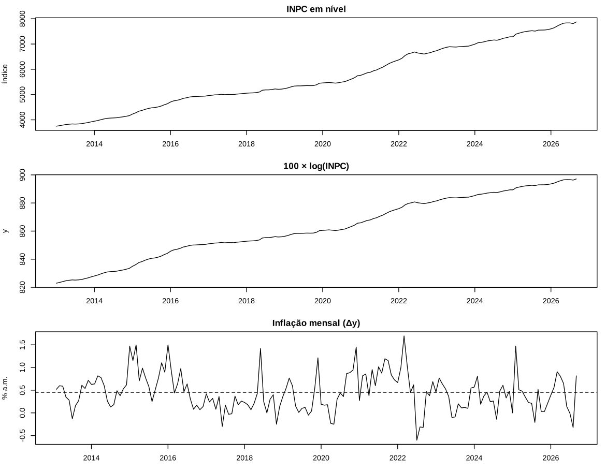
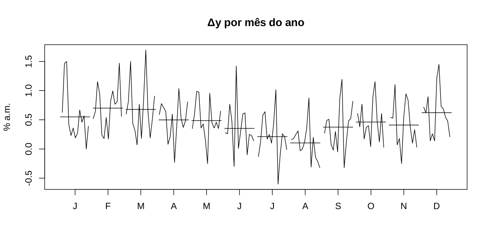
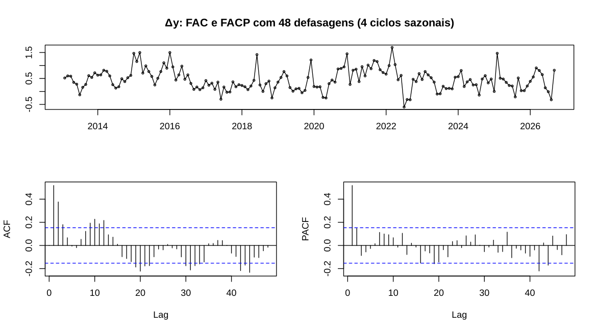
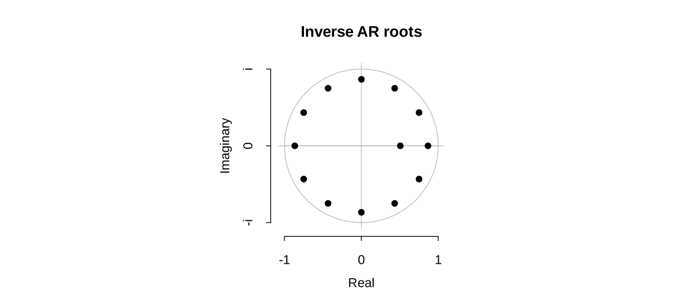
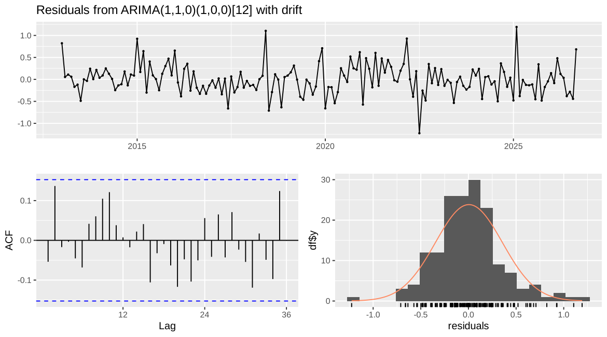
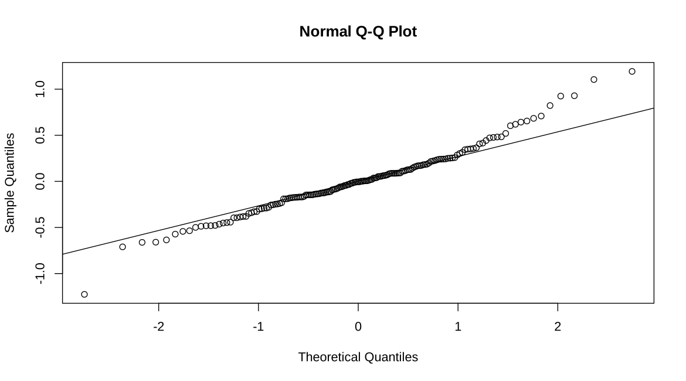
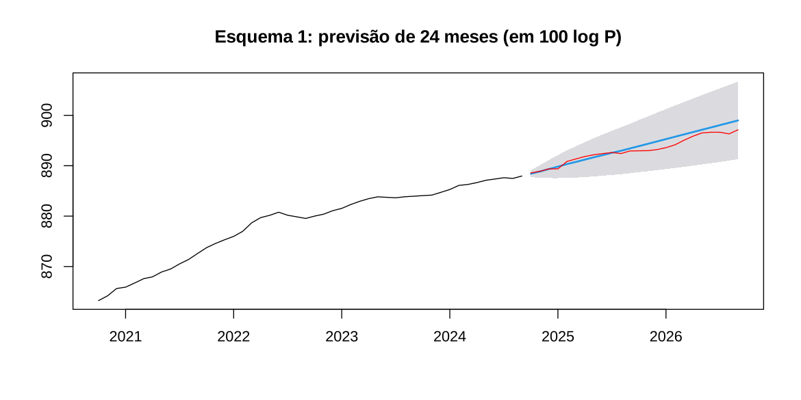

Script único e linear: lê a base, roda a bateria de testes e responde a
lista, questão por questão. Rode bloco a bloco no RStudio. Para virar
PDF e nota do Obsidian, use `Rscript lista01/renderizar_laboratorio.R`.

**Série.** INPC/IBGE (SIDRA, tabela 1736), índice mensal de jan/2013 a
set/2026 (165 meses). Modela-se $y_t = 100\ln P_t$, de modo que
$\Delta y_t$ é a inflação mensal em %.

**Sinal do MA.** O R escreve o MA como $1 + \theta B$; a lista escreve
$1 - \theta B$.

# Pacotes e dados

``` r
library(forecast)   # Arima, forecast, accuracy, checkresiduals, ndiffs, nsdiffs, BoxCox.lambda
library(tseries)    # jarque.bera.test, kpss.test
library(urca)       # ur.df, ur.pp, ur.kpss (com as regressões auxiliares completas)
library(lmtest)     # coeftest
library(FinTS)      # ArchTest (ARCH-LM)

arq <- if (file.exists("dados/inpc_lista01.csv")) "dados/inpc_lista01.csv" else "lista01/dados/inpc_lista01.csv"
dados <- read.csv(arq)
P  <- ts(dados$indice, start = c(2013, 1), frequency = 12)   # índice em nível
y  <- 100 * log(P)                                            # série modelada
dy <- diff(y)                                                 # inflação mensal (%)
length(y)                                                     # T >= 120
```

    #> [1] 165

``` r
summary(as.numeric(dy))
```

    #>    Min. 1st Qu.  Median    Mean 3rd Qu.    Max. 
    #> -0.6019  0.1774  0.4240  0.4525  0.6727  1.6956

# Questão 1 — Inspeção gráfica e transformação

``` r
par(mfrow = c(3, 1), mar = c(3, 4, 2, 1))
plot(P,  main = "INPC em nível", ylab = "índice", xlab = "")
plot(y,  main = "100 × log(INPC)", ylab = "y", xlab = "")
plot(dy, main = "Inflação mensal (Δy)", ylab = "% a.m.", xlab = ""); abline(h = mean(dy), lty = 2)
```



``` r
par(mfrow = c(1, 1))
```

``` r
monthplot(dy, main = "Δy por mês do ano", ylab = "% a.m.")
```



``` r
c(guerrero = BoxCox.lambda(P, method = "guerrero"),   # lambda de Box-Cox: 0 = log, 1 = nada
  mv = BoxCox.lambda(P, method = "loglik"))
```

    #> guerrero       mv 
    #> 0.740765 0.300000

**Resposta (a).**

-   **Tendência:** forte no nível (o índice dobra em 13 anos). Em log,
    vira quase uma reta.
-   **Inclinação:** a inclinação do log (a inflação) muda: mais alta até
    2016, baixa em 2017–2020, alta no pós-pandemia (2020–2022) e menor
    depois.
-   **Nível:** não há mudança de nível; choques no índice não são
    revertidos.
-   **Sazonalidade:** aparece só em $\Delta y$. Fevereiro, março e
    dezembro são altos, agosto é baixo.
-   **Outliers:** são os picos de $\Delta y$ (jun/2018, jul/2022,
    fev/2025).
-   **Dispersão:** muda pouco com o nível nesta janela. Os dois
    $\lambda$ de Box-Cox discordam: o de máxima verossimilhança (0,3)
    aponta o log, o de Guerrero (0,7) aponta não transformar.

**Transformação:** log. Quem decide é a interpretação: com log,
$\Delta y$ é a taxa de inflação e o drift é uma taxa média, que pode ser
constante. Sem log, o drift seria um aumento em pontos de índice, que
cresce com o nível. \# Questão 2 — Ordem de integração

## (a) ADF, PP e KPSS no nível

Regressão do ADF:
$\Delta y_t = \alpha + \beta t + \gamma y_{t-1} + \sum_i \delta_i\Delta y_{t-i} + e_t$.

-   **ADF e PP:** $H_0$ é raiz unitária ($\gamma = 0$).
-   **KPSS:** $H_0$ é estacionariedade.

As defasagens do ADF são escolhidas por AIC, até 13 (regra de Schwert,
$12(T/100)^{1/4}$).

``` r
adf_ct <- ur.df(y, type = "trend", lags = 13, selectlags = "AIC")
summary(adf_ct)
```

    #> 
    #> ############################################### 
    #> # Augmented Dickey-Fuller Test Unit Root Test # 
    #> ############################################### 
    #> 
    #> Test regression trend 
    #> 
    #> 
    #> Call:
    #> lm(formula = z.diff ~ z.lag.1 + 1 + tt + z.diff.lag)
    #> 
    #> Residuals:
    #>      Min       1Q   Median       3Q      Max 
    #> -0.98423 -0.20477 -0.00534  0.16454  1.21624 
    #> 
    #> Coefficients:
    #>              Estimate Std. Error t value Pr(>|t|)    
    #> (Intercept) 23.733501   9.971220   2.380   0.0186 *  
    #> z.lag.1     -0.028469   0.012080  -2.357   0.0198 *  
    #> tt           0.012115   0.005394   2.246   0.0262 *  
    #> z.diff.lag1  0.429117   0.081802   5.246 5.37e-07 ***
    #> z.diff.lag2  0.171394   0.083175   2.061   0.0411 *  
    #> ---
    #> Signif. codes:  0 '***' 0.001 '**' 0.01 '*' 0.05 '.' 0.1 ' ' 1
    #> 
    #> Residual standard error: 0.3572 on 146 degrees of freedom
    #> Multiple R-squared:  0.3111, Adjusted R-squared:  0.2923 
    #> F-statistic: 16.49 on 4 and 146 DF,  p-value: 3.618e-11
    #> 
    #> 
    #> Value of test-statistic is: -2.3567 7.4491 3.0468 
    #> 
    #> Critical values for test statistics: 
    #>       1pct  5pct 10pct
    #> tau3 -3.99 -3.43 -3.13
    #> phi2  6.22  4.75  4.07
    #> phi3  8.43  6.49  5.47

``` r
summary(ur.pp(y, type = "Z-tau", model = "trend", lags = "long"))
```

    #> 
    #> ################################## 
    #> # Phillips-Perron Unit Root Test # 
    #> ################################## 
    #> 
    #> Test regression with intercept and trend 
    #> 
    #> 
    #> Call:
    #> lm(formula = y ~ y.l1 + trend)
    #> 
    #> Residuals:
    #>      Min       1Q   Median       3Q      Max 
    #> -0.95987 -0.28227 -0.02666  0.25634  1.30575 
    #> 
    #> Coefficients:
    #>              Estimate Std. Error t value Pr(>|t|)    
    #> (Intercept) 12.503940  11.114130   1.125    0.262    
    #> y.l1         0.986017   0.012896  76.458   <2e-16 ***
    #> trend        0.005318   0.005863   0.907    0.366    
    #> ---
    #> Signif. codes:  0 '***' 0.001 '**' 0.01 '*' 0.05 '.' 0.1 ' ' 1
    #> 
    #> Residual standard error: 0.4109 on 161 degrees of freedom
    #> Multiple R-squared:  0.9996, Adjusted R-squared:  0.9996 
    #> F-statistic: 2.239e+05 on 2 and 161 DF,  p-value: < 2.2e-16
    #> 
    #> 
    #> Value of test-statistic, type: Z-tau  is: -1.963 
    #> 
    #>            aux. Z statistics
    #> Z-tau-mu             -0.7713
    #> Z-tau-beta            2.4426
    #> 
    #> Critical values for Z statistics: 
    #>                      1pct      5pct     10pct
    #> critical values -4.016497 -3.437891 -3.142926

``` r
summary(ur.kpss(y, type = "tau", lags = "long"))
```

    #> 
    #> ####################### 
    #> # KPSS Unit Root Test # 
    #> ####################### 
    #> 
    #> Test is of type: tau with 13 lags. 
    #> 
    #> Value of test-statistic is: 0.0822 
    #> 
    #> Critical value for a significance level of: 
    #>                 10pct  5pct 2.5pct  1pct
    #> critical values 0.119 0.146  0.176 0.216

## (b) Constante e tendência

A série sobe por 13 anos. Sob a alternativa ela só pode ser estacionária
**em torno de uma tendência**, então o teste começa com constante e
tendência. Depois segue o procedimento sequencial: se o $\phi_3$ (que
testa $\beta = \gamma = 0$) não rejeita, a tendência sai, e passa-se ao
modelo só com constante:

``` r
summary(ur.df(y, type = "drift", lags = 13, selectlags = "AIC"))@teststat   # tau2, phi1
```

    #>                tau2     phi1
    #> statistic -1.010274 8.419613

``` r
summary(ur.df(y, type = "none",  lags = 13, selectlags = "AIC"))@teststat   # tau1
```

    #>               tau1
    #> statistic 3.935044

**Resposta.** O caminho do procedimento sequencial:

-   **Com tendência:** $\tau_3$ não rejeita a raiz unitária, e o
    $\phi_3$ não rejeita $\beta = \gamma = 0$: a tendência é
    dispensável.
-   **Só com constante:** $\tau_2$ não rejeita, mas o $\phi_1$ rejeita
    $\alpha = \gamma = 0$. Como $\gamma = 0$ ficou, quem é diferente de
    zero é a constante: passeio com **drift**.
-   **Sem determinísticos:** $\tau_1$ é positivo, o sintoma de ter
    omitido o drift.

## (c) Série diferenciada e diferença sazonal

``` r
summary(ur.df(dy, type = "drift", lags = 13, selectlags = "AIC"))@teststat
```

    #>                tau2     phi1
    #> statistic -5.159213 13.31178

``` r
kpss.test(dy)                          # H0: estacionária
```

    #> 
    #>  KPSS Test for Level Stationarity
    #> 
    #> data:  dy
    #> KPSS Level = 0.16442, Truncation lag parameter = 4, p-value = 0.1

``` r
ndiffs(y)                              # d sugerido (KPSS sequencial)
```

    #> [1] 1

``` r
nsdiffs(y, test = "ocsb")              # D sugerido pelo OCSB (H0: precisa de 1 - B^12)
```

    #> [1] 0

**Resposta.** Em $\Delta y$, o ADF rejeita com folga e o KPSS não
rejeita: **$d = 1$**. O teste OCSB não pede diferença sazonal:
**$D = 0$**, e a sazonalidade é determinística.

## (d) DS ou TS?

No nível, ADF e PP não rejeitam a raiz unitária, e o KPSS também não
rejeita a estacionariedade: os dados são pouco informativos. **Adota-se
DS ($d = 1$).** As razões:

1.  Todos os testes de raiz unitária apontam DS, e o procedimento
    sequencial termina em passeio com drift.
2.  O KPSS tem pouco poder em amostra curta.
3.  Sob metas de inflação, o nível de preços não volta a uma trajetória
    fixa.
4.  A Q5 mostra que $\Delta y$ não tem MA unitário, que seria o sinal de
    diferenciação em excesso. \# Questão 3 — FAC, FACP e candidatos

``` r
tsdisplay(dy, lag.max = 48, main = "Δy: FAC e FACP com 48 defasagens (4 ciclos sazonais)")
```



``` r
round(cbind(FAC = acf(dy, 13, plot = FALSE)$acf[-1], FACP = pacf(dy, 13, plot = FALSE)$acf), 3)
```

    #>          FAC   FACP
    #>  [1,]  0.518  0.518
    #>  [2,]  0.376  0.147
    #>  [3,]  0.180 -0.087
    #>  [4,]  0.067 -0.056
    #>  [5,] -0.006 -0.027
    #>  [6,] -0.019  0.015
    #>  [7,]  0.053  0.113
    #>  [8,]  0.122  0.099
    #>  [9,]  0.193  0.093
    #> [10,]  0.227  0.067
    #> [11,]  0.187 -0.015
    #> [12,]  0.216  0.105
    #> [13,]  0.092 -0.078

**Resposta (b).**

-   **Parte regular:** a FACP tem um pico claro em 1, e o valor em 2
    fica no limite da banda ($\pm 0{,}15$). A FAC decai: AR(1), com o
    AR(2) como alternativa.
-   **Defasagem sazonal:** há um pico em 12 na FAC (dentro da banda na
    FACP). Ele cabe tanto num SAR(1) (decaimento em 12, 24, …) quanto
    num SMA(1) (corte em 12).

**(c) Candidatos**, todos com $d = 1$, $D = 0$ e drift (a inflação
média):

-   **C1:** SARIMA(1,1,0)(1,0,0)$_{12}$;
-   **C2:** SARIMA(1,1,0)(0,0,1)$_{12}$;
-   **C3:** SARIMA(2,1,0)(1,0,0)$_{12}$. \# Questão 4 — Estimação e
    seleção

``` r
C1 <- Arima(y, order = c(1, 1, 0), seasonal = c(1, 0, 0), include.drift = TRUE, method = "ML")
C2 <- Arima(y, order = c(1, 1, 0), seasonal = c(0, 0, 1), include.drift = TRUE, method = "ML")
C3 <- Arima(y, order = c(2, 1, 0), seasonal = c(1, 0, 0), include.drift = TRUE, method = "ML")
coeftest(C1); coeftest(C2); coeftest(C3)
```

    #> 
    #> z test of coefficients:
    #> 
    #>       Estimate Std. Error z value  Pr(>|z|)    
    #> ar1   0.506437   0.067211  7.5350 4.883e-14 ***
    #> sar1  0.178301   0.077769  2.2927   0.02186 *  
    #> drift 0.453309   0.065131  6.9600 3.403e-12 ***
    #> ---
    #> Signif. codes:  0 '***' 0.001 '**' 0.01 '*' 0.05 '.' 0.1 ' ' 1

    #> 
    #> z test of coefficients:
    #> 
    #>       Estimate Std. Error z value  Pr(>|z|)    
    #> ar1   0.503540   0.067696  7.4383 1.020e-13 ***
    #> sma1  0.166043   0.074046  2.2424   0.02493 *  
    #> drift 0.453728   0.062445  7.2661 3.701e-13 ***
    #> ---
    #> Signif. codes:  0 '***' 0.001 '**' 0.01 '*' 0.05 '.' 0.1 ' ' 1

    #> 
    #> z test of coefficients:
    #> 
    #>       Estimate Std. Error z value  Pr(>|z|)    
    #> ar1   0.441476   0.078072  5.6547 1.561e-08 ***
    #> ar2   0.125824   0.079049  1.5917   0.11145    
    #> sar1  0.165444   0.078553  2.1061   0.03519 *  
    #> drift 0.452989   0.072444  6.2530 4.027e-10 ***
    #> ---
    #> Signif. codes:  0 '***' 0.001 '**' 0.01 '*' 0.05 '.' 0.1 ' ' 1

``` r
tab <- rbind(C1 = c(C1$nobs, C1$sigma2, C1$loglik, C1$aic, C1$bic),
             C2 = c(C2$nobs, C2$sigma2, C2$loglik, C2$aic, C2$bic),
             C3 = c(C3$nobs, C3$sigma2, C3$loglik, C3$aic, C3$bic))
colnames(tab) <- c("n efetivo", "sigma2", "logLik", "AIC", "BIC")
round(tab, 3)
```

    #>    n efetivo sigma2  logLik     AIC     BIC
    #> C1       164  0.126 -58.809 125.618 138.017
    #> C2       164  0.126 -58.983 125.966 138.366
    #> C3       164  0.125 -57.552 125.104 140.603

**(b)** $n = T - d - sD = 165 - 1 = 164$ nos três modelos.

**(c)** A comparação é **válida**: os três modelos têm a mesma variável,
o mesmo $d$ e o mesmo $D$, logo a mesma amostra efetiva. Com $d$
diferente, a verossimilhança seria de outra série, e o AIC deixaria de
ser comparável.

**(d)** O R conta $\widehat\sigma^2$ em $k$, como mostra a conta à mão:

``` r
k <- length(coef(C1)) + 1                    # coeficientes + sigma2
c(AIC_manual = -2 * C1$loglik + 2 * k, AIC_R = C1$aic)
```

    #> AIC_manual      AIC_R 
    #>   125.6178   125.6178

**(e)** O AIC escolhe **C3** e o BIC escolhe **C1**: o BIC pune mais
cada parâmetro ($\ln n \approx 5{,}1$ contra 2).

-   O BIC é **consistente**: escolhe o modelo verdadeiro, se ele estiver
    entre os candidatos, com probabilidade que tende a 1.
-   O AIC é **eficiente** para prever.

O objetivo aqui é prever (Q7), o que favorece o AIC. Mas a vantagem do
C3 é de só 0,5 ponto de AIC, menos que 2, e o $\phi_2$ não é
significativo. O teste LR confirma:

``` r
LR <- 2 * (C3$loglik - C1$loglik)
c(LR = LR, p = pchisq(LR, 1, lower.tail = FALSE))
```

    #>        LR         p 
    #> 2.5138971 0.1128466

Fica o **C1**, o mais parcimonioso. A regra (AIC, salvo diferença menor
que 2) foi fixada antes de olhar a validação.

**(f)** Raízes inversas dentro do círculo unitário: o modelo é
estacionário.

``` r
plot(C1)
```



A raiz inversa regular é $\widehat\phi \approx 0{,}51$. As 12 sazonais
têm módulo $\widehat\Phi^{1/12} \approx 0{,}87$: um $\widehat\Phi$
pequeno vira raízes inversas de módulo alto, mas ainda dentro do
círculo. \# Questão 5 — Diagnóstico

**(a)** O painel abaixo mostra os resíduos no tempo, a FAC e o
histograma. O `checkresiduals` já roda o Ljung-Box com os graus de
liberdade corrigidos. O QQ-plot vem em seguida.

``` r
checkresiduals(C1, lag = 24)
```



    #> 
    #>  Ljung-Box test
    #> 
    #> data:  Residuals from ARIMA(1,1,0)(1,0,0)[12] with drift
    #> Q* = 20.318, df = 22, p-value = 0.5632
    #> 
    #> Model df: 2.   Total lags used: 24

``` r
qqnorm(residuals(C1)); qqline(residuals(C1))
```



**(b) e (c)** Os testes. No Ljung-Box,
$\nu = K - (p + q + P + Q) = 24 - 2 = 22$.

``` r
Box.test(residuals(C1), lag = 24, type = "Ljung-Box", fitdf = 2)
```

    #> 
    #>  Box-Ljung test
    #> 
    #> data:  residuals(C1)
    #> X-squared = 20.318, df = 22, p-value = 0.5632

``` r
jarque.bera.test(residuals(C1))
```

    #> 
    #>  Jarque Bera Test
    #> 
    #> data:  residuals(C1)
    #> X-squared = 18.121, df = 2, p-value = 0.0001162

``` r
ArchTest(residuals(C1), lags = 12)
```

    #> 
    #>  ARCH LM-test; Null hypothesis: no ARCH effects
    #> 
    #> data:  residuals(C1)
    #> Chi-squared = 5.9531, df = 12, p-value = 0.9184

**Resposta.**

-   **Ljung-Box:** não rejeita; os resíduos são ruído branco.
-   **ARCH-LM:** não rejeita; não há heterocedasticidade condicional.
-   **Jarque-Bera:** **rejeita** a normalidade, por caudas pesadas.

**(d)** O diagnóstico de autocorrelação não falhou. A não normalidade
vem de choques pontuais (greve dos caminhoneiros em 2018, corte de
tributos em 2022, bônus de Itaipu em 2025). Ela afeta os intervalos de
previsão, mas não a consistência do estimador. Modelos sem o AR(1) foram
descartados, porque deixam autocorrelação nos resíduos (Ljung-Box
rejeita).

**(e) Sobreajuste:** um AR e um MA a mais.

``` r
coeftest(Arima(y, order = c(2, 1, 0), seasonal = c(1, 0, 0), include.drift = TRUE, method = "ML"))["ar2", ]
```

    #>   Estimate Std. Error    z value   Pr(>|z|) 
    #> 0.12582411 0.07904902 1.59172253 0.11144706

``` r
coeftest(Arima(y, order = c(1, 1, 1), seasonal = c(1, 0, 0), include.drift = TRUE, method = "ML"))["ma1", ]
```

    #>   Estimate Std. Error    z value   Pr(>|z|) 
    #> -0.1732418  0.1258123 -1.3769865  0.1685164

**Resposta.** Nenhum dos coeficientes extras é significativo, então a
especificação está adequada. O MA extra fica longe de $-1$, o que
confirma que $\Delta y$ não foi sobrediferenciada. \# Questão 6 —
Sobrediferenciação ($d^* + 1 = 2$)

``` r
D2  <- Arima(y, order = c(1, 2, 0), seasonal = c(1, 0, 0), method = "ML")   # mesmas ordens
D2m <- Arima(y, order = c(1, 2, 1), seasonal = c(1, 0, 0), method = "ML")   # com um MA a mais
coeftest(D2m)
```

    #> 
    #> z test of coefficients:
    #> 
    #>       Estimate Std. Error  z value  Pr(>|z|)    
    #> ar1   0.515253   0.068065   7.5700 3.733e-14 ***
    #> ma1  -1.000000   0.022023 -45.4079 < 2.2e-16 ***
    #> sar1  0.184267   0.078266   2.3544   0.01855 *  
    #> ---
    #> Signif. codes:  0 '***' 0.001 '**' 0.01 '*' 0.05 '.' 0.1 ' ' 1

``` r
abs(polyroot(c(1, coef(D2m)["ma1"])))                  # raiz do MA
```

    #> [1] 1

``` r
c(sigma2_d1 = C1$sigma2, sigma2_d2 = D2$sigma2, sigma2_d2_MA = D2m$sigma2)
```

    #>    sigma2_d1    sigma2_d2 sigma2_d2_MA 
    #>    0.1258763    0.1508776    0.1308745

``` r
c(rho1_d1 = acf(residuals(C1), plot = FALSE)$acf[2], rho1_d2 = acf(residuals(D2), plot = FALSE)$acf[2],
  rho1_serie_d2 = acf(diff(dy), plot = FALSE)$acf[2])
```

    #>       rho1_d1       rho1_d2 rho1_serie_d2 
    #>   -0.05386913   -0.04942052   -0.33881841

**Resposta.**

-   **(a)** $\widehat\theta \approx -1$ (na convenção da lista,
    $\theta = 1$). A raiz do MA é 1, **sobre o círculo unitário**: o
    modelo fica não invertível.
-   **(b)** $\widehat\sigma^2$ aumenta com a diferença extra, cerca de
    20% sem o MA.
-   **(c)** A série $\Delta^2 y$ tem $\rho_1$ negativo, perto de
    $-(1-\phi)/2$. No modelo, o AR troca de sinal para absorver esse
    $\rho_1$.
-   **(d)** Os sinais práticos de sobrediferenciação: MA perto de $-1$,
    AR que troca de sinal, $\rho_1 \approx -0{,}5$ e $\sigma^2$ que
    sobe. \# Questão 7 — Previsão fora da amostra

O treino vai até $T_0 = T - 24$, e os 24 meses finais são a validação.
As métricas são calculadas no índice $P = e^{y/100}$.

``` r
T0 <- length(y) - 24
y_treino <- window(y, end = time(y)[T0])
P_treino <- window(P, end = time(P)[T0])
P_teste  <- window(P, start = time(P)[T0 + 1])
fit <- Arima(y_treino, order = c(1, 1, 0), seasonal = c(1, 0, 0), include.drift = TRUE, method = "ML")   # C1

# Esquema 1: origem fixa, h = 1..24, com IC de 95%
prev1 <- forecast(fit, h = 24, level = 95)
plot(prev1, include = 48, main = "Esquema 1: previsão de 24 meses (em 100 log P)")
lines(window(y, start = time(y)[T0 + 1]), col = "red")
```



``` r
# Esquema 2: um passo à frente, SEM reestimar (mesmos coeficientes do treino)
prev2 <- window(fitted(Arima(y, model = fit)), start = time(y)[T0 + 1])

# Benchmarks no índice: passeio aleatório e sazonal ingênuo
rw1 <- naive(P_treino, h = 24)$mean                                            # origem fixa
sn1 <- snaive(P_treino, h = 24)$mean
rw2 <- window(stats::lag(P, -1), start = start(P_teste), end = end(P_teste))    # um passo: P_{t-1}
sn2 <- window(stats::lag(P, -12), start = start(P_teste), end = end(P_teste))   # um passo: P_{t-12}

metricas <- c("RMSE", "MAE", "MAPE")
rbind("SARIMA, esquema 1"            = accuracy(exp(prev1$mean / 100), P_teste)[, metricas],
      "SARIMA, esquema 2"            = accuracy(exp(prev2 / 100), P_teste)[, metricas],
      "Passeio aleatório, esquema 1" = accuracy(rw1, P_teste)[, metricas],
      "Passeio aleatório, esquema 2" = accuracy(rw2, P_teste)[, metricas],
      "Sazonal ingênuo, esquema 1"   = accuracy(sn1, P_teste)[, metricas],
      "Sazonal ingênuo, esquema 2"   = accuracy(sn2, P_teste)[, metricas])
```

    #>                                   RMSE       MAE      MAPE
    #> SARIMA, esquema 1             81.54227  65.94999 0.8611550
    #> SARIMA, esquema 2             30.69034  22.38202 0.2957467
    #> Passeio aleatório, esquema 1 425.13541 379.63083 4.9583361
    #> Passeio aleatório, esquema 2  40.88458  32.23250 0.4259191
    #> Sazonal ingênuo, esquema 1   525.33598 501.93250 6.5949984
    #> Sazonal ingênuo, esquema 2   328.65202 326.97292 4.3288906

``` r
# (g) cobertura do IC de 95% do esquema 1
mean(P_teste >= exp(prev1$lower / 100) & P_teste <= exp(prev1$upper / 100))
```

    #> [1] 1

**Resposta.**

-   **(f)** O SARIMA supera o passeio aleatório e o sazonal ingênuo nos
    dois esquemas e nas três métricas. O sazonal ingênuo vai muito mal
    porque, no índice, ele repete o nível de 12 meses antes, sem a
    inflação do ano. O modelo não foi alterado em função desses
    resultados.
-   **(g)** Todas as 24 observações caíram dentro do IC de 95% do
    esquema 1: a cobertura empírica (100%) é maior que a nominal. O
    intervalo de um modelo integrado se abre com $h$, e os 24 erros de
    uma única origem são correlacionados entre si.

**Versões do software** (exigidas na entrega):

``` r
sessionInfo()
```

    #> R version 4.3.3 (2024-02-29)
    #> Platform: x86_64-pc-linux-gnu (64-bit)
    #> Running under: Ubuntu 24.04.5 LTS
    #> 
    #> Matrix products: default
    #> BLAS:   /usr/lib/x86_64-linux-gnu/blas/libblas.so.3.12.0 
    #> LAPACK: /usr/lib/x86_64-linux-gnu/lapack/liblapack.so.3.12.0
    #> 
    #> locale:
    #>  [1] LC_CTYPE=C.UTF-8       LC_NUMERIC=C           LC_TIME=C.UTF-8       
    #>  [4] LC_COLLATE=C.UTF-8     LC_MONETARY=C.UTF-8    LC_MESSAGES=C.UTF-8   
    #>  [7] LC_PAPER=C.UTF-8       LC_NAME=C              LC_ADDRESS=C          
    #> [10] LC_TELEPHONE=C         LC_MEASUREMENT=C.UTF-8 LC_IDENTIFICATION=C   
    #> 
    #> time zone: Etc/UTC
    #> tzcode source: system (glibc)
    #> 
    #> attached base packages:
    #> [1] stats     graphics  grDevices utils     datasets  methods   base     
    #> 
    #> other attached packages:
    #> [1] FinTS_0.4-9     lmtest_0.9-40   zoo_1.8-12      urca_1.3-3     
    #> [5] tseries_0.10-55 forecast_8.21.1
    #> 
    #> loaded via a namespace (and not attached):
    #>  [1] gtable_0.3.4      highr_0.10        dplyr_1.1.4       compiler_4.3.3   
    #>  [5] tinytex_0.49      tidyselect_1.2.0  Rcpp_1.0.12       parallel_4.3.3   
    #>  [9] scales_1.3.0      yaml_2.3.8        fastmap_1.1.1     lattice_0.22-5   
    #> [13] ggplot2_3.4.4     R6_2.5.1          labeling_0.4.3    generics_0.1.3   
    #> [17] curl_5.2.0        knitr_1.45        tibble_3.2.1      munsell_0.5.0    
    #> [21] nnet_7.3-19       timeDate_4032.109 pillar_1.9.0      rlang_1.1.3      
    #> [25] quantmod_0.4.26   utf8_1.2.4        xfun_0.41         quadprog_1.5-8   
    #> [29] cli_3.6.2         withr_2.5.0       magrittr_2.0.3    xts_0.13.2       
    #> [33] digest_0.6.34     grid_4.3.3        nlme_3.1-164      lifecycle_1.0.4  
    #> [37] fracdiff_1.5-3    vctrs_0.6.5       evaluate_0.23     glue_1.7.0       
    #> [41] farver_2.1.1      fansi_1.0.5       colorspace_2.1-0  TTR_0.24.4       
    #> [45] rmarkdown_2.25    tools_4.3.3       pkgconfig_2.0.3   htmltools_0.5.7
