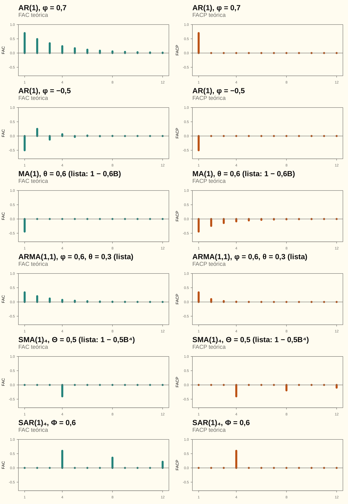

# O que cai na P1: o quadro de 04/11, linha a linha

Na aula de quarta, o professor anunciou o formato e listou os tópicos no quadro. Esta folha organiza o quadro em **quatro questões prováveis** e destrincha, **à força bruta**, cada processo que o quadro pede e que o guia ainda não cobria: cada produto aberto, cada esperança calculada, cada comparação com o crítico escrita.

**Como usar.** Cada processo vem como exercício. Leia o enunciado e o "Antes de escrever", **cubra a partir de "Linha a linha" e tente no papel**. Depois confira linha a linha; na primeira linha diferente, leia o sentido dela. As respostas só aparecem no fim da conta, nunca antes.

> [!IMPORTANT]
> **O que foi anunciado**
> - **4 questões de 2,5 pontos.**
> - AIC e BIC caem para **interpretar**, não necessariamente para calcular. RMSE e MAPE entram junto.
> - Cai uma questão de **previsão**.
> - **Yule-Walker foi riscado: não cai.** A questão-tipo 5 do guia fica com prioridade zero.
>
> **Anotado também em aula:** usar BIC, RMSE e MAPE; **identificar a ordem pela FAC** (seção 8); e o **teste de raiz unitária de Dickey-Fuller**, com a cadeia de decisão que começa pelo modelo 3 (seção 9).

## 1. As quatro questões prováveis

| Questão provável | O que o quadro pede | Onde treinar |
|---|---|---|
| A. Processos | passeio aleatório; $z_3=z_1+2z_2$ (circulado no quadro); $E$, $V$, $\operatorname{Cov}$; estacionário? | questões-tipo 1 e 2 do [guia](nao_posso_errar.md) |
| B. ARMA | estacionário pelas raízes de $(1-\phi B)$; **montar a FAC**, com conta e desenho; FAC e FACP | seções 2 e 3; questões-tipo 3 e 4 |
| C. SARIMA | o SMA(1) sazonal desenhado; a equação de previsão; o $d$ pelo Dickey-Fuller | seções 4, 5 e 9; questão-tipo 9 |
| D. Ciclo e análise | o ciclo de modelagem; identificar a ordem; interpretar AIC, BIC, RMSE e MAPE; previsão | seções 6, 7 e 8; questão-tipo 8 |

O treino no formato anunciado é o [Simulado 05](simulado_05.md): 4 questões de 2,5, em 1 hora.

## 2. AR(1): estacionário e a FAC montada à mão

**Enunciado.** Seja $(1-0{,}7B)y_t=u_t$, com $u_t\sim RB(0,1)$. Verifique se é estacionário, calcule $\gamma_0,\gamma_1,\gamma_2,\gamma_3$ e $\rho_1,\rho_2,\rho_3$, e desenhe a FAC e a FACP.

### Antes de escrever

Três fatos e nada mais:
- a **causalidade**, $E(u_ty_{t-k})=0$ para $k\ge1$;
- o **ruído branco**, $E(u_t^2)=1$;
- a **estacionariedade**, $E(y_{t-1}y_{t-1})=\gamma_0$ e $E(y_ty_{t-1})=E(y_{t-1}y_{t-2})=\gamma_1$.

O molde é o dos quatro movimentos do guia, com um auxiliar só.

### Linha a linha

$$
\begin{aligned}
\text{(1)}\quad & y_t-0{,}7y_{t-1}=u_t\ \Rightarrow\ y_t=0{,}7y_{t-1}+u_t && [B\,y_t=y_{t-1};\ \text{isola}]\\
\text{(2)}\quad & \phi(x)=1-0{,}7x=0\ \Rightarrow\ x=1/0{,}7=1{,}4286 && [x \text{ é um número}]\\
\text{(3)}\quad & \lvert1{,}4286\rvert\gt1\ \Rightarrow\ \text{estacionário} && [\text{fora do círculo}]\\
\text{(4)}\quad & E(y_t)=0{,}7E(y_{t-1})+E(u_t)\Rightarrow\mu=0{,}7\mu\Rightarrow\mu=0 && [\text{F4; estac.; RB}]\\
\text{(5)}\quad & E(u_ty_t)=0{,}7E(u_ty_{t-1})+E(u_t^2)=0{,}7\cdot0+1=1 && [(1)\times u_t;\ \text{caus.; RB}]\\
\text{(6)}\quad & \gamma_0=E(y_ty_t)=0{,}7E(y_{t-1}y_t)+E(u_ty_t)=0{,}7\gamma_1+1 && [(1)\times y_t;\ \text{estac.};\ (5)]\\
\text{(7)}\quad & \gamma_1=E(y_ty_{t-1})=0{,}7E(y_{t-1}^2)+E(u_ty_{t-1})=0{,}7\gamma_0+0 && [(1)\times y_{t-1};\ \text{caus.}]\\
\text{(8)}\quad & \gamma_0=0{,}7(0{,}7\gamma_0)+1=0{,}49\gamma_0+1 && [(7)\text{ em }(6)]\\
\text{(9)}\quad & \gamma_0(1-0{,}49)=1\ \Rightarrow\ \gamma_0=1/0{,}51=1{,}9608 && [\text{isola}]\\
\text{(10)}\quad & \gamma_1=0{,}7\cdot1{,}9608=1{,}3725 && [(7)]\\
\text{(11)}\quad & \gamma_2=E(y_ty_{t-2})=0{,}7E(y_{t-1}y_{t-2})+E(u_ty_{t-2})=0{,}7\gamma_1=0{,}9608 && [(1)\times y_{t-2};\ \text{caus.}]\\
\text{(12)}\quad & \gamma_3=0{,}7\gamma_2=0{,}6725 && [\text{idem, }\times y_{t-3}]\\
\text{(13)}\quad & \rho_1=\tfrac{1{,}3725}{1{,}9608}=0{,}7;\ \ \rho_2=\tfrac{0{,}9608}{1{,}9608}=0{,}49;\ \ \rho_3=0{,}343 && [\div\gamma_0]\\
\text{(14)}\quad & \rho_k=0{,}7^k:\ \text{positivas, cada uma } 70\% \text{ da anterior} && [\text{padrão da FAC}]\\
\text{(15)}\quad & \phi_{11}=\rho_1=0{,}7;\ \ \phi_{kk}=0 \text{ para } k\ge2 && [\text{FACP do AR(1)}]
\end{aligned}
$$

### O sentido de cada linha

- **(1)** O operador $B$ só atrasa: $(1-0{,}7B)y_t$ é $y_t-0{,}7y_{t-1}$. Isolo $y_t$ porque é essa equação que vou multiplicar e tirar a esperança.
- **(2)** A raiz é de um número $x$, não da série. É a linha que o Simulado 01 errou.
- **(3)** Raiz fora do círculo: os choques antigos perdem peso, e a variância é finita.
- **(4)** A média: com estacionariedade, $E(y_t)=E(y_{t-1})=\mu$. Sobra $\mu=0{,}7\mu$, e o único número que satisfaz isso é zero.
- **(5)** O auxiliar: quanto do choque de hoje está em $y_t$. O termo com $y_{t-1}$ zera pela causalidade, porque o passado não conhece o choque de hoje.
- **(6)** Multiplico por $y_t$ **porque $\gamma_0=E(y_t^2)$**. Cada termo vira um momento conhecido: $\gamma_1$ pela estacionariedade e 1 por (5).
- **(7)** Multiplico por $y_{t-1}$ porque quero $\gamma_1$. O choque $u_t$ é posterior a $y_{t-1}$ e some.
- **(8)–(9)** Duas equações e duas incógnitas: substituo e isolo. O 0,51 é $1-\phi^2$; a fórmula $\sigma^2/(1-\phi^2)$ sai da conta, não da memória.
- **(10)** Volto em (7) com o $\gamma_0$.
- **(11)** Para $\gamma_2$, multiplico por $y_{t-2}$. De novo o choque some, e sobra $0{,}7$ vezes a defasagem anterior.
- **(12)** O mesmo vale para toda defasagem: $\gamma_k=0{,}7\gamma_{k-1}$.
- **(13)** Divido por $\gamma_0$. São os números que vão **ao lado** das barras do desenho.
- **(14)** O padrão em palavras: decai geometricamente, sem trocar de sinal porque $\phi\gt0$. Com $\phi\lt0$, alternaria.
- **(15)** A FACP mede o que $y_{t-k}$ acrescenta **depois** de $y_{t-1}$. Num AR(1), nada: corta em 1.

**O desenho**, em quatro passos:
1. Eixo horizontal com $k=1,2,3,\dots$; eixo vertical de $-1$ a 1, com a linha do zero.
2. Barras na altura de cada $\rho_k$: 0,7; 0,49; 0,343; …
3. Os números escritos nas três primeiras barras.
4. O padrão em uma frase.

Na FACP, uma barra só, de 0,7, em $k=1$. Numa FAC **amostral**, desenhe também as bandas $\pm2/\sqrt T$.

**Frase de fecho:** "A raiz é 1,43, fora do círculo: o AR(1) é estacionário. $\gamma_0=1{,}9608$ e $\rho_k=0{,}7^k$ (0,7; 0,49; 0,343): **a FAC decai geometricamente e a FACP corta em 1**, a assinatura de um AR(1)."

O ARMA(1,1), com os dois auxiliares, está linha a linha na questão-tipo 4 do [guia](nao_posso_errar.md). Lá, $\rho_1=0{,}337$, e depois $\rho_2=0{,}2022$ e $\rho_3=0{,}1213$.

## 3. A tabela de consulta: reconhecer pela FAC e pela FACP

| Modelo | FAC | FACP |
|---|---|---|
| AR($p$) | decai (geométrica; alterna se $\phi\lt0$) | **corta** depois de $p$ |
| MA($q$) | **corta** depois de $q$ | decai |
| ARMA($p,q$) | decai | decai |
| passeio (raiz unitária) | decai **muito devagar**, quase em linha reta | um pico perto de 1 em $k=1$ |
| SMA(1)$_s$ | **um pico só, em $s$** | picos em $s,2s,3s$, **decaindo** |
| SAR(1)$_s$ | picos em $s,2s,3s$, **decaindo** | **um pico só, em $s$** |
| multiplicativo $(0,1,1)(0,1,1)_s$ | picos em 1 e $s$, com satélites em $s\pm1$ | decai perto de 1 e de $s$ |

A regra de bolso: **AR corta na FACP; MA corta na FAC**. No sazonal, vale a mesma regra nas defasagens $s,2s,\dots$.

## 4. O SMA(1)$_4$ do quadro, à força bruta

**Enunciado.** Seja a série trimestral $y_t=(1-0{,}5B^4)a_t$, com $a_t\sim RB(0,1)$. Calcule $\gamma_k$ para $k=0,\dots,8$, a FAC, e a FACP nas defasagens 4, 8 e 12. Desenhe as duas.

### Antes de escrever

A força bruta é esta: para cada $k$, abrir o produto em **quatro termos** e perguntar, em cada um, **se as duas datas coincidem**. Pelo ruído branco, $E(a_ra_s)=1$ se $r=s$ e 0 se $r\ne s$. Não há nada a decorar.

### Linha a linha

$$
\begin{aligned}
\text{(1)}\quad & y_t=a_t-0{,}5a_{t-4} && [B^4a_t=a_{t-4}]\\
\text{(2)}\quad & \gamma_k=E\big((a_t-0{,}5a_{t-4})(a_{t-k}-0{,}5a_{t-4-k})\big) && [\text{definição; média zero}]\\
\text{(3)}\quad & \phantom{\gamma_k}=E(a_ta_{t-k})-0{,}5E(a_ta_{t-4-k})-0{,}5E(a_{t-4}a_{t-k})+0{,}25E(a_{t-4}a_{t-4-k}) && [\text{4 produtos}]\\
\text{(4)}\quad & k=0:\ 1-0-0+0{,}25=1{,}25 && [\text{1º e 4º casam}]\\
\text{(5)}\quad & k=1,2,3:\ 0-0-0+0=0 && [\text{nada casa}]\\
\text{(6)}\quad & k=4:\ 0-0-0{,}5\cdot1+0=-0{,}5 && [\text{só o 3º casa}]\\
\text{(7)}\quad & k=5,\dots,8:\ 0 && [\text{nada casa}]\\
\text{(8)}\quad & \rho_4=-0{,}5/1{,}25=-0{,}4;\quad \rho_k=0 \text{ para } k\ne4 && [\div\gamma_0]\\
\text{(9)}\quad & \text{na escala de 4, é um MA(1) com } \rho=-0{,}4:\ \phi_{44}=\rho_4=-0{,}4 && [\text{FACP, passo 1}]\\
\text{(10)}\quad & \phi_{88}=\frac{\rho_8-\phi_{44}\rho_4}{1-\phi_{44}\rho_4}=\frac{0-0{,}16}{1-0{,}16}=-0{,}1905 && [\text{D-L}]\\
\text{(11)}\quad & \phi_{8,4}=\phi_{44}-\phi_{88}\phi_{44}=-0{,}4-(-0{,}1905)(-0{,}4)=-0{,}4762 && [\text{atualiza}]\\
\text{(12)}\quad & \phi_{12,12}=\frac{0-0-\phi_{88}\rho_4}{1-\phi_{8,4}\rho_4-0}=\frac{-0{,}0762}{0{,}8095}=-0{,}0941 && [\text{D-L}]\\
\text{(13)}\quad & \text{confere: } \frac{\rho^3}{1-2\rho^2}=\frac{-0{,}064}{0{,}68}=-0{,}0941 && [\text{fórmula do MA(1)}]\\
\text{(14)}\quad & \text{FACP} = 0 \text{ fora de } 4,8,12,\dots && [\text{só múltiplos de 4}]
\end{aligned}
$$

### O sentido de cada linha

- **(1)** Tiro o operador: o choque de hoje e o de 4 trimestres atrás, este com peso $-0{,}5$.
- **(2)** A definição da autocovariância, escrita com as duas datas, $t$ e $t-k$. Com média zero, não há o que subtrair.
- **(3)** Abro o produto $(A-0{,}5B)(C-0{,}5D)$ em quatro termos. O $0{,}25$ é $(-0{,}5)(-0{,}5)$. Agora cada termo é uma pergunta: as datas coincidem?
- **(4)** Em $k=0$, o 1º termo é $E(a_t^2)=1$ e o 4º é $0{,}25E(a_{t-4}^2)=0{,}25$. Os cruzados ligam datas distantes 4 e zeram. Sai a variância, $1+\Theta^2$.
- **(5)** Em $k=1,2,3$, as datas dos dois lados ficam sempre a uma distância que não é zero. Todos os termos zeram.
- **(6)** Em $k=4$, só o 3º termo casa: $a_{t-4}$ de um lado e $a_{t-k}=a_{t-4}$ do outro. Vale $-0{,}5$: é $-\Theta\sigma^2$.
- **(7)** De 5 em diante, nenhuma data casa. É a memória finita do MA: depois de 4, acabou.
- **(8)** Divido por $\gamma_0$. É o desenho do quadro: **uma barra só, em 4**.
- **(9)** Só as defasagens múltiplas de 4 têm correlação, então, olhando de 4 em 4, a série é um MA(1). A primeira FACP é a própria correlação.
- **(10)** A FACP em 8 pergunta o que $y_{t-8}$ acrescenta depois de $y_{t-4}$. A fórmula de Durbin-Levinson (D-L) desconta a parte já explicada por $\rho_4$. Como $\rho_8=0$, sobra só o desconto.
- **(11)** O coeficiente de $y_{t-4}$ muda quando $y_{t-8}$ entra na regressão. Esse valor alimenta o passo seguinte.
- **(12)** O mesmo para 12: o numerador e o denominador descontam o que 4 e 8 já explicaram. Como $\rho_8=\rho_{12}=0$, dois termos zeram, e sobra $-\phi_{88}\rho_4=-0{,}0762$ em cima e $1-\phi_{8,4}\rho_4=0{,}8095$ embaixo.
- **(13)** Confiro pela fórmula fechada da FACP do MA(1). Na prova, os números de (10)–(12) só são pedidos se o enunciado pedir; o que vale sempre é o **formato**.
- **(14)** Nas defasagens que não são múltiplas de 4, nada se correlaciona, e a FACP é zero.

**Frase de fecho:** "$\gamma_0=1{,}25$, $\gamma_4=-0{,}5$ e zero no resto, logo $\rho_4=-0{,}4$: **a FAC tem um pico só, em 4**. A FACP tem picos em 4, 8 e 12, de $-0{,}4$, $-0{,}1905$ e $-0{,}0941$, **decaindo**: é a assinatura de um SMA(1)$_4$, o MA(1) na escala sazonal."

## 5. A equação de previsão do SARIMA$(0,1,1)(0,1,1)_4$, à força bruta

**Enunciado.** Uma série trimestral segue SARIMA$(0,1,1)(0,1,1)_4$, com $\theta=0{,}3$ e $\Theta=0{,}5$. Escreva $y_t$ em função do passado e as equações de $\widehat y_T(1)$ até $\widehat y_T(6)$. Diga até que horizonte os resíduos aparecem.

### Antes de escrever

Expandir **cada** produto de polinômios termo a termo. Depois, para cada horizonte, escrever o modelo na data futura e aplicar as três regras:
1. o que é conhecido em $T$ fica;
2. o choque futuro vira 0;
3. o $y$ futuro vira a sua previsão.

### Linha a linha

$$
\begin{aligned}
\text{(1)}\quad & (1-B)(1-B^4)=1-B^4-B+B^5 && [\text{distributiva}]\\
\text{(2)}\quad & (1-B)(1-B^4)y_t=y_t-y_{t-1}-y_{t-4}+y_{t-5} && [\text{aplica a } y_t]\\
\text{(3)}\quad & (1-0{,}3B)(1-0{,}5B^4)=1-0{,}3B-0{,}5B^4+0{,}15B^5 && [\text{distributiva}]\\
\text{(4)}\quad & y_t=y_{t-1}+y_{t-4}-y_{t-5}+a_t-0{,}3a_{t-1}-0{,}5a_{t-4}+0{,}15a_{t-5} && [\text{isola}]\\
\text{(5)}\quad & y_{T+1}=y_T+y_{T-3}-y_{T-4}+a_{T+1}-0{,}3a_T-0{,}5a_{T-3}+0{,}15a_{T-4} && [t=T+1]\\
\text{(6)}\quad & \widehat y_T(1)=y_T+y_{T-3}-y_{T-4}-0{,}3\widehat a_T-0{,}5\widehat a_{T-3}+0{,}15\widehat a_{T-4} && [a_{T+1}\to0]\\
\text{(7)}\quad & y_{T+2}=y_{T+1}+y_{T-2}-y_{T-3}+a_{T+2}-0{,}3a_{T+1}-0{,}5a_{T-2}+0{,}15a_{T-3} && [t=T+2]\\
\text{(8)}\quad & \widehat y_T(2)=\widehat y_T(1)+y_{T-2}-y_{T-3}-0{,}5\widehat a_{T-2}+0{,}15\widehat a_{T-3} && [y_{T+1}\to\widehat y(1)]\\
\text{(9)}\quad & \widehat y_T(3)=\widehat y_T(2)+y_{T-1}-y_{T-2}-0{,}5\widehat a_{T-1}+0{,}15\widehat a_{T-2} && [t=T+3]\\
\text{(10)}\quad & \widehat y_T(4)=\widehat y_T(3)+y_T-y_{T-1}-0{,}5\widehat a_T+0{,}15\widehat a_{T-1} && [t=T+4]\\
\text{(11)}\quad & \widehat y_T(5)=\widehat y_T(4)+\widehat y_T(1)-y_T+0{,}15\widehat a_T && [t=T+5]\\
\text{(12)}\quad & \widehat y_T(6)=\widehat y_T(5)+\widehat y_T(2)-\widehat y_T(1) && [t=T+6]\\
\text{(13)}\quad & \text{resíduos até } h=5=s+1 && [\text{maior lag do MA}]
\end{aligned}
$$

### O sentido de cada linha

- **(1)** Os quatro produtos da distributiva. O $+B^5$ vem de $(-B)(-B^4)$.
- **(2)** Aplicar o polinômio é trocar cada $B^j$ por "atrasar $j$". O lado esquerdo é $w_t$, a série duas vezes diferenciada.
- **(3)** O mesmo no MA: $(-0{,}3)(-0{,}5)=+0{,}15$. O termo cruzado $+0{,}15B^5$ **ninguém escolheu**: é imposto pelo produto.
- **(4)** Igualo os dois lados e passo os $y$ do passado para a direita, trocando o sinal. É a equação que se escreve na prova.
- **(5)** Troco $t$ por $T+1$ em **todos** os índices. Só depois decido o que é conhecido.
- **(6)** Em $T$, conheço $y_T$, $y_{T-3}$, $y_{T-4}$ e os resíduos estimados $\widehat a_T$, $\widehat a_{T-3}$, $\widehat a_{T-4}$. Só $a_{T+1}$ é futuro, e vira 0.
- **(7)** Agora $T+2$. Aparecem dois futuros: $y_{T+1}$ e os choques $a_{T+2}$ e $a_{T+1}$.
- **(8)** O $y_{T+1}$ vira a previsão de (6), e os dois choques futuros viram 0. Saem os termos $-0{,}3a_{T+1}$ e $a_{T+2}$.
- **(9)–(10)** A mesma operação. Em cada passo, os resíduos que sobram são os que ainda são **passado**: em $h=4$, sobram $\widehat a_T$ e $\widehat a_{T-1}$.
- **(11)** Em $T+5$, entram $y_{T+4}$ e $y_{T+1}$, que viram previsões, e $y_T$, que é conhecido. Dos choques, só $a_T$ é passado: sobra $+0{,}15\widehat a_T$.
- **(12)** Em $T+6$, o choque mais antigo do modelo é $a_{T+1}$, que é futuro. Não sobra resíduo nenhum: a previsão só recicla previsões.
- **(13)** A regra que se escreve: os resíduos aparecem até a maior defasagem do MA, que é $1+s=5$.

**Frase de fecho:** "Com $w_t=(1-B)(1-B^4)y_t$, $y_t=y_{t-1}+y_{t-4}-y_{t-5}+a_t-0{,}3a_{t-1}-0{,}5a_{t-4}+0{,}15a_{t-5}$. **$\widehat y_T(1)=y_T+y_{T-3}-y_{T-4}-0{,}3\widehat a_T-0{,}5\widehat a_{T-3}+0{,}15\widehat a_{T-4}$**, e os resíduos entram até $h=5$. A variância do erro, $\sigma^2\sum_{j\lt h}\psi_j^2$, cresce com $h$."

O AR(1) com números, com variâncias e intervalos, está na questão-tipo 8 do [guia](nao_posso_errar.md); a variação no [banco, Q12](banco.md#q12--previsão-do-sarima-trimestral).

## 6. O ciclo de modelagem de Box-Jenkins

| Etapa | O que se faz | O que se olha |
|---|---|---|
| 1. Identificação | gráfico da série; diferenciar até ficar estacionária ($d$ e $D$, pelo Dickey-Fuller); propor $p,q,P,Q$ | FAC e FACP (seções 3 e 8) |
| 2. Estimação | estimar os candidatos por MV | coeficientes significativos; **AIC e BIC** para escolher |
| 3. Diagnóstico | checar se os resíduos são ruído branco | FAC dos resíduos dentro das bandas; **Ljung-Box** não rejeita |
| 4. Previsão | prever e avaliar fora da amostra | **RMSE e MAPE**; intervalos |

**Se o diagnóstico falha, volta-se à etapa 1**: é um ciclo, não uma linha reta. Na prova, escreva as quatro etapas, uma frase cada, e a seta de volta. O ciclo completo, com a Q16, está no [cap. 6 da apostila](../apostila/cap6_aplicacao.md).

## 7. Interpretar AIC, BIC, RMSE e MAPE, linha a linha

**Enunciado.** Dois modelos para uma série mensal. AIC e BIC vêm da estimação; RMSE e MAPE, de previsões fora da amostra. Interprete, sem calcular nenhum critério.

| Modelo | AIC | BIC | RMSE | MAPE |
|---|---|---|---|---|
| AR(1) | 512,3 | 519,8 | 0,84 | 3,2% |
| ARMA(2,1) | 509,1 | 524,0 | 0,91 | 3,5% |

### Antes de escrever

- **Menor é melhor nos quatro.**
- AIC e BIC são ajuste $-2\ln L$ mais uma multa por parâmetro: **2** no AIC e **$\ln T$** no BIC.
- RMSE e MAPE medem o erro **fora** da amostra.
- Uma diferença de AIC ou BIC menor que 2 é empate prático.

### Linha a linha

$$
\begin{aligned}
\text{(1)}\quad & AIC:\ 509{,}1\lt512{,}3\ \Rightarrow\ \text{ARMA(2,1)};\quad \Delta=3{,}2 && [\text{menor vence}]\\
\text{(2)}\quad & 3{,}2\gt2\ \Rightarrow\ \text{preferência real, não empate} && [\text{regra do 2}]\\
\text{(3)}\quad & BIC:\ 519{,}8\lt524{,}0\ \Rightarrow\ \text{AR(1)};\quad \Delta=4{,}2 && [\text{menor vence}]\\
\text{(4)}\quad & \text{ganho de ajuste do ARMA(2,1)}=3{,}2+2\cdot2=7{,}2 && [\text{2 parâm. a mais}]\\
\text{(5)}\quad & \text{multa do BIC pelos 2}=7{,}2+4{,}2=11{,}4\Rightarrow\ln T=5{,}7 && [T\approx299]\\
\text{(6)}\quad & RMSE:\ 0{,}84\lt0{,}91\ \Rightarrow\ \text{AR(1)};\ \ \Delta=0{,}07 && [\text{fora}]\\
\text{(7)}\quad & MAPE:\ 3{,}2\%\lt3{,}5\%\ \Rightarrow\ \text{AR(1)};\ \ \Delta=0{,}3 && [\text{fora}]\\
\text{(8)}\quad & \text{placar: BIC, RMSE e MAPE} \to \text{AR(1)};\ \text{AIC} \to \text{ARMA(2,1)} && [3\times1]\\
\text{(9)}\quad & \text{melhor dentro, pior fora}\Rightarrow\text{sobreajuste} && [\text{diagnóstico}]\\
\text{(10)}\quad & \text{escolha: AR(1)} && [\text{parcimônia e previsão}]
\end{aligned}
$$

### O sentido de cada linha

- **(1)** Leio o AIC e digo quem vence e **por quanto**. A diferença é o que permite julgar.
- **(2)** Com mais de 2 pontos, a preferência do AIC é real: não dá para chamar de empate.
- **(3)** O BIC escolhe o outro. Essa discordância é o que a questão quer que se explique.
- **(4)** A explicação, à força bruta: o ARMA(2,1) tem 2 parâmetros a mais. Se o AIC dele é 3,2 menor mesmo pagando $2\times2=4$ de multa, o ajuste melhorou 7,2.
- **(5)** No BIC, ele fica 4,2 pior. Então a multa dos 2 parâmetros foi $7{,}2+4{,}2=11{,}4$, ou seja, $\ln T=5{,}7$ por parâmetro, contra 2 do AIC. É por isso que o BIC recusa: a multa por parâmetro é quase três vezes maior.
- **(6)** O RMSE está na escala da série e pune os erros grandes. O AR(1) erra menos nos dados que **não viu**.
- **(7)** O MAPE, em %, confirma: 3,2% contra 3,5%.
- **(8)** Faço o placar. Três critérios contra um.
- **(9)** O único critério a favor do ARMA(2,1) olha **dentro** da amostra. Ajustar melhor o que já viu e prever pior o que não viu é a definição de sobreajuste.
- **(10)** A decisão, com os dois motivos: o modelo é menor e prevê melhor.

**Frase de fecho:** "O AIC prefere o ARMA(2,1), por 3,2 pontos, mas o BIC prefere o AR(1), por 4,2: o ganho de ajuste de 7,2 não paga os dois parâmetros extras quando a multa é $\ln T\approx5{,}7$ por parâmetro. Fora da amostra, o AR(1) tem RMSE e MAPE menores, o que mostra que o ganho do ARMA(2,1) era sobreajuste. **Escolho o AR(1)**: mais parcimonioso, preferido pelo BIC e melhor na previsão."

## 8. Identificar a ordem pela FAC e pela FACP amostrais, linha a linha

**Enunciado.** Com $T=100$, a FAC e a FACP amostrais de uma série estacionária foram:

| $k$ | 1 | 2 | 3 | 4 | 5 |
|---|---|---|---|---|---|
| FAC | 0,48 | 0,25 | 0,07 | $-0{,}05$ | 0,03 |
| FACP | 0,48 | $-0{,}26$ | 0,15 | $-0{,}09$ | 0,04 |

Identifique o modelo e a ordem.

### Antes de escrever

A banda é $\pm2/\sqrt T$. Cada barra é comparada com ela, uma por uma. A ordem é a **última defasagem fora da banda antes do corte**.

### Linha a linha

$$
\begin{aligned}
\text{(1)}\quad & \text{banda}=2/\sqrt{100}=0{,}2 && [\pm2/\sqrt T]\\
\text{(2)}\quad & \text{FAC: } \lvert0{,}48\rvert\gt0{,}2;\ \lvert0{,}25\rvert\gt0{,}2 && [k=1,2 \text{ fora da banda}]\\
\text{(3)}\quad & \text{FAC: } \lvert0{,}07\rvert,\ \lvert-0{,}05\rvert,\ \lvert0{,}03\rvert\lt0{,}2 && [k=3,4,5 \text{ dentro}]\\
\text{(4)}\quad & \text{a FAC corta depois de } k=2 && [(2),(3)]\\
\text{(5)}\quad & \text{FACP: } 0{,}48;\ -0{,}26;\ 0{,}15;\ -0{,}09;\ 0{,}04 && [\text{alterna o sinal}]\\
\text{(6)}\quad & \lvert\phi_{kk}\rvert:\ 0{,}48\gt0{,}26\gt0{,}15\gt0{,}09\gt0{,}04 && [\text{decai, sem corte}]\\
\text{(7)}\quad & \text{FAC corta em 2 e FACP decai}\ \Rightarrow\ \text{MA(2)} && [\text{MA corta na FAC}]
\end{aligned}
$$

### O sentido de cada linha

- **(1)** A banda é o tamanho de uma barra que pode ser só ruído. Sem ela, não há como dizer o que é zero.
- **(2)** Comparo **o valor absoluto** de cada barra com a banda: as duas primeiras passam.
- **(3)** Da terceira em diante, todas ficam dentro: são zero, estatisticamente.
- **(4)** Isso é um **corte**: a FAC é diferente de zero até 2 e zero depois.
- **(5)** Na FACP, os sinais alternam. Barras fora da banda em 1 e 2 não bastam: a pergunta é o **formato**.
- **(6)** Em valor absoluto, cada barra é menor que a anterior, sem um ponto em que despenca para zero: a FACP decai.
- **(7)** A regra de bolso: o lado que corta dá a ordem e o tipo. A FAC corta em 2, logo é um MA(2).

**Frase de fecho:** "Com a banda $\pm0{,}2$, a FAC tem só as defasagens 1 e 2 fora da banda e **corta depois de 2**, enquanto a FACP decai alternando o sinal: **o modelo é um MA(2)**."

Cuidados que valem ponto:
- uma barra isolada fora da banda numa defasagem alta, sem padrão, é ruído: com 20 defasagens, espera-se uma fora por acaso a 5%;
- barras fora da banda em $s$ e $2s$ são sazonais: leia como na seção 3;
- uma FAC que fica alta e cai devagar **não tem ordem**: é raiz unitária, e antes é preciso diferenciar (seção 9).

## 9. Teste de raiz unitária: Dickey-Fuller, linha a linha

### De onde vem a regressão do teste

$$
\begin{aligned}
\text{(1)}\quad & y_t=a_0+\rho\,y_{t-1}+a_2t+u_t && [\text{modelo geral}]\\
\text{(2)}\quad & y_t-y_{t-1}=a_0+(\rho-1)\,y_{t-1}+a_2t+u_t && [-y_{t-1} \text{ dos dois lados}]\\
\text{(3)}\quad & \Delta y_t=a_0+\gamma\,y_{t-1}+a_2t+u_t,\quad \gamma=\rho-1 && [\text{modelo 3}]\\
\text{(4)}\quad & 1-\rho x=0\Rightarrow x=1/\rho;\ \ \rho=1\iff x=1\iff\gamma=0 && [\text{raiz unitária}]\\
\text{(5)}\quad & H_0:\gamma=0 \ \ (\text{raiz unitária});\quad H_1:\gamma\lt0 \ \ (\text{estacionário}) && [\text{unilateral à esquerda}]\\
\text{(6)}\quad & \tau=\widehat\gamma/ep(\widehat\gamma):\ \text{sob } H_0, \text{ distribuição de Dickey-Fuller} && [\text{críticos mais negativos}]\\
\text{(7)}\quad & \text{modelo 2: } a_2=0;\quad \text{modelo 1: } a_0=a_2=0 && [\text{restrições}]
\end{aligned}
$$

**O sentido de cada linha:**
- **(1)** O modelo mais geral: constante, um AR(1) e tendência.
- **(2)** Subtraio $y_{t-1}$ dos dois lados. Do lado direito, $\rho y_{t-1}-y_{t-1}=(\rho-1)y_{t-1}$.
- **(3)** Dou nome ao coeficiente: $\gamma=\rho-1$. Esta é a regressão que se estima por MQO.
- **(4)** A raiz do polinômio AR é $1/\rho$. Raiz unitária é $\rho=1$, que é o mesmo que $\gamma=0$. É por isso que se testa $\gamma$.
- **(5)** A nula é a raiz unitária. A alternativa é só $\gamma\lt0$: um $\gamma$ positivo seria explosivo e não interessa.
- **(6)** A estatística é o $t$ de sempre, mas, sob $H_0$, $y_{t-1}$ é um passeio, e a distribuição não é $t$ de Student: os críticos são de tabela própria e mais negativos.
- **(7)** Os modelos 2 e 1 são o 3 com a tendência, ou a tendência e a constante, zeradas.

**Valores críticos a 5%, para $T=100$** (no ADF, acrescentam-se defasagens de $\Delta y$, escolhidas pelo BIC, e os críticos não mudam):

| Estatística | $\tau_\tau$ (modelo 3) | $\phi_3$: $\gamma=a_2=0$ | $\tau_\mu$ (modelo 2) | $\phi_1$: $a_0=\gamma=0$ | $\tau$ (modelo 1) | normal |
|---|---|---|---|---|---|---|
| crítico | $-3{,}45$ | 6,49 | $-2{,}89$ | 4,71 | $-1{,}95$ | $-1{,}65$ |
| rejeita se | menor | maior | menor | maior | menor | menor |

### A cadeia, começando pelo modelo 3

**Por que começar pelo 3.** É o mais geral. Se a série tem tendência e o modelo a omite, o teste quase nunca rejeita, e uma série estacionária em torno de tendência parece ter raiz unitária. Começa-se com tudo, e só se tira um termo depois de testar que ele não pertence ao modelo.

1. **Modelo 3, $\tau_\tau$ contra $-3{,}45$.** Se for menor, rejeita: sem raiz unitária, pare. Se não, vá ao passo 2.
2. **$\phi_3$ contra 6,49**, com $H_0$: $\gamma=a_2=0$. Se for maior, a tendência fica: teste $\gamma$ com a normal ($-1{,}65$) e pare. Se não, tire a tendência e vá ao passo 3.
3. **Modelo 2, $\tau_\mu$ contra $-2{,}89$.** Se for menor, rejeita e pare. Se não, vá ao passo 4.
4. **$\phi_1$ contra 4,71**, com $H_0$: $a_0=\gamma=0$. Se for maior, há drift: teste $\gamma$ com a normal e pare. Se não, vá ao passo 5.
5. **Modelo 1, $\tau$ contra $-1{,}95$.** Se for menor, rejeita: estacionária com média zero. Se não, há raiz unitária.

**Depois da cadeia:**
- se ficou raiz unitária, diferencie e repita em $\Delta y_t$; o número de diferenças até rejeitar é o $d$;
- se rejeitou no modelo 3, a série é estacionária em torno de tendência (TS): tira-se a tendência, **não se diferencia**, para não sobrediferenciar (questão-tipo 6).

### Quatro casos: tente antes de olhar a resolução

Todos com $T=100$ e a 5%.

| Caso | Modelo 3 | Modelo 2 | Modelo 1 |
|---|---|---|---|
| 1 | $\tau_\tau=-2{,}10$; $\phi_3=2{,}9$ | $\tau_\mu=-1{,}70$; $\phi_1=3{,}1$ | $\tau=-0{,}80$; e, em $\Delta y$, $\tau_\tau=-6{,}20$ |
| 2 | $\tau_\tau=-4{,}30$ | — | — |
| 3 | $\tau_\tau=-2{,}40$; $\phi_3=3{,}2$ | $\tau_\mu=-3{,}30$ | — |
| 4 | $\tau_\tau=-1{,}90$; $\phi_3=2{,}5$ | $\tau_\mu=-1{,}20$; $\phi_1=6{,}10$; $t=-1{,}20$ | — |

**Caso 1, linha a linha:**

$$
\begin{aligned}
\text{(1)}\quad & -2{,}10\gt-3{,}45\ \Rightarrow\ \text{não rejeita } \gamma=0 && [\text{passo 1}]\\
\text{(2)}\quad & 2{,}9\lt6{,}49\ \Rightarrow\ \text{não rejeita } \gamma=a_2=0:\ \text{tira a tendência} && [\text{passo 2}]\\
\text{(3)}\quad & -1{,}70\gt-2{,}89\ \Rightarrow\ \text{não rejeita} && [\text{passo 3}]\\
\text{(4)}\quad & 3{,}1\lt4{,}71\ \Rightarrow\ \text{não rejeita } a_0=\gamma=0:\ \text{tira a constante} && [\text{passo 4}]\\
\text{(5)}\quad & -0{,}80\gt-1{,}95\ \Rightarrow\ \text{não rejeita: raiz unitária, sem drift} && [\text{passo 5}]\\
\text{(6)}\quad & \Delta y:\ -6{,}20\lt-3{,}45\ \Rightarrow\ \text{rejeita: } \Delta y \text{ estacionária} && [\text{repete a cadeia}]\\
\text{(7)}\quad & y\sim I(1),\ d=1:\ \text{passeio aleatório} && [(5),(6)]
\end{aligned}
$$

**Caso 2:** $-4{,}30\lt-3{,}45$, então rejeita no passo 1. Não há raiz unitária. Como a regressão tinha tendência, a série é **estacionária em torno de tendência**: tira-se a tendência por regressão em $t$, sem diferenciar.

**Caso 3:**
- $-2{,}40\gt-3{,}45$: não rejeita no passo 1;
- $3{,}2\lt6{,}49$: tira a tendência (passo 2);
- $-3{,}30\lt-2{,}89$: **rejeita** no passo 3.

Não há raiz unitária: a série é estacionária, com média diferente de zero, porque a constante ficou.

**Caso 4:**
- $-1{,}90\gt-3{,}45$: não rejeita;
- $2{,}5\lt6{,}49$: tira a tendência;
- $-1{,}20\gt-2{,}89$: não rejeita;
- $6{,}10\gt4{,}71$: **rejeita** $a_0=\gamma=0$, então o drift fica;
- com drift, $\gamma$ se testa com a normal: $-1{,}20\gt-1{,}65$, não rejeita.

**Raiz unitária com drift**: um passeio com drift, que se diferencia.

**O sentido de cada comparação:**
- um $\tau$ **menor** que o crítico significa um $\widehat\gamma$ negativo demais para ser zero: a série volta para a média, sem raiz unitária;
- um $\phi$ **maior** que o crítico significa que o termo determinístico testado (a tendência, no $\phi_3$; a constante, no $\phi_1$) pertence ao modelo e não pode ser retirado.

**Frase de fecho:** "Como $\tau=\dots$ é maior que o crítico $\dots$, não rejeito $H_0$: a série tem raiz unitária e deve ser diferenciada." Ou: "é menor, rejeito $H_0$: a série não tem raiz unitária."

## 10. A noite de quarta e a manhã de quinta

| Hora | O quê |
|---|---|
| 18h–19h | chegar, comer, descansar; nada de matéria |
| 19h–19h20 | ler esta folha, **cobrindo as resoluções** |
| 19h20–20h20 | **[Simulado 05](simulado_05.md)**, 4 × 2,5, em 1 hora, sem consulta |
| 20h20–20h40 | correção pelo [gabarito](simulado_05_gabarito.md) |
| 20h40–21h10 | refazer cada item com perda, pelo guia e por esta folha |
| 21h10–21h35 | **a cadeia do Dickey-Fuller** (seção 9): os cinco passos de memória e os quatro casos, cobrindo as resoluções |
| 21h35–22h | o SMA(1)$_4$ da seção 4, à força bruta, em folha branca; os seis desenhos da seção 3 de memória |
| **até 22h30** | **parar e dormir** |

**Quinta, antes da prova:** 15 minutos com esta folha e com o [básico](basico.md). Na prova: leitura de 3 minutos, contas curtas primeiro, derivações depois e a frase de fecho em cada item.

<!-- conferência numérica
| chave_R | nota |
|---|---|
| pv_ob_ar1_raiz | 1,4286 |
| pv_ob_ar1_1mphi2 | 0,51 |
| pv_oc_ar1_g0 | 1,9608 |
| pv_ob_ar1_g1 | 1,3725 |
| pv_ob_ar1_g2 | 0,9608 |
| pv_ob_ar1_g3 | 0,6725 |
| pv_oc_ar1_rho1 | 0,7 |
| pv_oc_ar1_rho2 | 0,49 |
| pv_oc_ar1_rho3 | 0,343 |
| pv_oc_arma_rho1 | 0,337 |
| pv_oc_arma_rho2 | 0,2022 |
| pv_oc_arma_rho3 | 0,1213 |
| pv_oc_sma_g0 | 1,25 |
| pv_ob_sma_g4 | -0,5 |
| pv_ob_sma_g_resto | 0 |
| pv_oc_sma_rho4 | -0,4 |
| pv_oc_sma_facp4 | -0,4 |
| pv_ob_sma_rho2 | 0,16 |
| pv_ob_sma_1mrho2 | 0,84 |
| pv_ob_sma_f22 | -0,1905 |
| pv_oc_sma_facp8 | -0,1905 |
| pv_ob_sma_f21 | -0,4762 |
| pv_ob_sma_num33 | -0,0762 |
| pv_ob_sma_den33 | 0,8095 |
| pv_ob_sma_f33 | -0,0941 |
| pv_ob_sma_f33_formula | -0,0941 |
| pv_oc_sma_facp12 | -0,0941 |
| pv_ob_sma_rho3 | -0,064 |
| pv_ob_sma_1m2rho2 | 0,68 |
| pv_ob_sar_cruzado | 0,15 |
| pv_s5_q3_h_max_res | 5 |
| pv_oc_daic | 3,2 |
| pv_oc_dbic | 4,2 |
| pv_ob_ganho | 7,2 |
| pv_ob_multa_bic | 11,4 |
| pv_ob_lnT | 5,7 |
| pv_ob_T | 299 |
| pv_ob_drmse | 0,07 |
| pv_ob_dmape | 0,3 |
| pv_oc_banda100 | 0,2 |
| pv_df_tau3_5 | -3,45 |
| pv_df_phi3_5 | 6,49 |
| pv_df_tau2_5 | -2,89 |
| pv_df_phi1_5 | 4,71 |
| pv_df_tau1_5 | -1,95 |
| pv_df_normal_5 | -1,645 |
| pv_df_caso1 | 2 |
| pv_df_caso1_dif | 1 |
| pv_df_caso2 | 1 |
| pv_df_caso3 | 1 |
| pv_df_caso4 | 2 |
-->
