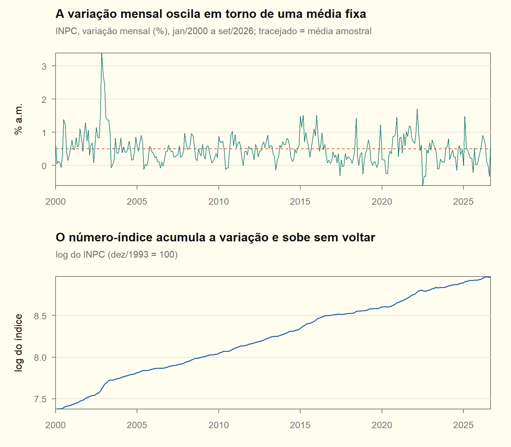
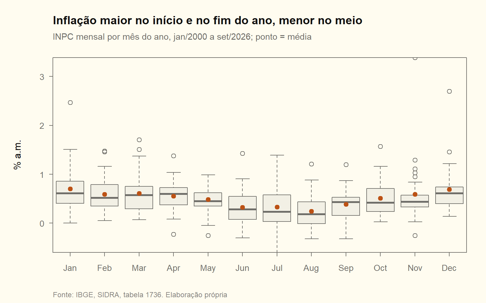
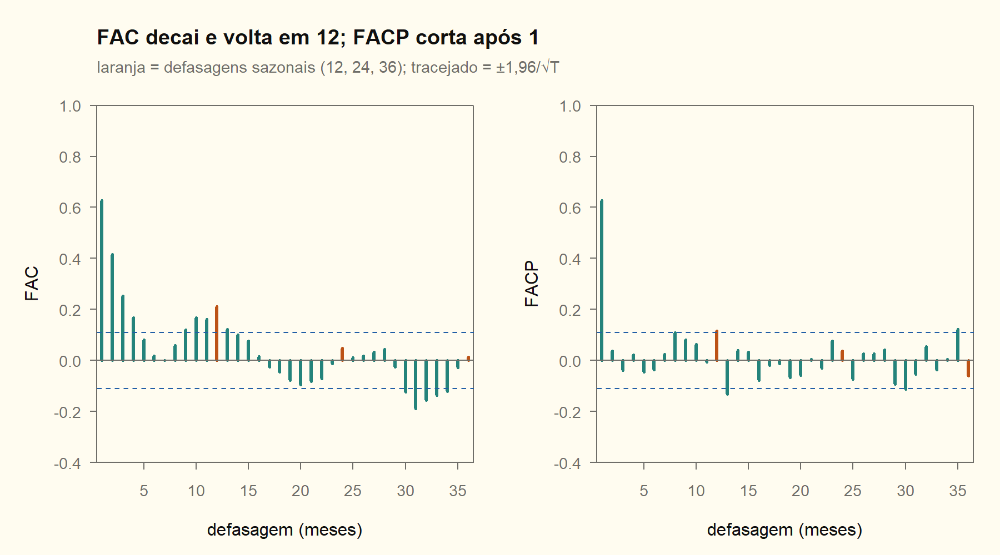
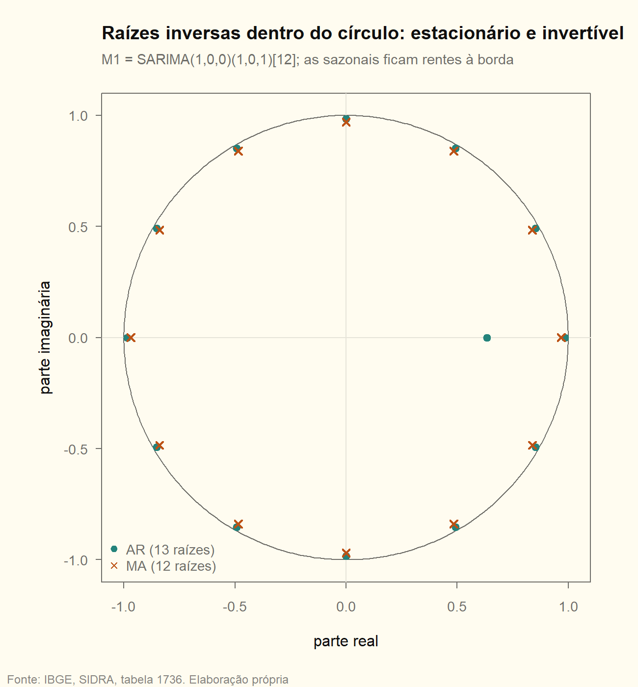
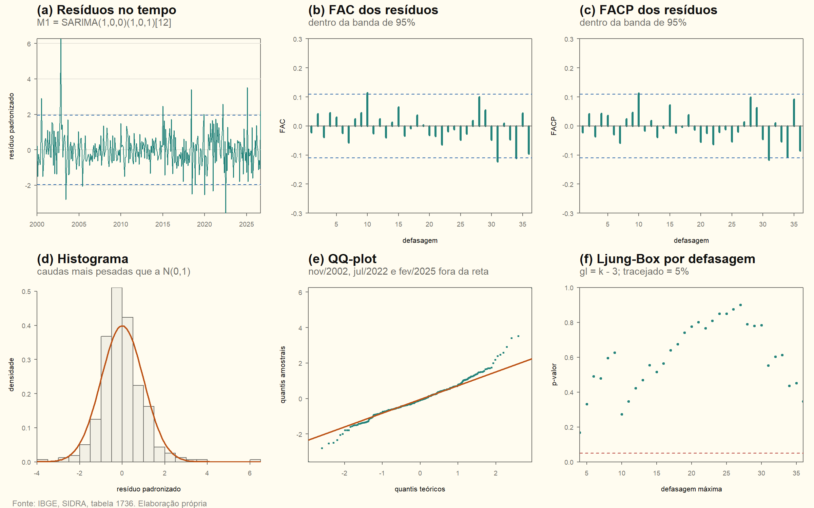
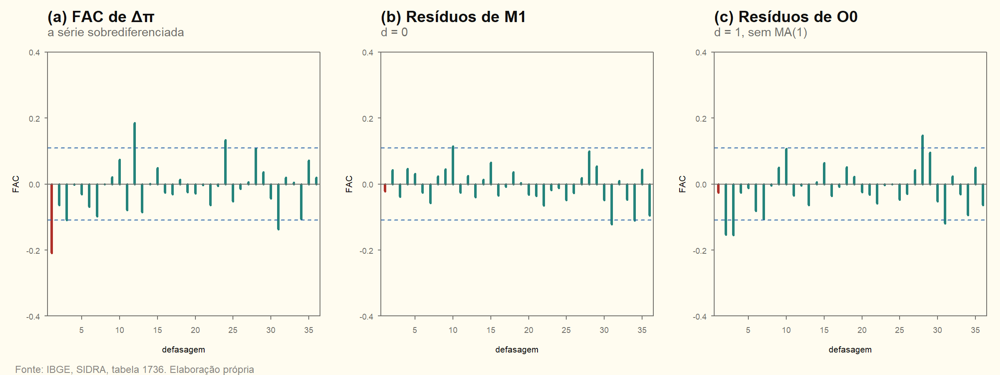
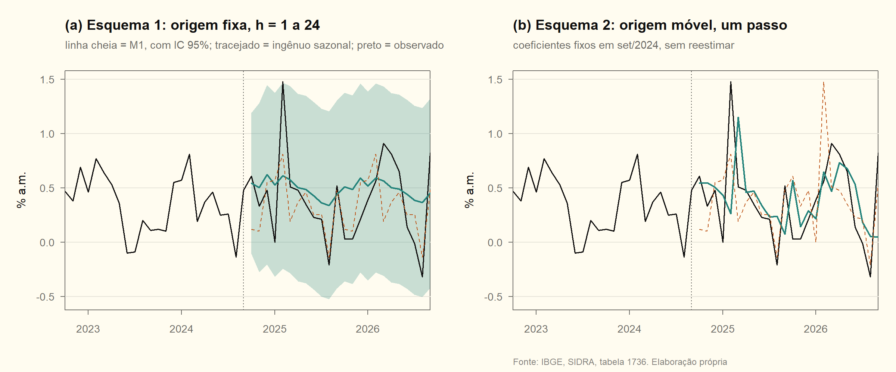
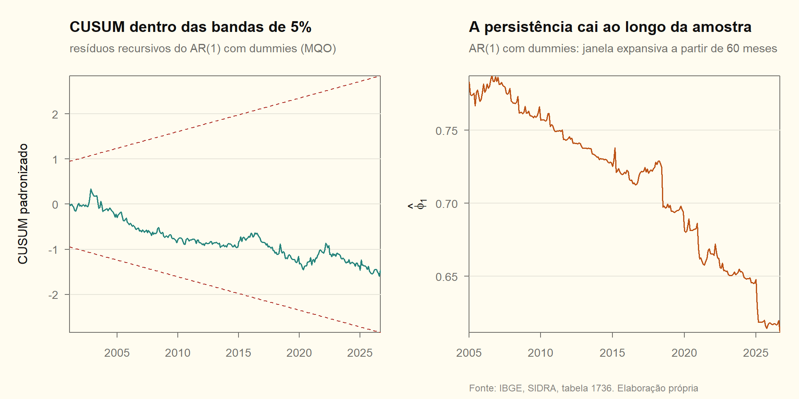
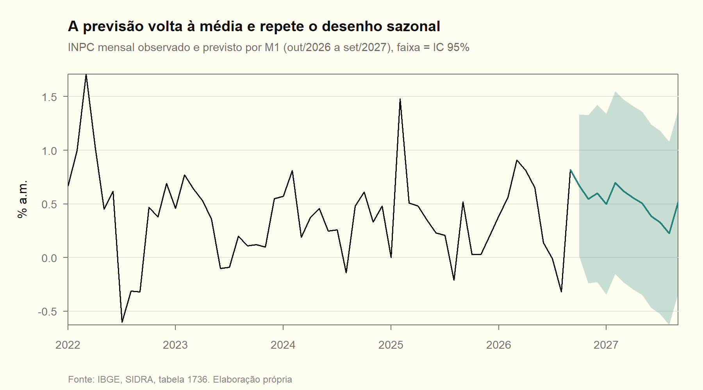

# Modelagem Box-Jenkins do INPC mensal

Relatório da parte empírica (Questões 1 a 7) da Lista 01 (LST01). As seções seguem a numeração do enunciado. Todo número do texto sai de [inpc.R](inpc.R), que segue a mesma ordem, e é conferido pelo `scripts/check_numbers.R` contra `resultados/inpc.csv`. O banco efetivamente usado está em `dados_utilizados.csv`, e as versões do R e dos pacotes, em `sessionInfo.txt`. A Questão 8 é manuscrita (ver [Entrega](#entrega)).

> [!NOTE]
> **Resumo**
> (1) A variação mensal do INPC é I(0) e não tem raiz unitária sazonal: $d=D=0$. O log do número-índice é I(1), então o modelo da variação é um ARIMA($p$,1,$q$) do log do índice.
> (2) A FAC e a FACP indicam um AR(1) com sazonalidade de 12 meses. O AIC escolhe o SARIMA(1,0,0)(1,0,1)₁₂ e o BIC escolhe o SARIMA(1,0,0)(1,0,0)₁₂. Ficamos com o primeiro, porque o objetivo é prever.
> (3) Os resíduos são ruído branco e não têm efeito ARCH, mas não são normais. O sobreajuste não acrescenta nada, e diferenciar de novo leva o MA exatamente à raiz unitária.
> (4) Fora da amostra, o modelo bate o passeio aleatório, mas não o ingênuo sazonal.

---

## Série e amostra

A série é o INPC/IBGE (SIDRA, tabela 1736): o número-índice (dez/1993 = 100) e a variação mensal em %. Ela não vem de pacote do R, como o enunciado exige. A amostra vai de **jan/2000** a **set/2026**, com $T=321$ meses, acima do mínimo de 120. Começamos em 2000 por três motivos: o Plano Real (1994), a flutuação cambial e o regime de metas para a inflação (1999). Antes disso, a série mistura regimes de inflação alta e de estabilização, e um único ARMA estacionário não descreve os dois.

A série modelada é a variação mensal $\pi_t$. A Questão 2 mostra por que ela, e não o índice, é a variável certa para um ARMA.

| Estatística | Valor |
|---|---|
| Média da variação mensal | 0,501% a.m. |
| Desvio-padrão | 0,444 p.p. |
| Mínimo / máximo | −0,60% / 3,39% |
| Meses com deflação | 25 |
| Último mês (set/2026) | 0,82% |
| Acumulado em 12 meses até set/2026 | 4,29% |

<!-- conferência numérica
| chave_R | nota |
|---|---|
| inpc_T | 321 |
| inpc_ano_fim | 2026 |
| inpc_mes_fim | 9 |
| inpc_media | 0,501 |
| inpc_dp | 0,444 |
| inpc_min | -0,60 |
| inpc_max | 3,39 |
| inpc_n_negativos | 25 |
| inpc_ultimo | 0,82 |
| inpc_acum12 | 4,29 |
-->

## Questão 1. O gráfico da série e a transformação

O painel de cima é a série modelada, em nível. O de baixo é o log do número-índice, que é a soma acumulada dela.

- **Tendência.** A variação mensal não tem tendência: oscila em torno da média de 0,501% a.m. Quem tem tendência é o índice, que sobe sem voltar.
- **Sazonalidade.** Ela é visível e estável (figura abaixo). A inflação é maior em janeiro e dezembro, com médias de 0,70% e 0,69%, e menor em agosto, com média de 0,25%. O padrão vem de alimentos (entressafra e safra), de reajustes concentrados no início do ano e do vestuário no fim do ano.
- **Mudanças de nível.** Há episódios em que a média sobe por alguns meses e depois volta: 2002–03 (câmbio e eleição), 2015–16 (preços administrados) e 2021–22 (pós-pandemia e combustíveis). São desvios temporários, não mudanças permanentes de nível.
- **Outliers.** O maior valor da amostra é 3,39%, em nov/2002 (mês 11 de 2002), no auge da crise cambial pré-eleitoral. Há 25 meses de deflação, concentrados nas safras e em jul–ago/2022, por causa do corte de tributos sobre combustíveis e energia.
- **Dispersão.** A dispersão cai depois de 2003: o desvio-padrão é 0,69 p.p. em 2000–2003 e 0,36 p.p. de 2004 em diante. Fora desse começo, a amplitude não cresce com o nível.

**Transformação.** Nenhuma. O log ou o Box-Cox servem para estabilizar uma variância que cresce com o nível, e aqui não é o caso. Além disso, a série tem valores negativos, o que impede o log. A variação mensal já é, na prática, a primeira diferença do log do índice (Questão 2d).

<!-- conferência numérica
| chave_R | nota |
|---|---|
| inpc_media_mes01 | 0,70 |
| inpc_media_mes12 | 0,69 |
| inpc_media_mes08 | 0,25 |
| inpc_max_ano | 2002 |
| inpc_max_mes | 11 |
| inpc_dp_2000_2003 | 0,69 |
| inpc_dp_2004_fim | 0,36 |
-->

## Questão 2. Raiz unitária: a escolha de $d$ e $D$

**Como os testes foram feitos** (AU04):

- **ADF** (`urca::ur.df`). As defasagens da diferença entram até 12 e são escolhidas por AIC. O p-valor é o de MacKinnon (`urca::punitroot`).
- **PP** (`urca::ur.pp`, estatística $Z_\tau$). A correção de Newey-West usa a janela curta, $\lfloor4(T/100)^{1/4}\rfloor=5$.
- **KPSS** (`urca::ur.kpss`). Usa a mesma janela. A hipótese nula se inverte: $H_0$ é a estacionariedade.

### (a) A série em nível

| Teste | Termos determinísticos | Estatística | Crítico 5% | p-valor | Defasagens |
|---|---|---|---|---|---|
| ADF | nenhum | $-1{,}61$ | $-1{,}95$ | $0{,}10$ | 12 (AIC) |
| ADF | constante | $-7{,}00$ | $-2{,}87$ | $0{,}0000$ | 1 (AIC) |
| ADF | constante e tendência | $-7{,}15$ | $-3{,}42$ | $0{,}0000$ | 1 (AIC) |
| PP | constante | $-8{,}57$ | $-2{,}87$ | $0{,}0000$ | 5 (Newey-West) |
| PP | constante e tendência | $-8{,}69$ | $-3{,}43$ | $0{,}0000$ | 5 (Newey-West) |
| KPSS | constante | $0{,}352$ | $0{,}463$ | $\gt0{,}05$ | 5 (Newey-West) |
| KPSS | constante e tendência | $0{,}076$ | $0{,}146$ | $\gt0{,}05$ | 5 (Newey-West) |

Com constante, o ADF e o PP rejeitam a raiz unitária com folga, e o KPSS não rejeita a estacionariedade. Os três concordam.

### (b) Constante e tendência na regressão auxiliar do ADF

A especificação certa é **com constante e sem tendência**:

- **A constante entra.** A série tem média positiva (0,501), e o intercepto da regressão auxiliar tem $t=5{,}46$. O teste conjunto $\phi_1$ ($H_0$: raiz unitária e constante nula) dá $24{,}48\gt4{,}61$ e rejeita.
- **A tendência sai.** Na versão com tendência, o coeficiente de $t$ tem $t=-1{,}44$ ($p=0{,}15$). O teste $\phi_3$ ($H_0$: raiz unitária e tendência nula) dá $25{,}60\gt6{,}30$ e rejeita, mas é a raiz unitária que cai, não a tendência que se confirma. Além disso, o gráfico não mostra tendência.

A conclusão **muda** quando a constante é omitida. Sem termos determinísticos, o ADF dá $-1{,}61\gt-1{,}95$ e não rejeita a raiz unitária. Essa especificação força a regressão a passar pela origem, embora a série oscile em torno de 0,5 e não de 0. O teste então lê o desvio da média como persistência e perde poder. É o erro de especificação que a AU04 aponta: omitir um termo determinístico presente nos dados enviesa o teste para a não rejeição. Entre as versões com constante e com constante e tendência, a conclusão **não muda**.

<!-- conferência numérica
| chave_R | nota |
|---|---|
| inpc_adf_y_n_tau | -1,61 |
| inpc_adf_y_n_c5 | -1,95 |
| inpc_adf_y_n_p | 0,10 |
| inpc_adf_y_n_lags | 12 |
| inpc_adf_y_c_tau | -7,00 |
| inpc_adf_y_c_c5 | -2,87 |
| inpc_adf_y_c_p | 0,0000 |
| inpc_adf_y_c_lags | 1 |
| inpc_adf_y_t_tau | -7,15 |
| inpc_adf_y_t_c5 | -3,42 |
| inpc_adf_y_t_p | 0,0000 |
| inpc_adf_y_t_lags | 1 |
| inpc_pp_y_c_z | -8,57 |
| inpc_pp_y_c_c5 | -2,87 |
| inpc_pp_y_c_p | 0,0000 |
| inpc_pp_y_c_lag | 5 |
| inpc_pp_y_t_z | -8,69 |
| inpc_pp_y_t_c5 | -3,43 |
| inpc_pp_y_t_p | 0,0000 |
| inpc_pp_y_t_lag | 5 |
| inpc_kpss_y_c_s | 0,352 |
| inpc_kpss_y_c_c5 | 0,463 |
| inpc_kpss_y_c_lag | 5 |
| inpc_kpss_y_t_s | 0,076 |
| inpc_kpss_y_t_c5 | 0,146 |
| inpc_kpss_y_t_lag | 5 |
| inpc_adf_y_c_const_t | 5,46 |
| inpc_adf_y_c_phi1 | 24,48 |
| inpc_adf_c5_phi1 | 4,61 |
| inpc_adf_y_t_tend_t | -1,44 |
| inpc_adf_y_t_tend_p | 0,15 |
| inpc_adf_y_t_phi3 | 25,60 |
| inpc_adf_c5_phi3 | 6,30 |
-->

### (c) A série diferenciada, a diferença sazonal e a escolha de $d$ e $D$

| Série | Teste | Estatística | Crítico 5% | Decisão |
|---|---|---|---|---|
| $\Delta\pi_t$ | ADF, constante, 12 defasagens (AIC) | $-7{,}31$ | $-2{,}87$ | rejeita a raiz unitária |
| $\Delta\pi_t$ | PP, constante | $-23{,}70$ | $-2{,}87$ | rejeita a raiz unitária |
| $\Delta\pi_t$ | KPSS, constante | $0{,}012$ | $0{,}463$ | não rejeita a estacionariedade |
| $\pi_t$ | OCSB, $H_0$: raiz unitária sazonal | $-12{,}79$ | $-1{,}80$ | rejeita a raiz unitária sazonal |

A diferença também é estacionária, como tem de ser: diferenciar uma série I(0) não cria raiz unitária autorregressiva, cria uma no MA (Questão 6). Como a série em nível já é estacionária, **$d=0$**. O `ndiffs` do pacote `forecast` dá o mesmo resultado (0).

A sazonalidade é forte, mas é **estável**: o padrão mensal se repete sem deriva. O teste OCSB rejeita a raiz unitária sazonal, e o `nsdiffs` (pela força da sazonalidade) indica 0 diferenças sazonais. Portanto **$D=0$**. A sazonalidade entra nos termos SAR/SMA, não numa diferença $\Delta_{12}$ (AU05).

<!-- conferência numérica
| chave_R | nota |
|---|---|
| inpc_adf_dy_c_tau | -7,31 |
| inpc_adf_dy_c_c5 | -2,87 |
| inpc_adf_dy_c_lags | 12 |
| inpc_pp_dy_c_z | -23,70 |
| inpc_pp_dy_c_c5 | -2,87 |
| inpc_kpss_dy_c_s | 0,012 |
| inpc_kpss_dy_c_c5 | 0,463 |
| inpc_ocsb | -12,79 |
| inpc_ocsb_c5 | -1,80 |
| inpc_ndiffs | 0 |
| inpc_nsdiffs | 0 |
-->

### (d) Tendência estocástica ou determinística?

A **variação mensal** não tem nenhuma das duas: é estacionária em torno de uma constante. A pergunta interessa para o **número-índice**:

| Série | Teste (constante e tendência) | Estatística | Crítico 5% | Decisão |
|---|---|---|---|---|
| $\ln P_t$ | ADF, 1 defasagem (AIC) | $-3{,}26$ ($p=0{,}075$) | $-3{,}42$ | não rejeita a raiz unitária |
| $\ln P_t$ | PP | $-2{,}18$ ($p=0{,}50$) | $-3{,}43$ | não rejeita a raiz unitária |
| $\ln P_t$ | KPSS | $0{,}415$ | $0{,}146$ | rejeita a estacionariedade em tendência |

Os três testes apontam para **tendência estocástica**: o log do índice é diferença-estacionário, I(1). O ADF, com $p=0{,}075$, é o menos enfático, mas a ambiguidade se resolve com o PP e o KPSS, que vão na mesma direção. A correlação entre $100\,\Delta\ln P_t$ e a variação mensal publicada é 0,99998. Por isso modelar $\pi_t$ com $d=0$ é modelar $\ln P_t$ com $d=1$ (lista teórica, Q10a). Tirar uma tendência linear do índice, em vez de diferenciá-lo, deixaria a raiz unitária nos resíduos.

<!-- conferência numérica
| chave_R | nota |
|---|---|
| inpc_adf_li_t_tau | -3,26 |
| inpc_adf_li_t_p | 0,075 |
| inpc_adf_li_t_c5 | -3,42 |
| inpc_adf_li_t_lags | 1 |
| inpc_pp_li_t_z | -2,18 |
| inpc_pp_li_t_p | 0,50 |
| inpc_pp_li_t_c5 | -3,43 |
| inpc_kpss_li_t_s | 0,415 |
| inpc_kpss_li_t_c5 | 0,146 |
| inpc_cor_dli_y | 0,99998 |
-->

## Questão 3. Correlogramas e três candidatos

### (a) Correlogramas

Como $d=D=0$, os correlogramas são os da própria série. As 36 defasagens cobrem três ciclos sazonais completos. A banda de 95% é $\pm1{,}96/\sqrt T=\pm0{,}109$.

| Defasagem | 1 | 2 | 11 | 12 | 13 | 24 | 36 |
|---|---|---|---|---|---|---|---|
| FAC | 0,628 | 0,417 | 0,161 | 0,212 | 0,123 | 0,049 | 0,014 |
| FACP | 0,628 | 0,038 | −0,006 | 0,115 | −0,132 | 0,038 | — |

### (b) Leitura

1. **Parte não sazonal.** A FAC decai de forma exponencial, sem oscilar (0,628, 0,417, …). A FACP **trunca** após a defasagem 1: 0,628 e depois 0,038, dentro da banda. É a assinatura de um AR(1).
2. **Lags sazonais.** A FAC volta a subir em $s=12$ (0,212), depois de ter passado pelo zero, e cai em $2s=24$ (0,049) e $3s=36$ (0,014). A FACP tem um pico em 12 (0,115). Há estrutura sazonal de ordem 1, e o decaimento rápido nos múltiplos de 12 confirma que não é preciso diferença sazonal.
3. **Vizinhanças.** A FAC é alta também em $s-1=11$ (0,161) e $s+1=13$ (0,123), e a FACP tem um pico negativo em 13 (−0,132). Esse "grupo" 11-12-13 é o que um modelo multiplicativo produz: o termo AR(1) interage com o termo sazonal (lista teórica, Q11 e Q16).
4. **Não é ruído branco:** $Q_{LB}(24)=277{,}3$.

### (c) Três candidatos

| Candidato | Especificação | Por que |
|---|---|---|
| **M1** | SARIMA(1,0,0)(1,0,1)₁₂ | FACP truncada em 1, mais o grupo 11-12-13 e o decaimento sazonal lento da FAC até 24 pedem as duas partes sazonais (AR e MA) num modelo multiplicativo |
| **M2** | SARIMA(1,0,0)(1,0,0)₁₂ | o pico da FACP em 12 é a assinatura de um AR sazonal |
| **M3** | SARIMA(1,0,0)(0,0,1)₁₂ | a FAC sazonal é grande em 12 e quase some em 24, a assinatura de um MA sazonal |

Os três têm média, $d=D=0$ e a mesma variável dependente.

<!-- conferência numérica
| chave_R | nota |
|---|---|
| inpc_fac1 | 0,628 |
| inpc_fac2 | 0,417 |
| inpc_fac11 | 0,161 |
| inpc_fac12 | 0,212 |
| inpc_fac13 | 0,123 |
| inpc_fac24 | 0,049 |
| inpc_fac36 | 0,014 |
| inpc_facp1 | 0,628 |
| inpc_facp2 | 0,038 |
| inpc_facp11 | -0,006 |
| inpc_facp12 | 0,115 |
| inpc_facp13 | -0,132 |
| inpc_facp24 | 0,038 |
| inpc_banda | 0,109 |
| inpc_lb24_serie | 277,3 |
-->

## Questão 4. Máxima verossimilhança, AIC e BIC

### (a) e (b) Estimativas

Estimação por máxima verossimilhança exata (filtro de Kalman, `forecast::Arima`, `method = "ML"`). Em cada célula: coeficiente, (erro padrão) e [estatística $t$].

| | M1 = (1,0,0)(1,0,1)₁₂ | M2 = (1,0,0)(1,0,0)₁₂ | M3 = (1,0,0)(0,0,1)₁₂ |
|---|---|---|---|
| $\phi_1$ (AR 1) | 0,6330 (0,0431) [14,70] | 0,6231 (0,0435) [14,34] | 0,6216 (0,0436) [14,27] |
| $\Phi_1$ (SAR 12) | 0,8304 (0,1381) [6,02] | 0,2024 (0,0562) [3,60] | — |
| $\Theta_1$ (SMA 12) | −0,6852 (0,1770) [−3,87] | — | 0,1666 (0,0503) [3,31] |
| $\mu$ (média) | 0,5071 (0,0861) [5,89] | 0,5009 (0,0619) [8,10] | 0,5015 (0,0578) [8,68] |
| $\widehat\sigma_a^2$ | 0,1139 | 0,1154 | 0,1162 |
| $\ln L$ | −105,80 | −107,83 | −108,96 |
| $k$ | 5 | 4 | 4 |
| AIC | **221,60** | 223,65 | 225,91 |
| BIC | 240,46 | **238,74** | 241,00 |
| Amostra efetiva | 321 | 321 | 321 |

O R usa o sinal positivo no MA: $(1+\Theta_1B^{12})\varepsilon_t$, como os slides (ver [CONVENCOES](../CONVENCOES.md) §2). M1 se escreve $(1-\phi_1B)(1-\Phi_1B^{12})(\pi_t-\mu)=(1+\Theta_1B^{12})\varepsilon_t$.

**(b) Amostra efetiva.** São as 321 observações nos três modelos. Como $d=D=0$, nenhuma observação se perde com diferenças. E a verossimilhança exata usa todas, inclusive as iniciais, sem condicionar nas primeiras $p+sP$ (AU02).

### (c) A comparação por AIC e BIC é válida?

Sim. Os três modelos têm a mesma variável dependente ($\pi_t$, sem diferença) e a mesma amostra efetiva (321). A comparação seria inválida para um candidato com $d$ ou $D$ diferente, como o modelo sobrediferenciado da Questão 6. Esse modelo explica $\Delta\pi_t$, não $\pi_t$, e usa 320 observações, então as verossimilhanças são de variáveis diferentes e não se comparam. O caminho, nesse caso, é decidir $d$ e $D$ antes, pelos testes da Questão 2, e só então comparar critérios dentro de uma mesma ordem de integração. A alternativa é comparar pelo desempenho fora da amostra, na mesma escala (Questão 7).

### (d) A convenção de contagem de parâmetros

O `forecast::Arima`, assim como o `stats::arima`, **inclui $\widehat\sigma_a^2$ em $k$**: $\text{AIC}=-2\ln L+2k$ e $\text{BIC}=-2\ln L+k\ln T$, com $k$ igual ao número de coeficientes ARMA mais a média mais 1. No M1, $k=3+1+1=5$. Conferimos no próprio script: `f$aic` é igual a $-2\ln L+2k$ com esse $k$ (o `stopifnot` falha se não for). A AU02 escreve os critérios divididos por $T$. Como $T$ é o mesmo nos três modelos, a divisão não muda a ordenação.

### (e) AIC e BIC divergem

O AIC escolhe o **M1** e o BIC escolhe o **M2**. Na grade completa de 64 modelos SARIMA$(p,0,q)(P,0,Q)_{12}$, com $p,q\le3$ e $P,Q\le1$, os vencedores são os mesmos ([grade_sarima.csv](grade_sarima.csv)). A divergência é a esperada. O AIC penaliza cada parâmetro em 2, e o BIC em $\ln321\approx5{,}77$, então o BIC prefere o modelo menor.

O **BIC é consistente**: se o modelo verdadeiro estiver entre os candidatos, ele o escolhe com probabilidade que tende a 1. O **AIC é eficiente**: minimiza o erro de previsão esperado, ainda que tenda a escolher modelos um pouco maiores (lista teórica, Q14b). Como o objetivo deste trabalho é **prever** (Questão 7), adotamos o critério eficiente, e **M1 é o modelo selecionado**. O M2 segue como alternativa na Questão 7.

### (f) Raízes

O polinômio AR de M1, $(1-\phi_1B)(1-\Phi_1B^{12})$, tem 13 raízes, e o MA, $(1+\Theta_1B^{12})$, tem 12. A figura mostra as **inversas** das raízes: todas ficam dentro do círculo unitário, então M1 é **estacionário e invertível**.

- A raiz não sazonal está em $1/\widehat\phi_1=1{,}58$.
- As 12 raízes do SAR têm módulo $\widehat\Phi_1^{-1/12}=1{,}016$, e as do SMA, $\lvert\widehat\Theta_1\rvert^{-1/12}=1{,}032$. São os menores módulos de cada polinômio: 1,016 no AR e 1,032 no MA.

As raízes sazonais ficam rentes à borda. Isso acompanha um sintoma: $\widehat\Phi_1\approx0{,}83$ e $\widehat\Theta_1\approx-0{,}69$ quase se cancelam. O par $(1-\Phi_1B^{12})^{-1}(1+\Theta_1B^{12})$ fica próximo de um padrão sazonal fixo. É o que acontece quando um SARMA estima uma **sazonalidade determinística**, de médias mensais estáveis, coerente com o OCSB da Questão 2c. Expandido, M1 é um AR(13) restrito: o coeficiente de $\pi_{t-13}$ é $-\widehat\phi_1\widehat\Phi_1=-0{,}526$, fixado pelos outros dois (lista teórica, Q11c). A média de longo prazo, $\widehat\mu=0{,}507\%$ a.m., equivale a 6,26% a.a.

<!-- conferência numérica
| chave_R | nota |
|---|---|
| inpc_m1_ar1 | 0,6330 |
| inpc_m1_ar1_ep | 0,0431 |
| inpc_m1_ar1_t | 14,70 |
| inpc_m1_sar1 | 0,8304 |
| inpc_m1_sar1_ep | 0,1381 |
| inpc_m1_sar1_t | 6,02 |
| inpc_m1_sma1 | -0,6852 |
| inpc_m1_sma1_ep | 0,1770 |
| inpc_m1_sma1_t | -3,87 |
| inpc_m1_intercept | 0,5071 |
| inpc_m1_intercept_ep | 0,0861 |
| inpc_m1_intercept_t | 5,89 |
| inpc_m1_sigma2 | 0,1139 |
| inpc_m1_loglik | -105,80 |
| inpc_m1_k | 5 |
| inpc_m1_aic | 221,60 |
| inpc_m1_bic | 240,46 |
| inpc_m1_n | 321 |
| inpc_m2_ar1 | 0,6231 |
| inpc_m2_ar1_ep | 0,0435 |
| inpc_m2_ar1_t | 14,34 |
| inpc_m2_sar1 | 0,2024 |
| inpc_m2_sar1_ep | 0,0562 |
| inpc_m2_sar1_t | 3,60 |
| inpc_m2_intercept | 0,5009 |
| inpc_m2_intercept_ep | 0,0619 |
| inpc_m2_intercept_t | 8,10 |
| inpc_m2_sigma2 | 0,1154 |
| inpc_m2_loglik | -107,83 |
| inpc_m2_k | 4 |
| inpc_m2_aic | 223,65 |
| inpc_m2_bic | 238,74 |
| inpc_m2_n | 321 |
| inpc_m3_ar1 | 0,6216 |
| inpc_m3_ar1_ep | 0,0436 |
| inpc_m3_ar1_t | 14,27 |
| inpc_m3_sma1 | 0,1666 |
| inpc_m3_sma1_ep | 0,0503 |
| inpc_m3_sma1_t | 3,31 |
| inpc_m3_intercept | 0,5015 |
| inpc_m3_intercept_ep | 0,0578 |
| inpc_m3_intercept_t | 8,68 |
| inpc_m3_sigma2 | 0,1162 |
| inpc_m3_loglik | -108,96 |
| inpc_m3_k | 4 |
| inpc_m3_aic | 225,91 |
| inpc_m3_bic | 241,00 |
| inpc_m3_n | 321 |
| inpc_grade_n | 64 |
| inpc_m1_raiz_ar | 1,58 |
| inpc_m1_raiz_sar | 1,016 |
| inpc_m1_raiz_sma | 1,032 |
| inpc_m1_raiz_ar_min | 1,016 |
| inpc_m1_raiz_ma_min | 1,032 |
| inpc_m1_ar13 | -0,526 |
| inpc_m1_mu_anual | 6,26 |
-->

## Questão 5. Os resíduos

### (a) Gráficos dos resíduos de M1

### (b) e (c) Testes

| Teste | M1 | M2 | M3 | Crítico 5% (M1) |
|---|---|---|---|---|
| Ljung-Box $Q(12)$ | 9,15; gl = 9; $p=0{,}42$ | 9,22; gl = 10; $p=0{,}51$ | 8,98; gl = 10; $p=0{,}53$ | $\chi^2_9=16{,}92$ |
| Ljung-Box $Q(24)$ | 14,46; gl = 21; $p=0{,}85$ | 17,30; gl = 22; $p=0{,}75$ | 19,13; gl = 22; $p=0{,}64$ | $\chi^2_{21}=32{,}67$ |
| ARCH-LM, 12 defasagens ($nR^2$) | 10,74 ($p=0{,}55$) | 9,48 ($p=0{,}66$) | 8,94 ($p=0{,}71$) | $\chi^2_{12}=21{,}03$ |
| Jarque-Bera | 463,0 ($p=0{,}00$) | 445,4 ($p=0{,}00$) | 454,7 ($p=0{,}00$) | $\chi^2_2=5{,}99$ |
| Assimetria / curtose | 0,94 / 8,58 | — | — | 0 / 3 |

**Correção dos graus de liberdade no Ljung-Box** (AU03): $\text{gl}=m-(p+q+P+Q)$, contando os termos sazonais e sem contar a média. No M1, $\text{gl}=12-3=9$.

- **Autocorrelação (M1).** $H_0:\rho_1=\dots=\rho_{12}=0$ nos resíduos. $Q=9{,}15\lt16{,}92$ ($p=0{,}42$), então não se rejeita $H_0$. O mesmo vale até 24 defasagens e, no painel (f) da figura, para todo $m$ de 4 a 36. Os resíduos não guardam estrutura linear.
- **Heterocedasticidade condicional.** $nR^2=10{,}74\lt21{,}03$, então não se rejeita a ausência de efeito ARCH.
- **Normalidade.** $JB=463\gg5{,}99$, então rejeita-se a normalidade. A causa são poucos choques grandes, visíveis no QQ-plot. Em resíduos padronizados, os maiores são nov/2002 ($z=6{,}26$, a crise cambial), jul/2022 ($z=-3{,}57$, o corte de tributos sobre combustíveis e energia) e fev/2025 ($z=3{,}52$, a reversão do bônus de Itaipu na conta de luz).

A não normalidade **não invalida** o modelo. A estrutura ARMA e a consistência do estimador não dependem dela: o estimador vira de quase-MV (AU03). Ela afeta os intervalos de previsão gaussianos, que ficam estreitos demais nos meses de choque. A extensão natural seria incluir dummies de intervenção nas três datas.

<!-- conferência numérica
| chave_R | nota |
|---|---|
| inpc_m1_lb12 | 9,15 |
| inpc_m1_lb12_gl | 9 |
| inpc_m1_lb12_p | 0,42 |
| inpc_m2_lb12 | 9,22 |
| inpc_m2_lb12_gl | 10 |
| inpc_m2_lb12_p | 0,51 |
| inpc_m3_lb12 | 8,98 |
| inpc_m3_lb12_gl | 10 |
| inpc_m3_lb12_p | 0,53 |
| inpc_lb12_c5_m1 | 16,92 |
| inpc_m1_lb24 | 14,46 |
| inpc_m1_lb24_gl | 21 |
| inpc_m1_lb24_p | 0,85 |
| inpc_m2_lb24 | 17,30 |
| inpc_m2_lb24_gl | 22 |
| inpc_m2_lb24_p | 0,75 |
| inpc_m3_lb24 | 19,13 |
| inpc_m3_lb24_gl | 22 |
| inpc_m3_lb24_p | 0,64 |
| inpc_lb24_c5_m1 | 32,67 |
| inpc_m1_arch12 | 10,74 |
| inpc_m1_arch12_p | 0,55 |
| inpc_m2_arch12 | 9,48 |
| inpc_m2_arch12_p | 0,66 |
| inpc_m3_arch12 | 8,94 |
| inpc_m3_arch12_p | 0,71 |
| inpc_chi2_12_c5 | 21,03 |
| inpc_m1_jb | 463,0 |
| inpc_m1_jb_p | 0,00 |
| inpc_m2_jb | 445,4 |
| inpc_m3_jb | 454,7 |
| inpc_chi2_2_c5 | 5,99 |
| inpc_m1_assim | 0,94 |
| inpc_m1_curt | 8,58 |
| inpc_m1_out1_z | 6,26 |
| inpc_m1_out1_ano | 2002 |
| inpc_m1_out1_mes | 11 |
| inpc_m1_out2_z | -3,57 |
| inpc_m1_out2_ano | 2022 |
| inpc_m1_out2_mes | 7 |
| inpc_m1_out3_z | 3,52 |
| inpc_m1_out3_ano | 2025 |
| inpc_m1_out3_mes | 2 |
-->

### (d) O caminho percorrido: modelos descartados

Antes dos três candidatos, testamos as especificações não sazonais que a parte não sazonal dos correlogramas sugere sozinha. Todas foram descartadas pelo mesmo motivo: deixam autocorrelação sazonal nos resíduos.

| Modelo | AIC | Ljung-Box $Q(12)$ | p-valor | Motivo do descarte |
|---|---|---|---|---|
| AR(1) | 234,33 | 20,24 | 0,042 | resíduo autocorrelacionado em 12: falta o termo sazonal |
| AR(2) | 235,99 | 19,61 | 0,033 | idem; o segundo AR não substitui o sazonal |
| ARMA(1,1) | 236,03 | 19,71 | 0,032 | idem |
| MA(1) | 285,18 | 90,16 | 0,0000 | não captura a persistência: a FAC decai, não trunca |

Daí a volta à Questão 3, onde os termos sazonais entram nos três candidatos. Todos passam no Ljung-Box. Também ficou de fora a versão de M1 com sazonalidade determinística, o AR(1) com 11 dummies mensais: ela tem a maior verossimilhança, mas paga 9 parâmetros a mais e perde no AIC e no BIC. Ela reaparece no Complemento A, onde serve para os testes de estabilidade por MQO.

<!-- conferência numérica
| chave_R | nota |
|---|---|
| inpc_desc_ar1_aic | 234,33 |
| inpc_desc_ar1_lb12 | 20,24 |
| inpc_desc_ar1_lb12_p | 0,042 |
| inpc_desc_ar2_aic | 235,99 |
| inpc_desc_ar2_lb12 | 19,61 |
| inpc_desc_ar2_lb12_p | 0,033 |
| inpc_desc_arma11_aic | 236,03 |
| inpc_desc_arma11_lb12 | 19,71 |
| inpc_desc_arma11_lb12_p | 0,032 |
| inpc_desc_ma1_aic | 285,18 |
| inpc_desc_ma1_lb12 | 90,16 |
| inpc_desc_ma1_lb12_p | 0,0000 |
-->

### (e) Sobreajuste deliberado

| Especificação | Parâmetro adicional | Estimativa (ep) | $t$ | p-valor | AIC | p-valor da RV contra M1 |
|---|---|---|---|---|---|---|
| SARIMA(2,0,0)(1,0,1)₁₂ | $\phi_2$ | 0,039 (0,057) | 0,68 | 0,49 | 223,13 | 0,495 |
| SARIMA(1,0,1)(1,0,1)₁₂ | $\theta_1$ | −0,057 (0,087) | −0,65 | 0,51 | 223,17 | 0,513 |

Nenhum dos dois parâmetros adicionais é significativo. Os dois modelos maiores têm AIC pior que o de M1 (221,60), e a razão de verossimilhanças não rejeita a restrição. O sobreajuste confirma que M1 não deixou dinâmica de fora: a especificação está adequada na parte não sazonal.

<!-- conferência numérica
| chave_R | nota |
|---|---|
| inpc_sobre_ar2 | 0,039 |
| inpc_sobre_ar2_ep | 0,057 |
| inpc_sobre_ar2_t | 0,68 |
| inpc_sobre_ar2_p | 0,49 |
| inpc_sobre_ar2_aic | 223,13 |
| inpc_sobre_ar2_lr_p | 0,495 |
| inpc_sobre_ma1 | -0,057 |
| inpc_sobre_ma1_ep | 0,087 |
| inpc_sobre_ma1_t | -0,65 |
| inpc_sobre_ma1_p | 0,51 |
| inpc_sobre_ma1_aic | 223,17 |
| inpc_sobre_ma1_lr_p | 0,513 |
-->

## Questão 6. Uma diferença a mais

A Questão 2 deu $d^\ast=0$. Reestimamos M1 com $d^\ast+1=1$, isto é, para $\Delta\pi_t$, sem média, porque a diferença a elimina. Se $\pi_t$ segue M1, então $\Delta\pi_t$ satisfaz $(1-\phi_1B)(1-\Phi_1B^{12})\Delta\pi_t=(1-B)(1+\Theta_1B^{12})\varepsilon_t$. O fator $(1-B)$ que a diferença cria fica no lado do MA (lista teórica, Q9). Por isso estimamos duas versões:

- **O1** = SARIMA(1,1,1)(1,0,1)₁₂, com um MA(1) livre para absorver esse fator;
- **O0** = SARIMA(1,1,0)(1,0,1)₁₂, só com a diferença a mais.

As duas usam 320 observações.

**(a) O coeficiente MA.** Em O1, $\widehat\theta_1=-1{,}0000$, com erro padrão 0,0140. Com o sinal do R, o polinômio é $1+\widehat\theta_1B$, e a raiz é $1/\lvert\widehat\theta_1\rvert=1{,}0000$: **exatamente sobre o círculo unitário**. O estimador encontra o fator $(1-B)$ que a diferença introduziu, e o modelo é não invertível. O erro padrão pequeno não indica precisão. Ele é artefato da fronteira do espaço paramétrico, onde a teoria assintótica usual não vale.

**(b) A variância residual.** A comparação com M1 ($\widehat\sigma_a^2=0{,}1139$) depende da versão:

- **O1:** $\widehat\sigma_a^2=0{,}1142$, só 0,24% acima. O MA(1) com raiz unitária desfaz a diferença, e o ajuste quase volta ao de M1. Mesmo assim, o AIC de O1 (224,61) não se compara ao de M1, porque a variável e a amostra são outras (Questão 4c).
- **O0:** $\widehat\sigma_a^2=0{,}1326$, **16,4% acima**. Sem o MA para compensar, diferenciar custa caro.

A diferença também **reduz** a variância da série: a variância de $\Delta\pi_t$ é 0,147, contra 0,197 de $\pi_t$. Isso porque $\operatorname{Var}(\Delta\pi_t)=2\gamma_0(1-\rho_1)$ e $\rho_1=0{,}628\gt0{,}5$. O sinal clássico de sobrediferenciação (a variância aumentar ao diferenciar) aparece quando $\rho_1\lt0{,}5$. Numa série tão persistente quanto a inflação, ele não aparece.

**(c) A FAC.** A **série sobrediferenciada** tem a autocorrelação negativa pronunciada no primeiro lag: $\rho_1(\Delta\pi)=-0{,}209$, fora da banda. É o que a teoria prevê: se $\pi_t$ fosse um AR(1) puro, seria $-(1-\rho_1)/2=-0{,}186$. Nos **resíduos**, a autocorrelação no primeiro lag é pequena nos três modelos: −0,022 em M1, −0,025 em O0 e −0,029 em O1. Isso porque o AR(1) dos modelos sobrediferenciados se ajusta para absorver o lag 1. O custo aparece em outro lugar. Os resíduos de O0 têm picos negativos nas defasagens 2 e 3, fora da banda (painel c da figura), e falham no Ljung-Box(12) ($p=0{,}0014$), enquanto os de M1 passam.

**(d) Sinais práticos de sobrediferenciação**, visíveis numa saída típica de estimação, sem conhecer o $d$ verdadeiro:

1. **Um coeficiente MA perto de −1** (no sinal do R; perto de +1 no de Box-Jenkins), ou uma soma de coeficientes MA perto de −1. Equivalentemente, uma raiz MA no círculo unitário. É o sinal mais forte, e o deste experimento.
2. **Um erro padrão degenerado** ou avisos de não invertibilidade e de convergência na fronteira.
3. **Uma FAC da série diferenciada com $\rho_1$ perto de −0,5** e pouca estrutura depois.
4. **A variância residual não cair** ao acrescentar a diferença, ou até subir. A variância da série diferenciada maior que a da original é um indício quando a série não é muito persistente.
5. **A série original já passar nos testes de raiz unitária**, como aqui (Questão 2).

<!-- conferência numérica
| chave_R | nota |
|---|---|
| inpc_sd_n | 320 |
| inpc_sd_ma1 | -1,0000 |
| inpc_sd_ma1_ep | 0,0140 |
| inpc_sd_raiz_ma | 1,0000 |
| inpc_sd_o1_sigma2 | 0,1142 |
| inpc_sd_o1_var_pct | 0,24 |
| inpc_sd_o1_aic | 224,61 |
| inpc_sd_o0_sigma2 | 0,1326 |
| inpc_sd_o0_var_pct | 16,4 |
| inpc_sd_var_dy | 0,147 |
| inpc_sd_var_y | 0,197 |
| inpc_sd_fac1_dy | -0,209 |
| inpc_sd_fac1_dy_teoria | -0,186 |
| inpc_sd_fac1_m1 | -0,022 |
| inpc_sd_fac1_o0 | -0,025 |
| inpc_sd_fac1_o1 | -0,029 |
| inpc_sd_o0_lb12_p | 0,0014 |
-->

## Questão 7. Previsão na amostra de validação

**(a) A divisão.** Reservamos as últimas $H=24$ observações (out/2024 a set/2026) para validação. O treino termina em $T_0=T-H=297$, set/2024 (mês 9 de 2024). Os três candidatos foram reestimados só com o treino. No M1, por exemplo, $\widehat\phi_1=0{,}660$ (0,6330 na amostra inteira).

**(b) Esquema 1, origem fixa e múltiplos passos.** Com os coeficientes de $T_0$, prevemos $\widehat\pi_{T_0+h\mid T_0}$ para $h=1,\dots,24$, com intervalos de 95%.

**(c) Esquema 2, origem móvel e um passo.** Com **os mesmos coeficientes de $T_0$, sem reestimar**, percorremos as origens $t=T_0,\dots,T-1$ e prevemos só $\widehat\pi_{t+1\mid t}$. No R, `Arima(y, model = ajuste_T0)` reaplica os coeficientes à série inteira, e o `fitted()` resultante é exatamente a previsão de um passo do filtro de Kalman.

**(d) e (e) Métricas e benchmarks.** Há dois benchmarks, avaliados nos mesmos dois esquemas:

- **RW** é o passeio aleatório, $\widehat\pi_{t+h}=\pi_t$. No esquema 1, ele repete $\pi_{T_0}$ nos 24 meses.
- **SN** é o ingênuo sazonal, $\widehat\pi_{t+h}=\pi_{t+h-12\lceil h/12\rceil}$. Ele repete o mesmo mês do último ano observado.

| Modelo | RMSE (esq. 1) | MAE (esq. 1) | MAPE % (esq. 1) | RMSE (esq. 2) | MAE (esq. 2) | MAPE % (esq. 2) |
|---|---|---|---|---|---|---|
| M1 | 0,364 | 0,293 | 369,5 | 0,410 | 0,293 | 237,5 |
| M2 | 0,390 | 0,306 | 426,6 | 0,416 | 0,303 | 264,6 |
| M3 | 0,396 | 0,310 | 433,8 | 0,421 | 0,307 | 269,6 |
| RW | 0,399 | 0,309 | 411,5 | 0,516 | 0,362 | 210,6 |
| SN | **0,317** | **0,247** | **183,7** | **0,366** | **0,290** | 269,3 |

> [!CAUTION]
> **O MAPE desta série não é interpretável**
> O MAPE divide o erro por $\pi_t$. Um mês da validação tem variação exatamente zero, o que torna o MAPE infinito. Por isso ele foi calculado sobre os 23 meses restantes. Mesmo assim, há meses com $\lvert\pi_t\rvert$ de apenas 0,01 p.p., em que um erro de 0,3 p.p. vale 3.000%. Os valores de três dígitos da tabela vêm desses poucos meses, não da qualidade geral das previsões. A ordenação pelo MAPE contradiz a do RMSE e a do MAE (no esquema 2, o RW parece o melhor). É o caso que a AU03 dá como exemplo de quando o MAPE não serve. Reportamos o MAPE porque o enunciado pede, mas a comparação deve se apoiar no RMSE e no MAE.

**(f) O modelo superou os benchmarks?**

- **O passeio aleatório, sim.** M1 tem RMSE e MAE menores que os do RW nos dois esquemas. No esquema 2, o teste de Diebold-Mariano (perda quadrática, $h=1$) rejeita a igualdade de acurácia a 5%: $DM=-2{,}11$, $p=0{,}046$. A persistência que o AR(1) captura vale alguma coisa.
- **O ingênuo sazonal, não.** O SN tem o menor RMSE e o menor MAE nos dois esquemas. A diferença para M1 não é significativa ($DM=0{,}52$, $p=0{,}61$), mas o sinal é contra o modelo. M1 e M2 também não se distinguem ($DM=-0{,}66$, $p=0{,}51$).

Não alteramos o modelo por causa disso. Duas leituras explicam o resultado sem forçá-lo:

- **A sazonalidade da inflação é quase determinística.** O SN, que repete o mês do ano anterior, já carrega quase toda a informação útil, e o ganho do AR(1) sobre ele é pequeno. Isso é coerente com $\widehat\Phi_1\approx-\widehat\Theta_1$ (Questão 4f).
- **Os coeficientes ficam fixos em set/2024.** O esquema 2 não reestima o modelo, e a persistência vem caindo ao longo da amostra (Complemento A).

Com 24 meses de validação, os dados não separam M1 do SN. Esse é um resultado, e o relatório deve dizê-lo.

**(g) Cobertura.** No esquema 1, 23 das 24 observações caíram dentro do intervalo de 95% de M1, uma cobertura empírica de **95,8%**: 1 mês ficou fora. M2 e M3 também cobrem 95,8%. A cobertura empírica corresponde à nominal. Mas com 24 observações, um mês a mais ou a menos fora do intervalo muda a cobertura em mais de 4 p.p., então o teste é pouco exigente. Os intervalos são gaussianos e, com resíduos de caudas pesadas (Questão 5), devem falhar justamente nos meses de choque.

<!-- conferência numérica
| chave_R | nota |
|---|---|
| inpc_H | 24 |
| inpc_T0 | 297 |
| inpc_t0_ano | 2024 |
| inpc_t0_mes | 9 |
| inpc_m1_t0_ar1 | 0,660 |
| inpc_e1_m1_rmse | 0,364 |
| inpc_e1_m1_mae | 0,293 |
| inpc_e1_m1_mape | 369,5 |
| inpc_e2_m1_rmse | 0,410 |
| inpc_e2_m1_mae | 0,293 |
| inpc_e2_m1_mape | 237,5 |
| inpc_e1_m2_rmse | 0,390 |
| inpc_e1_m2_mae | 0,306 |
| inpc_e1_m2_mape | 426,6 |
| inpc_e2_m2_rmse | 0,416 |
| inpc_e2_m2_mae | 0,303 |
| inpc_e2_m2_mape | 264,6 |
| inpc_e1_m3_rmse | 0,396 |
| inpc_e1_m3_mae | 0,310 |
| inpc_e1_m3_mape | 433,8 |
| inpc_e2_m3_rmse | 0,421 |
| inpc_e2_m3_mae | 0,307 |
| inpc_e2_m3_mape | 269,6 |
| inpc_e1_rw_rmse | 0,399 |
| inpc_e1_rw_mae | 0,309 |
| inpc_e1_rw_mape | 411,5 |
| inpc_e2_rw_rmse | 0,516 |
| inpc_e2_rw_mae | 0,362 |
| inpc_e2_rw_mape | 210,6 |
| inpc_e1_sn_rmse | 0,317 |
| inpc_e1_sn_mae | 0,247 |
| inpc_e1_sn_mape | 183,7 |
| inpc_e2_sn_rmse | 0,366 |
| inpc_e2_sn_mae | 0,290 |
| inpc_e2_sn_mape | 269,3 |
| inpc_val_n_zero | 1 |
| inpc_val_n_mape | 23 |
| inpc_val_min_abs_nz | 0,01 |
| inpc_dm_m1_rw | -2,11 |
| inpc_dm_m1_rw_p | 0,046 |
| inpc_dm_m1_sn | 0,52 |
| inpc_dm_m1_sn_p | 0,61 |
| inpc_dm_m1_m2 | -0,66 |
| inpc_dm_m1_m2_p | 0,51 |
| inpc_e1_m1_cob | 95,8 |
| inpc_e1_m1_fora | 1 |
| inpc_e1_m2_cob | 95,8 |
| inpc_e1_m3_cob | 95,8 |
-->

---

## Complemento A. Estabilidade dos parâmetros

Fora do enunciado, mas útil para a Questão 7f (AU03). Os testes clássicos pedem um modelo estimável por MQO, então usamos o AR(1) com 11 dummies mensais: $\pi_t=c+\phi_1\pi_{t-1}+\sum_{m}\delta_mD_{mt}+\varepsilon_t$, com $\widehat\phi_1^{MQO}=0{,}611$.

- **Chow (break-point em mar/2020).** A data foi fixada **a priori**, pela pandemia. Se ela viesse dos dados, os críticos usuais não valeriam (AU03). $H_0$: os 13 coeficientes são iguais antes e depois de mar/2020. $F=3{,}14$ com $p=0{,}0002$, então rejeita-se $H_0$.
- **CUSUM de resíduos recursivos** (Brown, Durbin e Evans, 1975). A trajetória não cruza as bandas de 5% (estatística 0,58, $p=0{,}45$).
- **Estimativas recursivas de $\phi_1$.** Caem de 0,79 para 0,61 ao longo da amostra.

Os dois testes não se contradizem. O Chow tem poder contra uma quebra numa data conhecida e testa os 13 coeficientes ao mesmo tempo. O CUSUM procura desvios sistemáticos acumulados e perde poder quando a mudança é parcial. A leitura honesta é que há indício de instabilidade e que a persistência vem caindo. Isso ajuda a entender por que os coeficientes fixos do esquema 2 não batem o ingênuo sazonal.

<!-- conferência numérica
| chave_R | nota |
|---|---|
| inpc_ols_phi | 0,611 |
| inpc_chow_q | 13 |
| inpc_chow_f | 3,14 |
| inpc_chow_p | 0,0002 |
| inpc_cusum_stat | 0,58 |
| inpc_cusum_p | 0,45 |
| inpc_rec_phi_max | 0,79 |
| inpc_rec_phi_min | 0,61 |
-->

## Complemento B. Previsão de out/2026 a set/2027

Com M1 reestimado na amostra inteira:

| Mês | Previsão (% a.m.) |
|---|---|
| out/2026 | 0,67 (IC 95%: 0,01 a 1,33) |
| nov/2026 | 0,54 |
| dez/2026 | 0,60 |
| jan/2027 | 0,50 |
| fev/2027 | 0,70 |
| mar/2027 | 0,62 |
| abr/2027 | 0,56 |
| mai/2027 | 0,51 |
| jun/2027 | 0,39 |
| jul/2027 | 0,33 |
| ago/2027 | 0,23 |
| set/2027 | 0,52 |

**Acumulado em 12 meses:** 6,32% pelo M1, 6,34% pelo M2 e 6,44% pelo M3. A tabela completa, com os limites, está em [previsao_m1.csv](previsao_m1.csv).

A figura mostra duas propriedades da teoria (lista teórica, Q15):

- **A previsão volta à média.** Ela converge para $\widehat\mu$ à medida que $h$ cresce, porque $\widehat\phi_1^h\to0$. O que sobra é o desenho sazonal.
- **O intervalo se abre e depois se estabiliza.** A variância do erro de previsão é $\sigma^2\sum_{j=0}^{h-1}\psi_j^2$, que cresce com $h$ e converge para a variância incondicional $\gamma_0$.

<!-- conferência numérica
| chave_R | nota |
|---|---|
| inpc_m1_prev1 | 0,67 |
| inpc_m1_prev1_li | 0,01 |
| inpc_m1_prev1_ls | 1,33 |
| inpc_m1_prev_h02 | 0,54 |
| inpc_m1_prev_h03 | 0,60 |
| inpc_m1_prev_h04 | 0,50 |
| inpc_m1_prev_h05 | 0,70 |
| inpc_m1_prev_h06 | 0,62 |
| inpc_m1_prev_h07 | 0,56 |
| inpc_m1_prev_h08 | 0,51 |
| inpc_m1_prev_h09 | 0,39 |
| inpc_m1_prev_h10 | 0,33 |
| inpc_m1_prev_h11 | 0,23 |
| inpc_m1_prev_h12 | 0,52 |
| inpc_m1_prev12_acum | 6,32 |
| inpc_m2_prev12_acum | 6,34 |
| inpc_m3_prev12_acum | 6,44 |
-->

## Conclusão

- **Modelo.** A variação mensal do INPC é I(0), sem raiz unitária sazonal, e é bem descrita por um SARIMA(1,0,0)(1,0,1)₁₂. Para o log do índice, isso equivale a um ARIMA com uma diferença.
- **Diagnóstico.** O modelo é estacionário e invertível. Passa nos diagnósticos de autocorrelação e de heterocedasticidade condicional e resiste ao sobreajuste.
- **Sobrediferenciação.** O experimento mostra o custo de diferenciar além do necessário: a diferença extra cria uma raiz MA exatamente unitária.
- **Ressalvas.** Os resíduos não são normais, por causa de choques de oferta e de política tributária. Há sinal de quebra depois de 2020. E, fora da amostra, o modelo bate o passeio aleatório, mas não o ingênuo sazonal, sinal de que a sazonalidade da inflação é quase determinística.

## Entrega

O enunciado exige:

| Item | Onde está |
|---|---|
| Relatório em PDF (Q1–Q7), com gráficos e tabelas no texto | volume 3 do caderno: `Rscript caderno/montar_caderno.R` gera `caderno/pdf/caderno_volume3_trabalho_inpc.pdf` |
| Código completo, comentado, na ordem de execução | [inpc.R](inpc.R), na ordem das questões |
| Banco de dados efetivamente usado | `dados_utilizados.csv`, gerado pelo script: jan/2000 a set/2026 |
| Versões do software e dos pacotes | `sessionInfo.txt`, gerado pelo script |
| Questão 8, manuscrita | fora do repositório (ver abaixo) |

O critério de reprodutibilidade do professor é rodar `inpc.R` sobre `dados_utilizados.csv` e obter os mesmos números e gráficos. O script lê `dados/inpc.csv` e recorta a mesma janela, então os dois caminhos dão o mesmo resultado.

> [!IMPORTANT]
> **Antes de entregar**
> 1. **Comunicar ao professor a escolha da série** (INPC, variação mensal), para evitar duplicação na turma.
> 2. **Questão 8.** Escolher dois exercícios da lista teórica (LST) e resolvê-los à mão, com todas as passagens e as hipóteses de cada passo. Os que mais conversam com este trabalho são a **Q9** (sobrediferenciação, a teoria da Questão 6) e a **Q12** (equações de previsão de um SARIMA, a teoria da Questão 7). As resoluções comentadas estão em [03_lista](../03_arima_sarima/03_lista.md), para conferir depois de resolver, não para copiar.
> 3. **Se a série for atualizada** (`scripts/baixar_inpc.R`), rodar o build: as divergências mostram exatamente quais frases reescrever.
