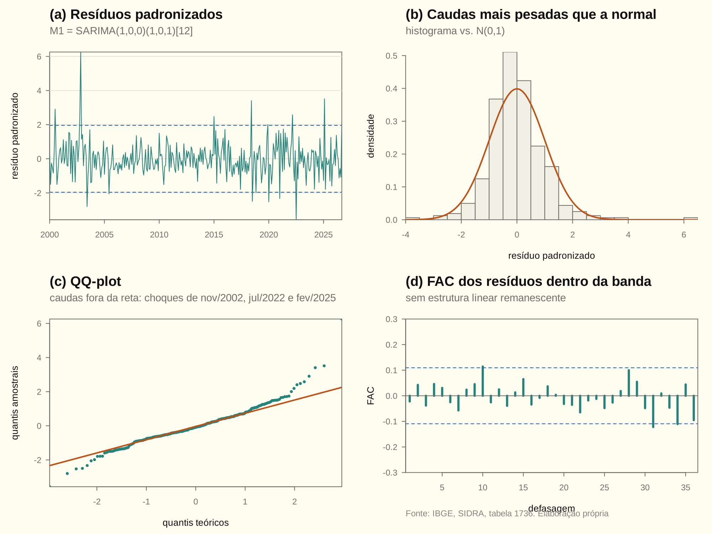
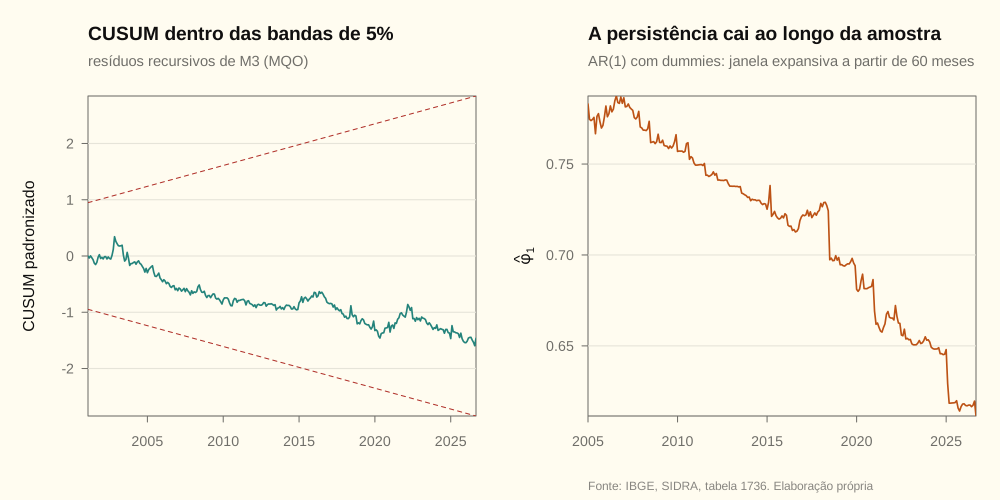
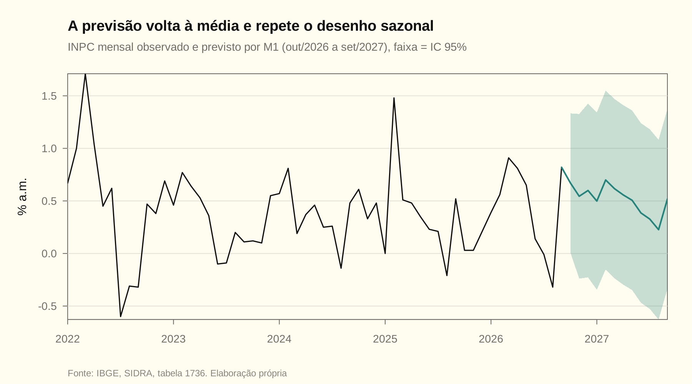

# Modelagem Box-Jenkins do INPC mensal

Rascunho do relatório da dupla. Todo número do texto sai de [inpc.R](inpc.R) e é conferido pelo `scripts/check_numbers.R` contra `resultados/inpc.csv`. Se a série for atualizada (`scripts/baixar_inpc.R`), rode o build: as divergências mostram exatamente quais frases reescrever.

> [!NOTE]
> **Resumo em quatro linhas**
> (1) O log do índice tem raiz unitária; a variação mensal, que é a sua primeira diferença, é estacionária. Modelar a variação mensal com um ARMA é, portanto, modelar o log do índice com um ARIMA(p,1,q).
> (2) A FAC/FACP indicam um AR(1) com componente sazonal de período 12. O AIC escolhe o SARIMA(1,0,0)(1,0,1)₁₂ e o BIC escolhe o SARIMA(1,0,0)(1,0,0)₁₂.
> (3) Os resíduos são ruído branco e não têm efeito ARCH, mas não são normais: há choques pontuais de oferta. O teste de Chow aponta uma quebra em mar/2020.
> (4) Fora da amostra, nenhum modelo supera de forma significativa o ingênuo sazonal (teste de Diebold-Mariano). A previsão central para out/2026–set/2027 acumula cerca de 6,3%.

---

## 1. Dados e amostra

A série é o INPC/IBGE (SIDRA, tabela 1736): o número-índice (dez/1993 = 100) e a variação mensal em %. A amostra começa em **jan/2000** e termina em **set/2026**, com $T=321$ meses. Começamos em 2000 por três motivos: o Plano Real (1994), a flutuação cambial e o regime de metas para a inflação (1999). Antes disso, a série mistura regimes de inflação alta e de estabilização, e um único ARMA estacionário não descreve os dois.

| Estatística | Valor |
|---|---|
| Média da variação mensal | 0,501% a.m. |
| Desvio-padrão | 0,444 p.p. |
| Mínimo / máximo | −0,60% / 3,39% |
| Último mês (set/2026) | 0,82% |
| Acumulado em 12 meses até set/2026 | 4,29% |

<!-- conferência numérica
| chave_R | nota |
|---|---|
| inpc_T | 321 |
| inpc_ano_fim | 2026 |
| inpc_mes_fim | 9 |
| inpc_media | 0,501 |
| inpc_dp | 0,444 |
| inpc_min | -0,60 |
| inpc_max | 3,39 |
| inpc_ultimo | 0,82 |
| inpc_acum12 | 4,29 |
-->

## 2. Identificação

### 2.1 Tendência e raiz unitária

O painel de cima da figura mostra o padrão de um processo integrado: o log do índice sobe sem voltar a um nível fixo. O de baixo mostra a variação mensal oscilando em torno de uma média constante. Os testes formalizam o que se vê.

| Série | Teste e especificação | Estatística | Crítico 5% | Decisão |
|---|---|---|---|---|
| $\ln P_t$ | ADF com constante e tendência | $\tau_{cal}=-3{,}26$ | $-3{,}42$ | não rejeita $H_0$: raiz unitária |
| $\ln P_t$ | KPSS com tendência | $0{,}415$ | $0{,}146$ | rejeita $H_0$: estacionária em tendência |
| $\Delta\ln P_t$ | ADF com constante | $\tau_{cal}=-6{,}98$ | $-2{,}87$ | rejeita $H_0$ |
| $\pi_t$ (var. mensal) | ADF com constante | $\tau_{cal}=-7{,}00$ | $-2{,}87$ | rejeita $H_0$ |
| $\pi_t$ (var. mensal) | KPSS com constante | $0{,}352$ | $0{,}463$ | não rejeita $H_0$: estacionária |

No ADF, as defasagens da diferença entram até 12 e são escolhidas por AIC.

- **Hipóteses (ADF em $\pi_t$):** $H_0$: $\pi_t$ tem raiz unitária vs. $H_1$: $\pi_t$ é estacionária.
- **Estatística:** $\tau_{cal}=-7{,}00$, com distribuição de Dickey-Fuller e não a $t$ de Student.
- **Decisão:** como $\tau_{cal}=-7{,}00\lt-2{,}87$, rejeita-se $H_0$ ao nível de 5%.
- **Conclusão:** a variação mensal do INPC é I(0). O log do índice é I(1): ADF e KPSS concordam.

A correlação entre $100\,\Delta\ln P_t$ e a variação mensal publicada é 0,99998. As duas séries são, na prática, a mesma. Por isso estimar um ARMA$(p,q)$ para $\pi_t$ equivale a estimar um ARIMA$(p,1,q)$ para $\ln P_t$ (lista, Q10a). As funções `ndiffs` e `nsdiffs` do pacote `forecast` também indicam zero diferenças, simples e sazonais.

> [!WARNING]
> **Não diferencie $\pi_t$**
> Diferenciar uma série que já é estacionária cria uma raiz unitária no polinômio MA. O processo resultante deixa de ser invertível (lista, Q9). É o erro clássico de quem vê "inflação" e aplica $\Delta$ por reflexo.

<!-- conferência numérica
| chave_R | nota |
|---|---|
| inpc_adf_li_tau | -3,26 |
| inpc_adf_li_c5 | -3,42 |
| inpc_kpss_li | 0,415 |
| inpc_kpss_li_c5 | 0,146 |
| inpc_adf_dli_tau | -6,98 |
| inpc_adf_y_tau | -7,00 |
| inpc_adf_y_c5 | -2,87 |
| inpc_kpss_y | 0,352 |
| inpc_kpss_y_c5 | 0,463 |
| inpc_cor_dli_y | 0,99998 |
| inpc_ndiffs | 0 |
| inpc_nsdiffs | 0 |
-->

### 2.2 Sazonalidade

A inflação ao consumidor é maior em janeiro e dezembro, com médias de 0,70% e 0,69%. É menor em agosto, com média de 0,25%. O padrão vem de alimentos (entressafra e safra), de reajustes concentrados no início do ano e do vestuário no fim do ano.

<!-- conferência numérica
| chave_R | nota |
|---|---|
| inpc_media_mes01 | 0,70 |
| inpc_media_mes12 | 0,69 |
| inpc_media_mes08 | 0,25 |
-->

### 2.3 FAC e FACP

| Defasagem | FAC | FACP |
|---|---|---|
| 1 | 0,628 | 0,628 |
| 2 | 0,417 | 0,038 |
| 12 | 0,212 | 0,115 |
| 24 | 0,049 | — |

A banda de significância é $\pm1{,}96/\sqrt T=\pm0{,}109$. Três leituras:

1. **A FACP corta após a defasagem 1** ($0{,}628$, e depois $0{,}038$ dentro da banda), enquanto a FAC decai geometricamente: assinatura de um AR(1) na parte não sazonal.
2. **A FAC volta a subir na defasagem 12** ($0{,}212$), depois de ter passado pelo zero. A FACP também tem um pico em 12. Isso pede um termo sazonal de período 12.
3. **A série não é ruído branco:** $Q_{LB}(24)=277{,}3$, muito acima do crítico $\chi^2_{24}$.

**Candidatos naturais:** SARIMA$(1,0,0)(1,0,0)_{12}$ e SARIMA$(1,0,0)(0,0,1)_{12}$, além de variações vizinhas, a serem comparadas por critério de informação.

<!-- conferência numérica
| chave_R | nota |
|---|---|
| inpc_fac1 | 0,628 |
| inpc_fac2 | 0,417 |
| inpc_fac12 | 0,212 |
| inpc_fac24 | 0,049 |
| inpc_facp1 | 0,628 |
| inpc_facp2 | 0,038 |
| inpc_facp12 | 0,115 |
| inpc_banda | 0,109 |
| inpc_lb24_serie | 277,3 |
-->

## 3. Estimação e seleção

Estimamos por máxima verossimilhança exata (filtro de Kalman, `forecast::Arima`) a grade inteira SARIMA$(p,0,q)(P,0,Q)_{12}$ com média, $p,q\in\{0,\dots,3\}$ e $P,Q\in\{0,1\}$: 64 modelos, todos com o mesmo $T$. A grade completa está em [grade_sarima.csv](grade_sarima.csv).

| Modelo | $\ln L$ | $k$ | AIC | BIC | AIC/$T$ (slides) | BIC/$T$ (slides) |
|---|---|---|---|---|---|---|
| **M1** = SARIMA(1,0,0)(1,0,1)₁₂ | −105,80 | 5 | **221,60** | 240,46 | **0,6903** | 0,7491 |
| **M2** = SARIMA(1,0,0)(1,0,0)₁₂ | −107,83 | 4 | 223,65 | **238,74** | 0,6967 | **0,7437** |
| **M3** = AR(1) + 11 dummies sazonais | −102,33 | 14 | 232,66 | 285,46 | 0,7248 | 0,8893 |

Aqui $k$ conta os coeficientes, a média e a variância do erro. A AU02 define os critérios divididos por $T$, e o R os reporta sem a divisão. Como $T$ é o mesmo para todos os modelos, a ordenação não muda.

> [!IMPORTANT]
> **AIC e BIC discordam, como a teoria prevê**
> O AIC penaliza cada parâmetro em 2 e o BIC em $\ln T=\ln 321\approx5{,}77$. Por isso o BIC fica com o modelo mais parcimonioso (M2) e o AIC aceita o MA sazonal extra (M1). O BIC é consistente: escolhe o modelo verdadeiro com probabilidade que tende a 1, se ele estiver entre os candidatos. O AIC é eficiente para previsão (lista, Q14b). Levamos os dois para a etapa de previsão.

### 3.1 Coeficientes

**M1 = SARIMA(1,0,0)(1,0,1)₁₂:** $(1-\phi_1B)(1-\Phi_1B^{12})(\pi_t-\mu)=(1+\Theta_1B^{12})\,\varepsilon_t$. O R usa o sinal positivo no MA, como os slides; ver [CONVENCOES](../CONVENCOES.md) §2.

| Variável | Coeficiente | Erro padrão | Valor $z$ | Prob. |
|---|---|---|---|---|
| $\phi_1$ (AR 1) | 0,6330 | 0,0431 | 14,70 | 0,0000 |
| $\Phi_1$ (SAR 12) | 0,8304 | 0,1381 | 6,02 | 0,0000 |
| $\Theta_1$ (SMA 12) | −0,6852 | 0,1770 | −3,87 | 0,0001 |
| $\mu$ (média) | 0,5071 | 0,0861 | 5,89 | 0,0000 |

$T=321$, $\ln L=-105{,}80$, $\widehat\sigma^2=0{,}1139$.

**M2 = SARIMA(1,0,0)(1,0,0)₁₂:** $\widehat\phi_1=0{,}6231$ (ep 0,0435), $\widehat\Phi_1=0{,}2024$ (ep 0,0562, $p=0{,}0003$), $\widehat\mu=0{,}5009$, $\widehat\sigma^2=0{,}1154$.

**Leitura.**
- **Persistência:** $\widehat\phi_1\approx0{,}63$. Um choque de 1 p.p. na inflação de um mês ainda deixa $0{,}63^3\approx0{,}25$ p.p. três meses depois.
- **Média de longo prazo:** $\widehat\mu=0{,}507\%$ a.m., que equivale a 6,26% a.a. Fica acima do centro da meta de quase todos os anos da amostra, puxada por 2002–03, 2015 e 2021–22.
- **Estacionariedade e invertibilidade:** a raiz do polinômio AR fica em $1/\widehat\phi_1=1{,}58$. As raízes sazonais têm módulo $\widehat\Phi_1^{-1/12}=1{,}016$ (SAR) e $\lvert\widehat\Theta_1\rvert^{-1/12}=1{,}032$ (SMA). Todas estão fora do círculo unitário, então o modelo é estacionário e invertível. As sazonais, porém, estão muito perto de 1.
- **Forma AR restrita:** expandindo, M1 é um AR(13) restrito. O coeficiente de $\pi_{t-13}$ é $-\widehat\phi_1\widehat\Phi_1=-0{,}526$, fixado pelos outros dois (lista, Q11c).

> [!CAUTION]
> **$\widehat\Phi_1\approx0{,}83$ e $\widehat\Theta_1\approx-0{,}69$ quase se cancelam**
> Com $\Phi_1$ perto de 1 e $\Theta_1$ perto de $-\Phi_1$, o par $(1-\Phi_1B^{12})^{-1}(1+\Theta_1B^{12})$ fica próximo da identidade mais um padrão sazonal fixo. É o sintoma de **sazonalidade determinística** (médias mensais estáveis) estimada por um SARMA. Por isso incluímos o M3, com 11 dummies mensais e AR(1). Ele tem a maior verossimilhança, mas paga 9 parâmetros a mais e perde no AIC e no BIC. Para a dupla discutir: o `nsdiffs` não vê raiz unitária sazonal, então não há motivo para $D=1$.

<!-- conferência numérica
| chave_R | nota |
|---|---|
| inpc_grade_n | 64 |
| inpc_m1_loglik | -105,80 |
| inpc_m1_k | 5 |
| inpc_m1_aic | 221,60 |
| inpc_m1_bic | 240,46 |
| inpc_m1_aic_t | 0,6903 |
| inpc_m1_bic_t | 0,7491 |
| inpc_m2_loglik | -107,83 |
| inpc_m2_k | 4 |
| inpc_m2_aic | 223,65 |
| inpc_m2_bic | 238,74 |
| inpc_m2_aic_t | 0,6967 |
| inpc_m2_bic_t | 0,7437 |
| inpc_m3_loglik | -102,33 |
| inpc_m3_k | 14 |
| inpc_m3_aic | 232,66 |
| inpc_m3_bic | 285,46 |
| inpc_m3_aic_t | 0,7248 |
| inpc_m3_bic_t | 0,8893 |
| inpc_m1_ar1 | 0,6330 |
| inpc_m1_ar1_ep | 0,0431 |
| inpc_m1_sar1 | 0,8304 |
| inpc_m1_sar1_ep | 0,1381 |
| inpc_m1_sma1 | -0,6852 |
| inpc_m1_sma1_ep | 0,1770 |
| inpc_m1_sma1_p | 0,0001 |
| inpc_m1_intercept | 0,5071 |
| inpc_m1_intercept_ep | 0,0861 |
| inpc_m1_sigma2 | 0,1139 |
| inpc_m2_ar1 | 0,6231 |
| inpc_m2_ar1_ep | 0,0435 |
| inpc_m2_sar1 | 0,2024 |
| inpc_m2_sar1_ep | 0,0562 |
| inpc_m2_sar1_p | 0,0003 |
| inpc_m2_intercept | 0,5009 |
| inpc_m2_sigma2 | 0,1154 |
| inpc_m1_mu_anual | 6,26 |
| inpc_m1_raiz_ar | 1,58 |
| inpc_m1_raiz_sar | 1,016 |
| inpc_m1_raiz_sma | 1,032 |
| inpc_m1_ar13 | -0,526 |
-->

## 4. Diagnóstico dos resíduos (model checking)

| Teste | M1 | M2 | M3 | Crítico 5% |
|---|---|---|---|---|
| Ljung-Box $Q(12)$, gl $=12-p-q$ | 9,15 ($p=0{,}42$) | 9,22 ($p=0{,}51$) | 14,44 ($p=0{,}21$) | $\chi^2_9=16{,}92$ (M1) |
| Ljung-Box $Q(24)$ | 14,46 ($p=0{,}85$) | 17,30 ($p=0{,}75$) | 23,13 ($p=0{,}45$) | $\chi^2_{21}=32{,}67$ (M1) |
| ARCH-LM, 12 defasagens ($nR^2$) | 10,74 ($p=0{,}55$) | 9,48 ($p=0{,}66$) | 8,57 ($p=0{,}74$) | $\chi^2_{12}=21{,}03$ |
| Jarque-Bera | 463,0 ($p=0{,}00$) | 445,4 ($p=0{,}00$) | 591,7 ($p=0{,}00$) | $\chi^2_2=5{,}99$ |
| Assimetria / curtose | 0,94 / 8,58 | 0,90 / 8,48 | 1,15 / 9,24 | 0 / 3 |

No Ljung-Box, os graus de liberdade descontam os parâmetros ARMA estimados (AU03): $\nu=k-p-q$, contando os sazonais. No M1, $\nu=12-3=9$.

- **Autocorrelação, M1:** $H_0:\rho_1=\dots=\rho_{12}=0$ nos resíduos. $Q_{cal}=9{,}15\lt\chi^2_{tab}(9)=16{,}92$ ($p=0{,}42$), então não se rejeita $H_0$. Os resíduos não guardam estrutura linear: o modelo capturou a dinâmica.
- **Heterocedasticidade condicional:** $nR^2=10{,}74\lt21{,}03$, então não se rejeita a ausência de efeito ARCH. A variância condicional pode ser tratada como constante.
- **Normalidade:** $JB=463\gg5{,}99$, então rejeita-se a normalidade. A culpa é de poucos choques grandes. Em resíduos padronizados, os maiores são nov/2002 ($z=6{,}26$, a crise cambial pré-eleitoral), jul/2022 ($z=-3{,}57$, o corte de tributos sobre combustíveis e energia) e fev/2025 ($z=3{,}52$, a reversão do bônus de Itaipu na conta de luz).

> [!TIP]
> **Como defender o modelo apesar do JB**
> A normalidade não é necessária para a estrutura ARMA nem para a consistência do estimador, que é de quase-MV (AU03). Ela afeta os intervalos de previsão gaussianos: nos meses de choque, eles ficam estreitos demais. Uma extensão natural é incluir dummies de intervenção nas três datas e reestimar. A dupla pode citar isso como robustez.

<!-- conferência numérica
| chave_R | nota |
|---|---|
| inpc_m1_lb12 | 9,15 |
| inpc_m1_lb12_p | 0,42 |
| inpc_m2_lb12 | 9,22 |
| inpc_m2_lb12_p | 0,51 |
| inpc_m3_lb12 | 14,44 |
| inpc_m3_lb12_p | 0,21 |
| inpc_lb12_c5_m1 | 16,92 |
| inpc_m1_lb24 | 14,46 |
| inpc_m1_lb24_p | 0,85 |
| inpc_m2_lb24 | 17,30 |
| inpc_m2_lb24_p | 0,75 |
| inpc_m3_lb24 | 23,13 |
| inpc_m3_lb24_p | 0,45 |
| inpc_lb24_c5_m1 | 32,67 |
| inpc_m1_arch12 | 10,74 |
| inpc_m1_arch12_p | 0,55 |
| inpc_m2_arch12 | 9,48 |
| inpc_m2_arch12_p | 0,66 |
| inpc_m3_arch12 | 8,57 |
| inpc_m3_arch12_p | 0,74 |
| inpc_chi2_12_c5 | 21,03 |
| inpc_m1_jb | 463,0 |
| inpc_m2_jb | 445,4 |
| inpc_m3_jb | 591,7 |
| inpc_chi2_2_c5 | 5,99 |
| inpc_m1_assim | 0,94 |
| inpc_m1_curt | 8,58 |
| inpc_m2_assim | 0,90 |
| inpc_m2_curt | 8,48 |
| inpc_m3_assim | 1,15 |
| inpc_m3_curt | 9,24 |
| inpc_m1_out1_z | 6,26 |
| inpc_m1_out1_ano | 2002 |
| inpc_m1_out1_mes | 11 |
| inpc_m1_out2_z | -3,57 |
| inpc_m1_out2_ano | 2022 |
| inpc_m1_out2_mes | 7 |
| inpc_m1_out3_z | 3,52 |
| inpc_m1_out3_ano | 2025 |
| inpc_m1_out3_mes | 2 |
-->

## 5. Estabilidade dos parâmetros

Os testes clássicos usam o M3, que é estimável por MQO: $\pi_t=c+\phi_1\pi_{t-1}+\sum_{m}\delta_mD_{mt}+\varepsilon_t$, com $\widehat\phi_1^{MQO}=0{,}611$.

- **Chow (break-point em mar/2020).** A data foi fixada **a priori**, pela pandemia: se a data viesse dos dados, os críticos usuais não valeriam (AU03). $H_0$: os 13 coeficientes são iguais antes e depois de mar/2020. $F_{cal}=3{,}14$ com $p=0{,}0002$, então rejeita-se $H_0$ a 5%.
- **CUSUM de resíduos recursivos** (Brown, Durbin e Evans, 1975). A trajetória não cruza as bandas de 5% (estatística 0,58, $p=0{,}45$), então não se rejeita a constância dos parâmetros.
- **Estimativas recursivas de $\phi_1$.** Caem de 0,79 para 0,61 ao longo da amostra. O degrau de 2025 é o choque de fev/2025.

> [!WARNING]
> **Chow rejeita, CUSUM não: os dois não se contradizem**
> O Chow tem poder contra uma quebra numa data conhecida e testa todos os 13 coeficientes ao mesmo tempo. O CUSUM procura desvios sistemáticos acumulados, perde poder quando a mudança é parcial ou se compensa, e é sensível às caudas pesadas. A leitura honesta: há indício de instabilidade, e a persistência $\phi_1$ vem caindo. Isso favorece reestimar o modelo a cada mês, e uma janela deslizante (*rolling*) é a alternativa natural a testar (AU03, "qual esquema escolher").

<!-- conferência numérica
| chave_R | nota |
|---|---|
| inpc_ols_phi | 0,611 |
| inpc_chow_q | 13 |
| inpc_chow_f | 3,14 |
| inpc_chow_p | 0,0002 |
| inpc_cusum_stat | 0,58 |
| inpc_cusum_p | 0,45 |
| inpc_rec_phi_max | 0,79 |
| inpc_rec_phi_min | 0,61 |
-->

## 6. Avaliação da previsão (model assessment)

**Desenho.** O treino vai até set/2023 e o teste são os últimos 36 meses (out/2023 a set/2026). As três decisões da AU03 ficam assim:

1. **Amostra de estimação:** janela recursiva (expansiva), com o modelo reestimado a cada origem.
2. **Geração da previsão:** iterada, $h=1,\dots,12$.
3. **Avaliação:** RMSE, MAD e MASE, mais o teste de Diebold-Mariano.

Há dois *benchmarks*. O **SN** é o ingênuo sazonal, $\widehat\pi_{t+h}=\pi_{t+h-12}$. O **MED** é a média histórica até a origem.

| Modelo | RMSE $h=1$ | MAD $h=1$ | MASE $h=1$ | RMSE $h=3$ | RMSE $h=12$ | MASE $h=12$ |
|---|---|---|---|---|---|---|
| M1 | 0,371 | 0,273 | 0,669 | 0,347 | 0,346 | 0,682 |
| M2 | 0,374 | 0,277 | 0,679 | 0,364 | 0,367 | 0,701 |
| M3 | 0,402 | 0,286 | 0,703 | 0,371 | 0,386 | 0,770 |
| SN | **0,341** | 0,278 | 0,682 | 0,343 | 0,367 | 0,719 |
| MED | 0,376 | 0,292 | 0,717 | 0,374 | 0,399 | 0,750 |

Para $h=1$ há $n=36$ previsões; para $h=12$, $n=25$. A escala do MASE é o erro absoluto médio do ingênuo sazonal no treino, $Q=0{,}408$.

> [!CAUTION]
> **Por que não há MAPE**
> O teste tem 1 mês com variação exatamente zero e 5 meses com $\lvert\pi_t\rvert\le0{,}1$. O MAPE divide por $\pi_t$: dá infinito, ou explode perto de zero. É o exemplo da AU03 de quando o MAPE não serve. O MASE, que é livre de escala e funciona com séries que cruzam o zero, ocupa o lugar dele.

**Diebold-Mariano** (perda quadrática, $h=1$). $H_0:E(d_t)=0$, com $d_t=e_{1t}^2-e_{2t}^2$.

| Comparação | $DM$ | Prob. | Decisão a 5% |
|---|---|---|---|
| M1 vs. M2 | −0,32 | 0,75 | não rejeita: mesma acurácia |
| M1 vs. M3 | −1,55 | 0,13 | não rejeita |
| M2 vs. M3 | −1,57 | 0,13 | não rejeita |
| M1 vs. SN | 0,49 | 0,62 | não rejeita |
| M1 vs. MED | −0,11 | 0,92 | não rejeita |

**Intervalos de 95% em $h=1$.** M1 cobre 94,4% dos meses do teste, com escore de Winkler de 2,05. M2 cobre 94,4%, com Winkler de 2,09. M3 cobre 91,7%, com Winkler de 2,32. O Winkler favorece o M1: intervalos mais estreitos com a mesma cobertura.

> [!IMPORTANT]
> **A conclusão honesta da avaliação**
> O M1 tem o menor MASE em $h=1$ e $h=12$ e o melhor Winkler, mas a vantagem não é estatisticamente significativa. Nenhum DM rejeita $H_0$. Em $h=1$, o ingênuo sazonal tem até RMSE menor. Com 36 meses de teste, os dados não distinguem os modelos. Isso é um resultado, não um defeito, e o relatório deve dizê-lo.

<!-- conferência numérica
| chave_R | nota |
|---|---|
| inpc_n_h1 | 36 |
| inpc_n_h12 | 25 |
| inpc_q_mase | 0,408 |
| inpc_m1_h1_rmse | 0,371 |
| inpc_m1_h1_mad | 0,273 |
| inpc_m1_h1_mase | 0,669 |
| inpc_m1_h3_rmse | 0,347 |
| inpc_m1_h12_rmse | 0,346 |
| inpc_m1_h12_mase | 0,682 |
| inpc_m2_h1_rmse | 0,374 |
| inpc_m2_h1_mad | 0,277 |
| inpc_m2_h1_mase | 0,679 |
| inpc_m2_h3_rmse | 0,364 |
| inpc_m2_h12_rmse | 0,367 |
| inpc_m2_h12_mase | 0,701 |
| inpc_m3_h1_rmse | 0,402 |
| inpc_m3_h1_mad | 0,286 |
| inpc_m3_h1_mase | 0,703 |
| inpc_m3_h3_rmse | 0,371 |
| inpc_m3_h12_rmse | 0,386 |
| inpc_m3_h12_mase | 0,770 |
| inpc_sn_h1_rmse | 0,341 |
| inpc_sn_h1_mad | 0,278 |
| inpc_sn_h1_mase | 0,682 |
| inpc_sn_h3_rmse | 0,343 |
| inpc_sn_h12_rmse | 0,367 |
| inpc_sn_h12_mase | 0,719 |
| inpc_med_h1_rmse | 0,376 |
| inpc_med_h1_mad | 0,292 |
| inpc_med_h1_mase | 0,717 |
| inpc_med_h3_rmse | 0,374 |
| inpc_med_h12_rmse | 0,399 |
| inpc_med_h12_mase | 0,750 |
| inpc_n_zero_teste | 1 |
| inpc_n_perto_zero_teste | 5 |
| inpc_dm_m1_m2 | -0,32 |
| inpc_dm_m1_m2_p | 0,75 |
| inpc_dm_m1_m3 | -1,55 |
| inpc_dm_m1_m3_p | 0,13 |
| inpc_dm_m2_m3 | -1,57 |
| inpc_dm_m2_m3_p | 0,13 |
| inpc_dm_m1_sn | 0,49 |
| inpc_dm_m1_sn_p | 0,62 |
| inpc_dm_m1_med | -0,11 |
| inpc_dm_m1_med_p | 0,92 |
| inpc_m1_cobertura | 94,4 |
| inpc_m1_winkler | 2,05 |
| inpc_m2_cobertura | 94,4 |
| inpc_m2_winkler | 2,09 |
| inpc_m3_cobertura | 91,7 |
| inpc_m3_winkler | 2,32 |
-->

## 7. Previsão: out/2026 a set/2027

Com o M1 reestimado na amostra inteira:

| Mês | Previsão (% a.m.) |
|---|---|
| out/2026 | 0,67 (IC 95%: 0,01 a 1,33) |
| nov/2026 | 0,54 |
| dez/2026 | 0,60 |
| jan/2027 | 0,50 |
| fev/2027 | 0,70 |
| mar/2027 | 0,62 |
| abr/2027 | 0,56 |
| mai/2027 | 0,51 |
| jun/2027 | 0,39 |
| jul/2027 | 0,33 |
| ago/2027 | 0,23 |
| set/2027 | 0,52 |

**Acumulado em 12 meses:** 6,32% pelo M1, 6,34% pelo M2 e 6,93% pelo M3. A tabela completa, com os limites, está em [previsao_m1.csv](previsao_m1.csv).

Duas propriedades da teoria aparecem na figura (lista, Q15):

- **Retorno à média.** A previsão converge para $\widehat\mu$ à medida que $h$ cresce, porque $\widehat\phi_1^h\to0$. O que sobra é o desenho sazonal.
- **Intervalo que se abre e se estabiliza.** A variância do erro de previsão é $\sigma^2\sum_{j=0}^{h-1}\psi_j^2$, que cresce com $h$ e converge para a variância incondicional $\gamma_0$.

<!-- conferência numérica
| chave_R | nota |
|---|---|
| inpc_m1_prev1 | 0,67 |
| inpc_m1_prev1_li | 0,01 |
| inpc_m1_prev1_ls | 1,33 |
| inpc_m1_prev_h02 | 0,54 |
| inpc_m1_prev_h03 | 0,60 |
| inpc_m1_prev_h04 | 0,50 |
| inpc_m1_prev_h05 | 0,70 |
| inpc_m1_prev_h06 | 0,62 |
| inpc_m1_prev_h07 | 0,56 |
| inpc_m1_prev_h08 | 0,51 |
| inpc_m1_prev_h09 | 0,39 |
| inpc_m1_prev_h10 | 0,33 |
| inpc_m1_prev_h11 | 0,23 |
| inpc_m1_prev_h12 | 0,52 |
| inpc_m1_prev12_acum | 6,32 |
| inpc_m2_prev12_acum | 6,34 |
| inpc_m3_prev12_acum | 6,93 |
-->

## 8. Conclusão

Um SARIMA(1,0,0)(1,0,1)₁₂ para a variação mensal do INPC, isto é, um ARIMA com uma diferença para o log do índice, passa nos diagnósticos de autocorrelação e de heterocedasticidade condicional. Ele descreve uma inflação persistente ($\phi_1\approx0{,}63$) com sazonalidade forte e estável. Três ressalvas acompanham o modelo:

- os resíduos não são normais, por causa de choques de oferta e de política tributária;
- há sinal de quebra depois de 2020;
- fora da amostra, o modelo não bate de forma significativa o ingênuo sazonal.

As extensões naturais são dummies de intervenção, janela deslizante e, para a variância, um modelo da família GARCH, se o professor pedir.

> [!TIP]
> **Para a dupla fechar o relatório**
> 1. Conferir com o enunciado do professor o período amostral e o tamanho do teste exigidos. Se mudarem, troque `INICIO` e `N_TESTE` em [inpc.R](inpc.R) e rode o build.
> 2. Decidir entre o M1 (AIC, melhor MASE e Winkler) e o M2 (BIC, mais parcimonioso) e justificar a escolha. O texto acima sustenta qualquer uma das duas.
> 3. Se quiserem, testar a robustez com dummies de intervenção em nov/2002, jul/2022 e fev/2025.
